# Shopify Image Studio — spécification de reconstruction

**Date : 9 octobre 2026. Base étudiée : dépôt local, commit `2442f19`.**

Ce document décrit ce que fait l'application, pourquoi elle existe, ses concepts, ses fonctionnalités, ses règles métier et les comportements à préserver pour la reconstruire avec React et un backend FastAPI ou Node. La technologie actuelle sert à expliquer les contrats ; elle n'est pas une exigence de la prochaine version.

Il est fondé sur le code frontend, le schéma, les fonctions backend, les tests et les documents de contexte. Il ne constitue pas une nouvelle validation authentifiée en production. Certaines refontes présentes dans le dépôt n'ont été qualifiées qu'en développement ; les réserves sont précisées plus bas. Les exemples de modèles IA et les tarifs sont ceux du code étudié, pas une confirmation des offres actuelles des fournisseurs.

Trois niveaux sont distingués : **comportement actuel accessible**, **compatibilité ou mécanisme interne**, et **proposition pour la reconstruction**. Les réglages, prompts, images et données réelles ne sont pas tous contenus dans le dépôt : une reconstruction fidèle devra aussi récupérer les données autorisées de l'installation utilisée.

L'[annexe technique](reconstruction-annexe-technique.md) recense **39 tables métier et 651 champs**, ainsi que **121 fonctions directement enregistrées publiques et 201 internes**. L'[inventaire JSON](reconstruction-inventaire.json) contient leurs validateurs et index complets. Six tables d'authentification sont injectées dans le schéma principal, et les workflows ont leurs tables de composant isolées ; elles s'ajoutent à ces 39 tables métier.

<!-- uml:index:start -->
**Schémas UML ajoutés le 11 octobre 2026 : 80 diagrammes** (62 séquences, 9 diagrammes d’états et 9 diagrammes de classes). Ils sont intégrés aux fonctionnalités ci-dessous sous forme de SVG, avec leur source Mermaid modifiable. L’[index UML](reconstruction-uml.md) permet de les parcourir par module. Chaque schéma précise sa portée : fonctionnement actuel, compatibilité historique ou proposition de reconstruction.
<!-- uml:index:end -->

## Sommaire

- [Finalité et périmètre](#finalite)
- [Concepts et vocabulaire](#concepts)
- [Accès, utilisateurs et boutiques](#acces)
- [Connexion Shopify et synchronisation](#shopify)
- [Produits, visuels, prompts et traitements d'images](#images)
- [Collecte, édition et import de catalogues](#catalogues)
- [Google Shopping, politiques et interface](#modules)
- [Données, architecture et exploitation actuelles](#architecture)
- [Contrats à préserver et recette de reconstruction](#contrats)
- [Découpage FastAPI ou Node + React](#reconstruction)
- [Migration, décisions et sources](#migration)
- [Index des schémas UML](reconstruction-uml.md)

<a id="finalite"></a>

## 1. À quoi sert l'application

### 1.1 Finalité principale

L'application est un **atelier de travail sur les catalogues et les images de boutiques Shopify**. Son cœur est de transformer les données et photographies existantes des produits en séries de visuels utiles au commerce : packshots, détails, mises en situation et visuels avec mannequin. L'utilisateur prépare des lots, lance des traitements, examine les résultats, corrige ce qui doit l'être et publie les images qu'il a approuvées sur les bons produits et variantes Shopify.

Le bénéfice recherché est de réduire le travail répétitif sur des centaines de produits tout en conservant un contrôle humain sur la qualité, l'identité du produit, les variantes, les coûts et les modifications de la boutique.

Le projet a commencé autour des rideaux et voilages, d'où des concepts de fixations et des noms historiques dans certains documents. Le code et le positionnement actuels couvrent des catégories plus générales : chaussures, vêtements, accessoires, maison et autres catalogues. Les prompts sont configurables par boutique ; le fonctionnement ne se résume donc pas à une liste fixe de visuels pour rideaux.

### 1.2 Utilisateurs et contexte d'usage

- Créateur de boutique Shopify : récupérer et préparer un catalogue source, importer des produits en brouillon, configurer les visuels et produire les documents de boutique.
- Marchand ou opérateur de catalogue : synchroniser les produits, sélectionner un sous-ensemble, générer et relire des images, enrichir les attributs Google Shopping.
- Administrateur de l'application : initialiser l'accès et approuver les comptes. L'approbation se fait aujourd'hui dans le backoffice de données, pas dans un écran d'administration dédié.

L'application est utilisée sur ordinateur et téléphone. Le produit privilégie les tableaux, filtres, galeries, sélections de masse et informations de progression. La boutique Shopify reste le lieu où les produits sont vendus ; les clients finaux de la boutique n'utilisent pas cet outil.

### 1.3 Les grands modules

| Module | Fonction | Résultat métier |
| --- | --- | --- |
| Boutiques et accès | Connexion utilisateur, connexion Shopify, boutique active, autorisations | Travailler dans le contexte de la bonne boutique |
| Produits Shopify | Synchronisation, recherche, filtres, navigation et galerie | Préparer les produits à traiter |
| Groupes visuels et variantes | Distinguer les déclinaisons et leurs photographies de référence | Éviter de mélanger les couleurs, matières ou variantes |
| Prompts et configuration IA | Templates, conditions, branches, mannequins, modèles et fonds | Définir des visuels adaptés à la catégorie et au produit |
| Génération et jobs | Génération immédiate ou batch, progression, coûts, erreurs et reprises | Obtenir un lot d'images traçable |
| Relecture et retouche | Approuver, rejeter, régénérer, retoucher et consulter l'historique | Produire des images validées |
| Publication Shopify | Publier une sélection approuvée, associer aux variantes, gérer le remplacement | Mettre à jour la boutique de manière contrôlée |
| Opérations de masse | Retournement horizontal, permutation de positions, restauration et suivi | Corriger de nombreuses galeries existantes |
| Import catalogue | Collecter une boutique source, éditer, exporter et importer dans une destination | Reconstituer un catalogue de produits exploitable |
| Google Shopping | Diagnostiquer, proposer et publier catégorie, genre et tranche d'âge | Préparer les attributs destinés à l'écosystème Google dans Shopify |
| Politiques de boutique | Adapter six documents dans six langues, aperçu et export HTML | Préparer les pages d'information de la boutique |

### 1.4 Parcours représentatifs

**Améliorer les visuels d'un catalogue existant.** Connexion → choix de boutique → synchronisation Shopify → recherche/sélection de produits → choix des prompts et des variantes → prévisualisation du nombre d’images → génération et suivi du coût → relecture → approbation/retouche/régénération → confirmation de publication → suivi des écritures Shopify.

**Préparer une nouvelle boutique à partir d'une source publique.** URL de boutique source → découverte des collections, du menu et des produits → validation des tags anglais → collecte JSON et HTML → corrections de fiches et tags → contrôle du caractère complet ou partiel → export JSON ou import vers une boutique autorisée → créations en brouillon, collections et menu → contrôle du bilan.

**Préparer Google Shopping.** Diagnostic des autorisations et définitions → synchronisation → édition manuelle ou règles → évaluation en brouillons → aperçu des changements et conflits → inclusion de la sélection → publication confirmée → historique.

### 1.5 Frontières actuelles

Il n'existe pas de gestion de commandes, de caisse, de clients finaux, de stocks autonome ou de facturation SaaS dans l'app. Le module Google n'envoie pas directement de flux XML/CSV à Merchant Center. Les politiques sont générées à partir de modèles locaux ; elles ne sont pas publiées automatiquement. La racine `/` ouvre les produits : il n'y a pas de dashboard analytique d'accueil distinct.

<a id="concepts"></a>

## 2. Concepts à comprendre avant de reconstruire

| Concept | Définition et distinction utile |
| --- | --- |
| Utilisateur approuvé | Compte email/mot de passe dont l'accès a été accepté ; authentifié seul ne suffit pas |
| Boutique connectée | Boutique Shopify avec domaine normalisé, credentials et jeton d'autorisation |
| Boutique active | Contexte de travail sélectionné par l'utilisateur ; les opérations avec boutique figée restent sur leur destination. Les limites d'isolation Google sont décrites au chapitre 7 |
| Produit Shopify | Produit de la boutique destination, identifié par un GID Shopify ; stocké localement pour le travail de l'app |
| Variante Shopify | Déclinaison vendable avec options, SKU et identité propre ; une taille demeure une variante réelle |
| Groupe visuel | Ensemble de variantes partageant une identité visuelle et des références ; ce n'est pas un produit Shopify supplémentaire |
| Référence produit | Photographie source utilisée pour guider l'IA ; son appartenance à la bonne variante/groupe doit rester explicite |
| Référence mannequin | Image configurée pour les prompts avec personne, selon adulte/enfant et genre |
| Cible de génération | Produit, groupe visuel ou variante réellement choisi ; identité enregistrée avec la tâche et son résultat |
| Type d'image | Identifiant d'un template de prompt ; ordre et contenu sont configurables |
| Template de prompt | Texte, genre de visuel, conditions, références, fond et paramètres propres à un type |
| Prompt maître | Instructions transversales de la boutique injectées dans les prompts ; à récupérer depuis les données |
| Branche conditionnelle | Variante de prompt choisie pour un produit/groupe à partir de critères définis |
| Analyse d'ambiance | Résumé IA des références produit, réutilisé pour préparer les prompts concernés |
| Job de génération | Lot métier regroupant les images à produire, le périmètre choisi et le contexte sauvegardé |
| Segment batch | Sous-lot technique envoyé à un fournisseur ; un job peut contenir plusieurs segments |
| Image générée | Asset avec produit/cible/prompt, état de traitement, relecture, URL, coût et éventuel média Shopify |
| État de relecture | `pending`, `approved` ou `rejected`, distinct du succès technique de la génération |
| Image publiée | Image acceptée dans Shopify avec identité de média distante ; distincte d'une image simplement stockée |
| Tentative de publication | Intention, verrou et reçu permettant de poursuivre une écriture externe sans créer de doublon |
| Résultat incertain | Appel externe dont l'acceptation est inconnue ; ne doit pas être traité comme une absence certaine d'écriture |
| Opération de masse | Traitement des images Shopify déjà existantes avec items individuels, backups et possibilité de restauration |
| Catalogue source | Espace éditable issu d'une boutique publique ; indépendant de la boutique Shopify active tant qu'une destination n'est pas choisie |
| Fiche collectée | Produit de catalogue avec source brute, données normalisées, compléments HTML, appartenances et corrections |
| Identité source | Identité canonique empêchant les doublons entre URL/alias et entre imports Shopify |
| Valeur effective | Résolution commune des données source et corrections manuelles ; utilisée par lecture, recherche, export et import |
| Collection source | Catégorie publique avec ses produits, son tag anglais validé et éventuellement sa place dans un menu |
| Top N | Sélection globale des N meilleures ventes distinctes de la source ; pas N par collection |
| Version | Version éditable du catalogue utilisée pour détecter une modification concurrente |
| Génération de worker | Numéro/token qui invalide une ancienne exécution après relance ; distinct d'une génération d'image IA |
| Snapshot | Photographie figée des paramètres ou données d'une opération pour éviter que des modifications ultérieures changent son résultat |
| Brouillon Google | Proposition d'attribut à publier, séparée de la valeur actuelle Shopify |
| Règle Google | Conditions et valeur proposée pour un attribut ; évaluation puis validation humaine |
| Bail / lease | Droit temporaire et exclusif de traiter un item ou une ressource ; le jeton protège contre les callbacks tardifs |
| Réconciliation | Recherche d'un résultat externe déjà accepté avant d'autoriser une reprise |

Trois identités ne doivent jamais être confondues : **la fiche collectée chez une source**, **le produit Shopify destination**, et **la cible visuelle de génération**. De même, la réussite technique d'une tâche, l'approbation humaine et la publication sont trois dimensions indépendantes.

<a id="acces"></a>

## 3. Authentification, droits et boutiques

### 3.1 Authentification

Le frontend et les fonctions métier sont protégés par Convex Auth avec email/mot de passe. La page `/login` offre connexion ou demande d'accès. Si le déploiement n'a aucun utilisateur, elle présente la création du premier administrateur avec un secret d'initialisation.

- L'email est normalisé en minuscules et sans espaces périphériques.
- Le compte dont l'email correspond à `AUTH_ADMIN_EMAIL` obtient le rôle `admin` et l'approbation `approved`.
- La création de cet administrateur exige `AUTH_SETUP_SECRET`.
- L'administrateur doit exister avant les demandes d'accès ordinaires.
- Les autres inscriptions créent un rôle `user` avec `approvalStatus = pending`.
- La création d'une session exige un compte approuvé. Les fonctions métier revérifient cette approbation.
- L'écran indique qu'une demande a été envoyée lorsque l'inscription est bloquée en attente d'approbation.
- L'approbation ou le rejet se fait aujourd'hui en modifiant la donnée utilisateur dans le backoffice Convex.
- Le formulaire impose un minimum de huit caractères pour le mot de passe. La redirection post-connexion accepte uniquement un chemin interne sûr.
- Déconnexion et contrôle d'accès transversal existent. La fermeture de session réinitialise aussi les caches associés.

La configuration actuelle ne fournit pas de parcours UI complet de récupération de mot de passe, d'invitations, de MFA ou de gestion des équipes. Les tables de sessions, comptes, refresh tokens, vérification et limites de tentatives sont gérées par le composant Auth.

<!-- uml:uml-auth-session:start -->
<a id="uml-auth-session"></a>

**UML — Connexion et contrôle d’accès · Séquence · Fonctionnement actuel**

L’approbation est contrôlée à la création de session et lors des appels métier. L’administrateur initial est créé avec l’email et le secret serveur configurés.

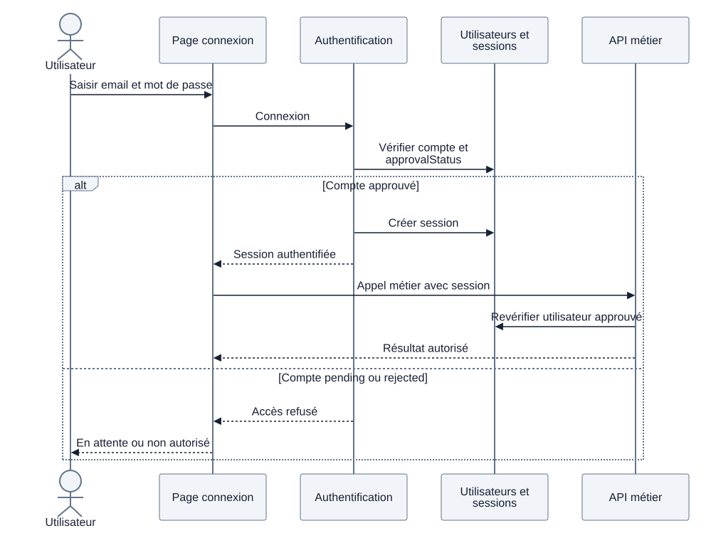

<details>
<summary>Source Mermaid modifiable</summary>

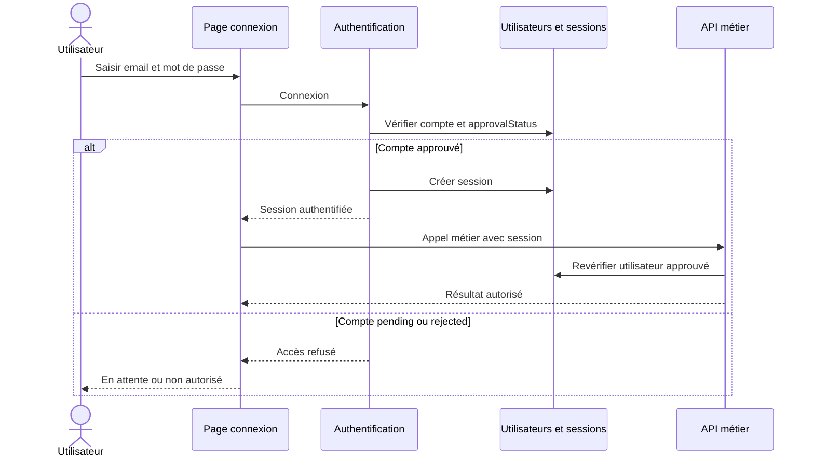

</details>
<!-- uml:uml-auth-session:end -->

<!-- uml:uml-auth-approval:start -->
<a id="uml-auth-approval"></a>

**UML — Approbation des comptes · États · Fonctionnement actuel**

L’approbation/rejet se fait actuellement dans le backoffice de données. Les changements d’état ci-dessous représentent des modifications administratives, pas des boutons de l’app.


<details>
<summary>Source Mermaid modifiable</summary>

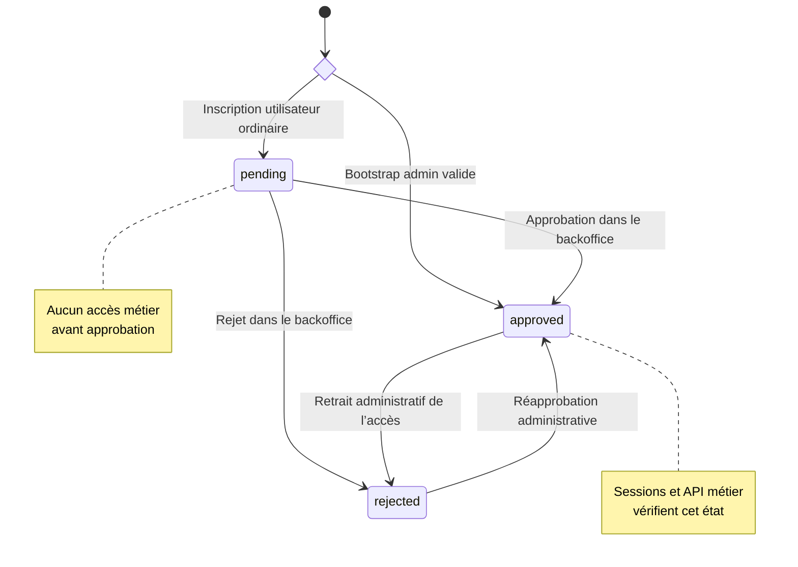

</details>
<!-- uml:uml-auth-approval:end -->

### 3.2 Sémantique réelle des droits

Les règles ne forment pas encore un modèle d'organisation uniforme :

| Domaine | Règle observée |
| --- | --- |
| Fonctions métier | Utilisateur authentifié et approuvé via `requireUserId` |
| Boutiques | La liste des boutiques est globale aux utilisateurs approuvés ; la boutique active est enregistrée par utilisateur |
| Produits, prompts, paramètres, jobs et visuels | Contexte principal de boutique active ou de boutique enregistrée sur la ressource ; pas un système général de membres par organisation |
| Catalogues collectés | Propriétaire individuel `ownerId` vérifié pour lire et modifier |
| Destinations d'import catalogue | Boutiques créées par le propriétaire du catalogue |
| Google Shopping | Plusieurs fonctions imposent que la boutique ait été créée par l'utilisateur courant |
| Workers de publication | Auteur toujours approuvé et ressource toujours liée à la boutique figée par l'opération |

**Décision à prendre pour la refonte :** conserver ce comportement de petit outil partagé ou introduire un modèle explicite d'organisation, membres, boutiques et rôles. Une nouvelle app multi-clients devra définir ces droits de manière cohérente ; ils ne peuvent pas être déduits de la seule présence d'un `shopId`.

<!-- uml:uml-auth-shop-scope:start -->
<a id="uml-auth-shop-scope"></a>

**UML — Boutique active et ownership actuel · Classes · Fonctionnement actuel**

Vue logique des règles actuelles : les boutiques sont visibles globalement aux comptes approuvés, tandis que catalogues et fonctions Google appliquent des règles de propriétaire. Aucun membership d’organisation n’est représenté, car il n’existe pas dans ce modèle.


<details>
<summary>Source Mermaid modifiable</summary>

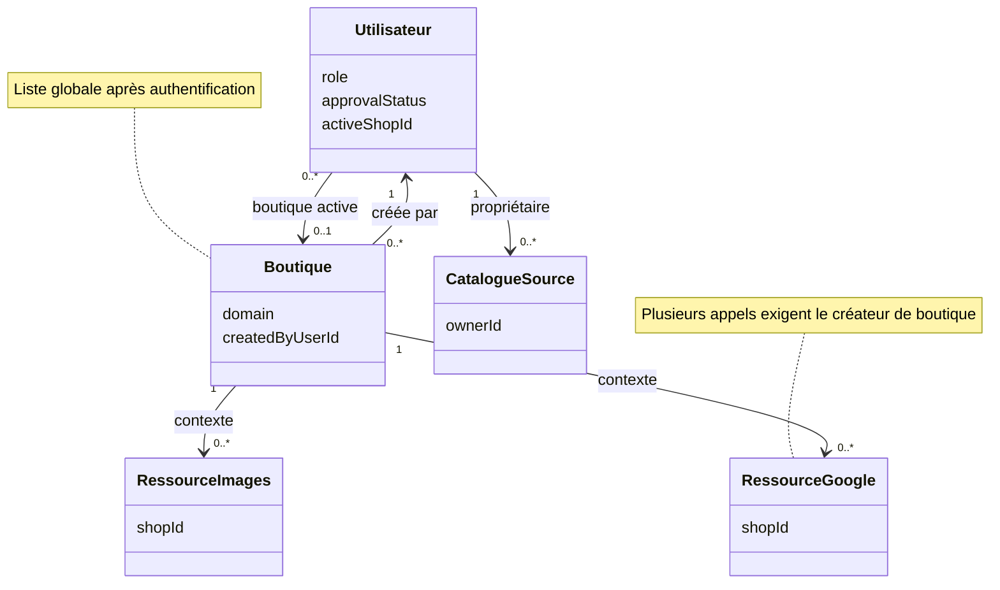

</details>
<!-- uml:uml-auth-shop-scope:end -->

### 3.3 Connexion et choix de boutique

Les paramètres permettent d'enregistrer une boutique avec domaine, nom facultatif, Client ID, Client Secret et requête de sélection des produits. Un domaine court est complété en `.myshopify.com` ; protocole et slash final sont supprimés ; le résultat doit être un domaine Shopify valide.

Une boutique déjà présente est mise à jour par son domaine. Un changement de Client ID/Secret invalide son jeton et ses scopes enregistrés. La boutique connectée devient active. Le sélecteur global permet ensuite de changer de boutique.

Pour les installations historiques, les credentials d'environnement peuvent fournir la boutique par défaut. Le backend peut la matérialiser dans `shops`. Des données sans `shopId` restent rattachables à cette boutique d'environnement lorsque les domaines correspondent. Cette compatibilité doit être traitée lors de la migration, pas reproduite comme nouvelle ambiguïté.

Les objets publics de boutique exposent le domaine, le nom, la requête de sélection et un indicateur de présence des credentials. Les secrets et le jeton restent serveur.

<!-- uml:uml-shop-connect:start -->
<a id="uml-shop-connect"></a>

**UML — Connexion ou mise à jour d’une boutique · Séquence · Fonctionnement actuel**

Le domaine sert à retrouver une boutique existante. Modifier les credentials invalide le jeton enregistré ; la connexion ne réalise pas à elle seule l’autorisation OAuth.

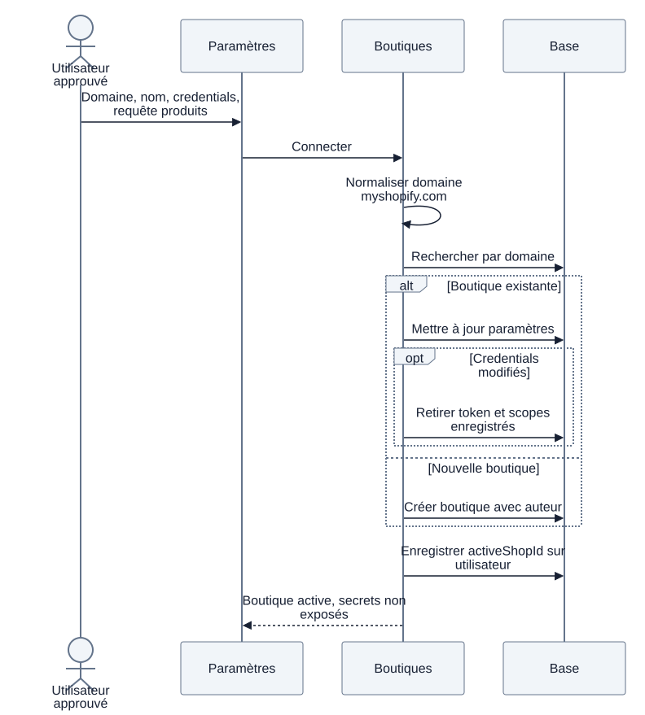

<details>
<summary>Source Mermaid modifiable</summary>

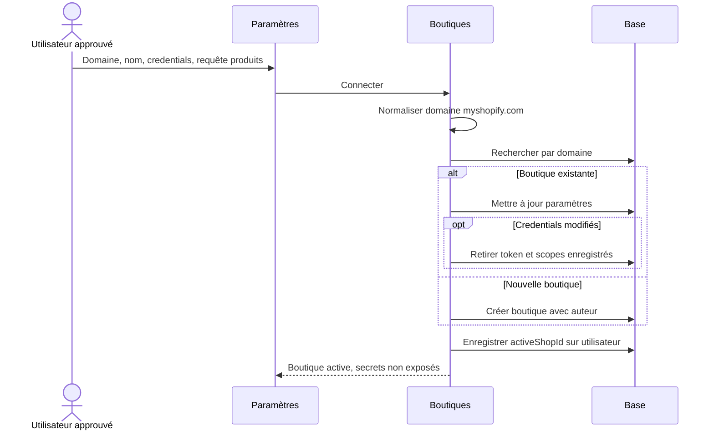

</details>
<!-- uml:uml-shop-connect:end -->

### Parcours UI de connexion et réglages
#### Assistant de connexion Shopify

Quatre étapes :

1. Nom interne et domaine en `.myshopify.com` ; le handle court est complété et le domaine final est affiché.
2. Instructions pour créer une application Shopify personnalisée, lien vers l'administration Shopify et bouton de copie du nom d'application « Image Studio ».
3. URL de l'application, URL de callback calculée côté serveur et scopes Admin API à publier/installer dans Shopify. Scopes partagés : `write_products`, `write_files`, `write_online_store_navigation`.
4. ID client, secret client et requête produits ; validation et connexion.

L'UI fournit étapes précédent/suivant, annulation/réinitialisation, copier les valeurs et aperçus illustratifs. Elle ne crée pas elle-même l'application personnalisée dans Shopify.

Reconnecter un domaine existant actualise ses paramètres. Modifier l'ID ou secret client retire le jeton mémorisé et ses scopes. La boutique connectée devient active. La requête par défaut est `status:active,draft,archived` ; une requête spécifique peut définir les produits synchronisés.

La table des boutiques affiche nom, requête produits, domaine, source, active, présence des clés, action « Utiliser », action « Accès Shopify ». Pas de bouton UI observé pour supprimer/déconnecter une boutique, ni d'éditeur dédié d'une boutique existante : repasser par le formulaire est la voie actuelle de mise à jour par domaine.

<!-- uml:uml-shop-wizard:start -->
<a id="uml-shop-wizard"></a>

**UML — Assistant de connexion Shopify · États · Fonctionnement actuel**

L’assistant aide à créer/configurer une application Shopify ; il ne la crée pas automatiquement. La connexion finale sauvegarde les credentials.


<details>
<summary>Source Mermaid modifiable</summary>

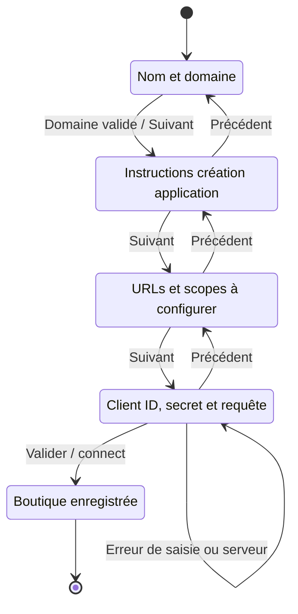

</details>
<!-- uml:uml-shop-wizard:end -->

#### Vérification et renouvellement de l'autorisation Shopify

Modal de vérification avec états : vérification, autorisation requise, configuration Shopify à publier, autorisation en attente, accordée, erreur. Elle affiche les scopes pertinents et la date de contrôle. Si les scopes sont demandés mais pas accordés, « Autoriser dans Shopify » démarre le parcours OAuth ; l'ouverture/redirection ne vaut pas autorisation. Il faut terminer le parcours et vérifier à nouveau. Le callback affiche succès/erreur dans Paramètres. Les résultats tardifs d'une requête de contrôle sont rejetés si le dialogue ou la boutique a changé.

<!-- uml:uml-shop-authorization-check:start -->
<a id="uml-shop-authorization-check"></a>

**UML — Vérification et renouvellement des autorisations Shopify · Séquence · Fonctionnement actuel**

Le dialogue distingue les scopes manquants, demandés et accordés. Une réponse tardive est ignorée après fermeture ou changement de boutique ; la redirection OAuth seule ne valide aucun accès.

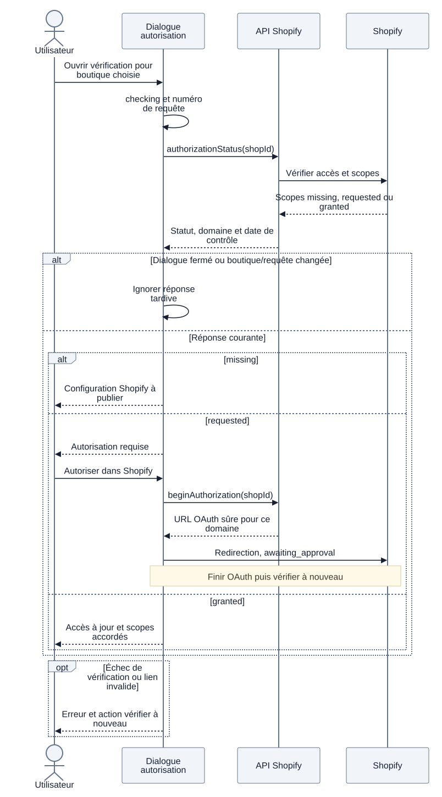

<details>
<summary>Source Mermaid modifiable</summary>

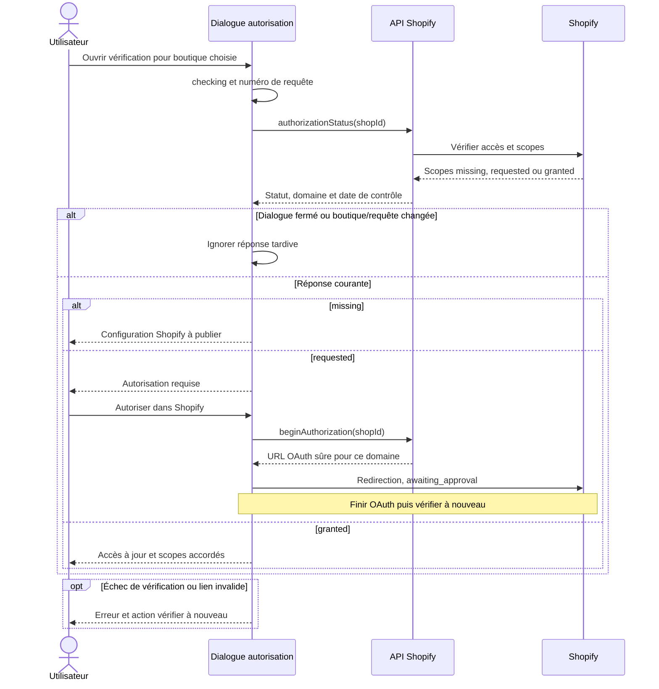

</details>
<!-- uml:uml-shop-authorization-check:end -->

#### Réglages de génération exposés

Les réglages sont par boutique ; certains choix sont capturés au lancement et certains paramètres techniques sont relus à l'exécution (voir 8.5). L'écran comprend quatre onglets : Boutique, Génération, Modèles, Avancé.

- Moteur image : OpenAI / Gemini.
- Exécution : temps réel / batch.
- OpenAI : nom du modèle, taille, qualité, format de sortie.
- Gemini : nom du modèle, taille, ratio.
- Modèle d'analyse visuelle (`VIBE_MODEL`).
- Cadence maximale de requêtes image par minute pour chaque fournisseur.
- Concurrence des générations.
- Enregistrement par ligne et confirmation par toast ; état local de brouillon jusqu'à l'enregistrement.
- Synchronisation des produits depuis le bandeau des Paramètres.

Les secrets des fournisseurs ne sont pas saisis dans ces formulaires : ils relèvent de l'environnement serveur. `VIBE_ANALYSIS` et `VARIANT_CLASSIFIER_MODEL` sont des paramètres backend présents dans les valeurs par défaut mais non proposés comme lignes générales dans cet écran ; l'analyse visuelle est aussi réglée par template. Les valeurs par défaut de modèle présentes dans le code sont des détails historiques de configuration, pas des recommandations de modèle pour le projet refait.

Sources : `app/features/settings/settingsData.ts`, `hooks/useSettingsPage.ts`, `components/SettingsPage.tsx`, `ShopOnboarding.tsx`, `ShopTable.tsx`, `ShopAuthorizationDialog.tsx`, `hooks/useShopAuthorization.ts`, `GenerationSettingsTab.tsx`, `convex/settings.ts`, `convex/settings/scope.ts`, `convex/shops.ts`, `convex/shopScope.ts`, `convex/shopify/scopes.ts`.

<!-- uml:uml-settings-write:start -->
<a id="uml-settings-write"></a>

**UML — Réglages par boutique et paramètres relus · Séquence · Fonctionnement actuel**

Cibles, prompts et certains choix sont capturés dans les jobs. Des réglages techniques sont encore relus à l’exécution ; ce schéma ne promet pas un snapshot complet de configuration.

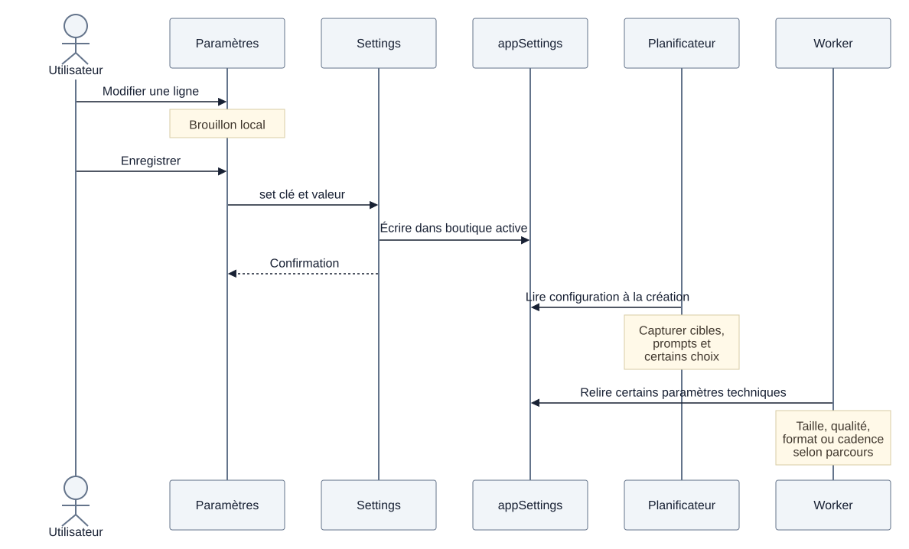

<details>
<summary>Source Mermaid modifiable</summary>

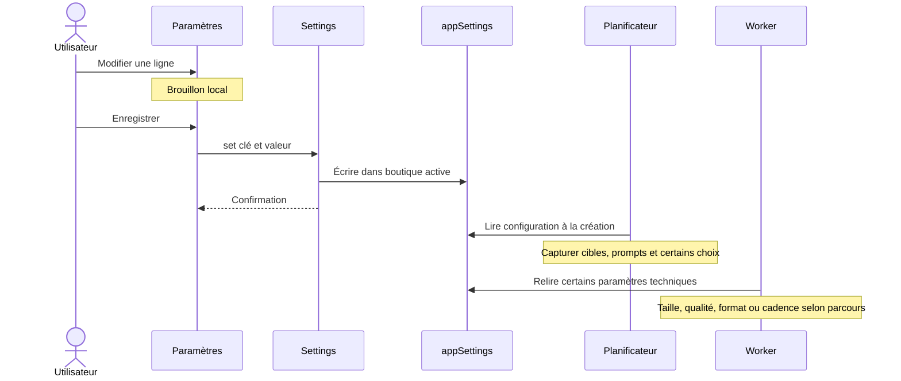

</details>
<!-- uml:uml-settings-write:end -->

<a id="shopify"></a>

## 4. Intégration Shopify et synchronisation

### 4.1 Autorisation Shopify

Enregistrer des credentials et disposer d'un accès Admin API autorisé sont deux étapes. Les boutiques enregistrées nécessitent un jeton offline sauvegardé ; le fallback historique d'environnement peut obtenir un jeton via client credentials.

Le parcours d'autorisation :

1. Vérifier l'installation et distinguer les scopes absents de la configuration, demandés mais non accordés, ou accordés.
2. Présenter les instructions et l'URL de callback résolue sur le backend.
3. Créer une tentative avec état aléatoire, état haché en base, utilisateur, boutique et expiration.
4. Ouvrir la page d'autorisation Shopify.
5. Recevoir `GET /shopify/oauth/callback` ; vérifier HMAC, état, expiration et domaine de boutique.
6. Échanger le code contre un jeton, contrôler les scopes accordés, sauvegarder et consommer la tentative.
7. Rediriger vers `/settings/` avec un statut de succès ou d'erreur.

Les scopes exigés par le code sont `write_products`, `write_files` et `write_online_store_navigation`. Ils servent respectivement aux produits/variantes/collections et médias, aux fichiers/images, et aux menus. L'URL de callback peut être configurée par `SHOPIFY_OAUTH_REDIRECT_URL`, sinon elle est construite depuis `CONVEX_SITE_URL`.

<!-- uml:uml-shop-oauth:start -->
<a id="uml-shop-oauth"></a>

**UML — Autorisation OAuth et sauvegarde du token · Séquence · Fonctionnement actuel**

La tentative est liée au domaine et expire. Un retour navigateur n’est pas une autorisation tant que la signature, l’état et les scopes n’ont pas été validés.

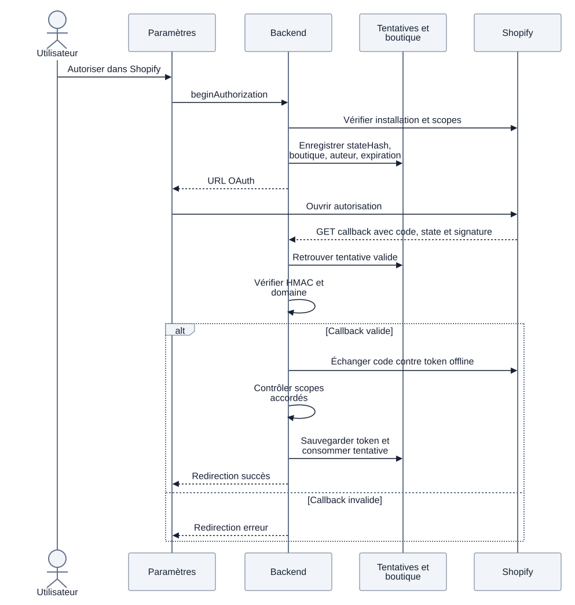

<details>
<summary>Source Mermaid modifiable</summary>

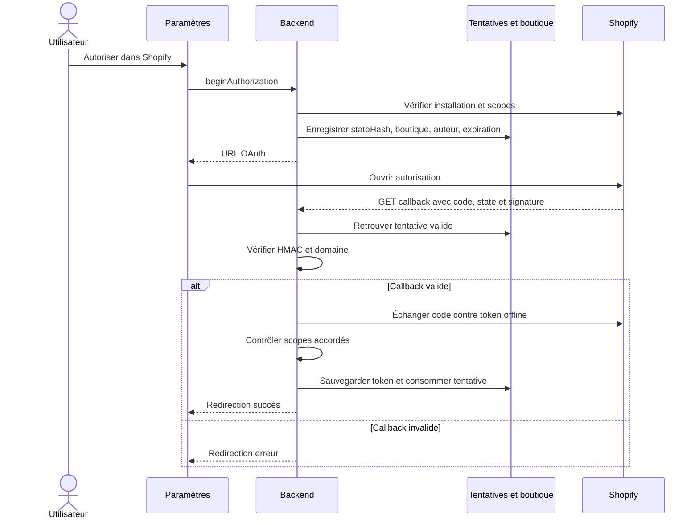

</details>
<!-- uml:uml-shop-oauth:end -->

### 4.2 Synchronisation des produits

L'utilisateur peut synchroniser le catalogue Shopify ou une seule fiche. La sélection vient de la requête configurée pour la boutique, avec un défaut couvrant `active`, `draft` et `archived`. L'API de synchronisation accepte une limite positive facultative ; sans limite explicite, elle parcourt les pages jusqu'à la fin.

Les données importées comprennent identités, titres, handles, vendeur, type, statut, tags, collections, options, variantes, images/médias, associations de variantes et métadonnées nécessaires aux autres modules. Le modèle local est mis à jour par identité Shopify et contexte de boutique. Les états locaux de génération et les références visuelles doivent être conservés selon les règles d'upsert, pas écrasés par une reconstruction naïve du produit.

Les variantes sont parcourues au-delà de la première page lorsque nécessaire. Les variantes Google ont aussi une représentation dédiée dans `productVariants`, tandis que les données produit contiennent des variantes embarquées utilisées par les workflows visuels. Les facettes de filtre sont rafraîchies après synchronisation.

Le backend vérifie la cohérence de la boutique entre les étapes. Un curseur manquant ou répété provoque une erreur explicite, pas une boucle infinie ni une réussite prématurée. Le client GraphQL traite erreurs HTTP, erreurs GraphQL et absence de données ; certaines opérations exploitent le coût de requête et les limites de débit Shopify.

La synchronisation est une action explicite dans l'app. Le routeur HTTP étudié monte l'authentification et OAuth ; il ne montre pas de système de webhooks produits assurant une synchronisation continue de tout le catalogue. Il ne faut donc pas supposer un miroir toujours à jour sans resynchronisation.

<!-- uml:uml-shop-sync:start -->
<a id="uml-shop-sync"></a>

**UML — Synchronisation paginée des produits et variantes · Séquence · Fonctionnement actuel**

La sélection utilise la requête de boutique. L’absence de limite explicite autorise le parcours complet ; les curseurs répétés ou manquants interrompent la synchronisation.

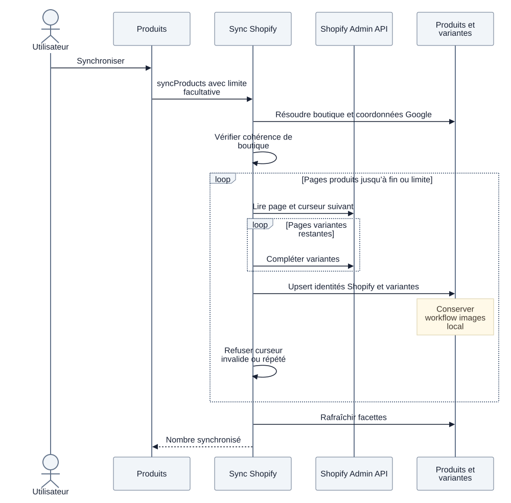

<details>
<summary>Source Mermaid modifiable</summary>

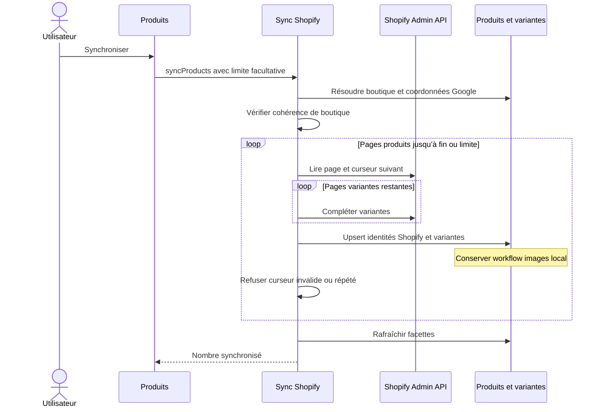

</details>
<!-- uml:uml-shop-sync:end -->

### 4.3 Sources de vérité

| Donnée | Source de vérité actuelle |
| --- | --- |
| Produit vendu et galerie publiée | Shopify, avec une copie de travail dans le backend |
| Jobs, relecture, prompts et configuration de l'app | Base de l'application |
| Images produites et backups des transformations | Stockage objet ; la base garde URLs et métadonnées |
| Catalogue collecté éditable | Tables `catalogues` et `produits` de l'application |
| Export catalogue | Un JSON final privé dans R2, résultat d'une version figée |
| Attributs Google publiés | Metafields Shopify, copiés localement à la sync |
| Propositions Google | Brouillons dans la base de l'application |
| Politiques en cours d'édition | État mémoire du navigateur |

<!-- uml:uml-truth-authorities:start -->
<a id="uml-truth-authorities"></a>

**UML — Sources de vérité et copies de travail · Classes · Fonctionnement actuel**

Classes conceptuelles de données, pas nouveaux services : chaque dépendance indique une lecture ou une dérivation. L’export catalogue n’est jamais utilisé comme base editable.


<details>
<summary>Source Mermaid modifiable</summary>

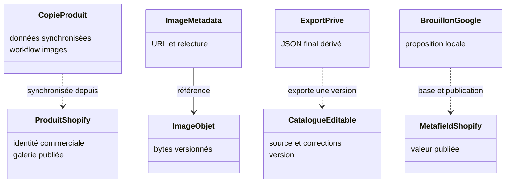

</details>
<!-- uml:uml-truth-authorities:end -->

<a id="images"></a>

## 5. Produits, visuels, prompts et traitements d'images

### Parcours produits

#### Catalogue produit courant

La page `/products` propose : synchronisation Shopify à la demande ; recherche de titre ou handle ; filtres type/catégorie produit, collection, statut Shopify, état de génération, état de review, état de publication et action métier ; onglets Tous, À traiter, À vérifier, Prêt, Publié ; nombre total et nombre filtré ; pagination et taille de page ; sélection de produits et sélection/désélection de la page visible ; lancement de génération sur un produit ou la sélection ; lancement miroir horizontal ou permutation d’images ; lien vers l’historique des opérations bulk.

La sélection peut traverser les pages ; changer les filtres la réinitialise. Les produits réservés par une opération bulk sont signalés. La liste n’est pas une sélection automatique de tout le catalogue filtré : « tous visibles » agit sur les lignes de la page.

La synchronisation lit Shopify en pages de 20 produits, avec médias, variantes, collections et metafields. Les variantes ont un chargement paginé complémentaire. Les données de génération et de review restent locales et ne doivent pas être écrasées par la synchronisation commerciale.

<!-- uml:uml-image-catalogue:start -->
<a id="uml-image-catalogue"></a>

**UML — Catalogue produit : filtres, pagination et sélection · Séquence · Fonctionnement actuel**

La sélection porte sur les lignes choisies, peut traverser les pages et est remise à zéro au changement de filtres. L'aperçu fournit un nombre d'images, sans devis monétaire.

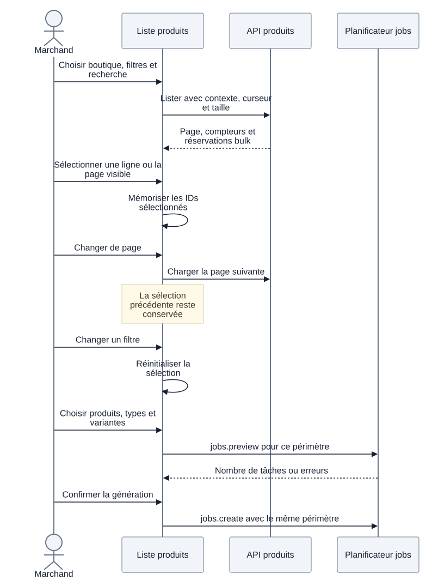

<details>
<summary>Source Mermaid modifiable</summary>

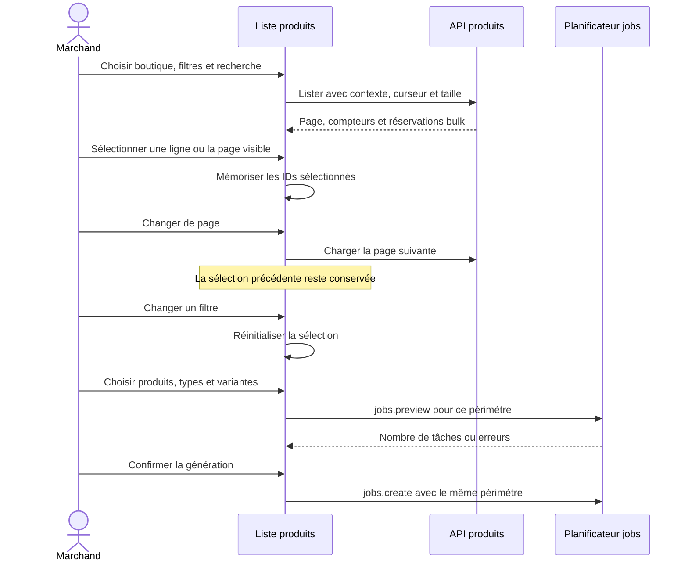

</details>
<!-- uml:uml-image-catalogue:end -->

#### Détail d’un produit

`/products/$productId` rassemble : informations produit et collections ; bouton Shopify Admin ; synchronisation d’un produit ; navigation précédent/suivant dans le contexte filtré ; galerie Shopify ; galerie des images générées et badges ; travail par déclinaison visuelle si configurée ; choix de génération ; approbation/rejet individuel et « Tout approuver » ; publication des images approuvées sélectionnées ; éditeur de retouche ; suppression d’image avec confirmation ; historique détaillé des prompts et images ; accès aux jobs de ce produit.

La galerie Shopify supporte une réorganisation par glisser-déposer. L’ordre local s’affiche immédiatement, la sauvegarde appelle Shopify, attend/confirme son job asynchrone autant que possible, met à jour le cache et annule l’ordre optimiste en cas d’erreur. Les références produit non groupées suivent ensuite l’ordre de la galerie.

Les images possèdent une lightbox avec navigation. L’historique affiche type, état, fournisseur, branche conditionnelle, erreur, URL de fichier et prompt utilisé. Il existe un lien de fichier ; cela ne prouve pas l’existence d’un export ZIP global des images.

<!-- uml:uml-image-detail-reorder:start -->
<a id="uml-image-detail-reorder"></a>

**UML — Détail produit : réorganisation de la galerie · Séquence · Fonctionnement actuel**

Le glisser-déposer est optimiste. Le serveur contrôle les identités des images live ; Shopify peut encore appliquer l'ordre lorsque l'action répond pending. Les médias hors images sont conservés.

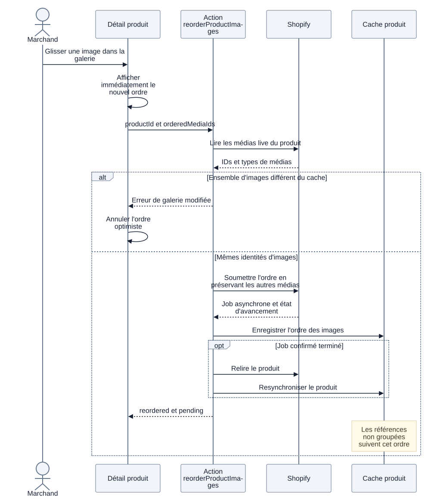

<details>
<summary>Source Mermaid modifiable</summary>

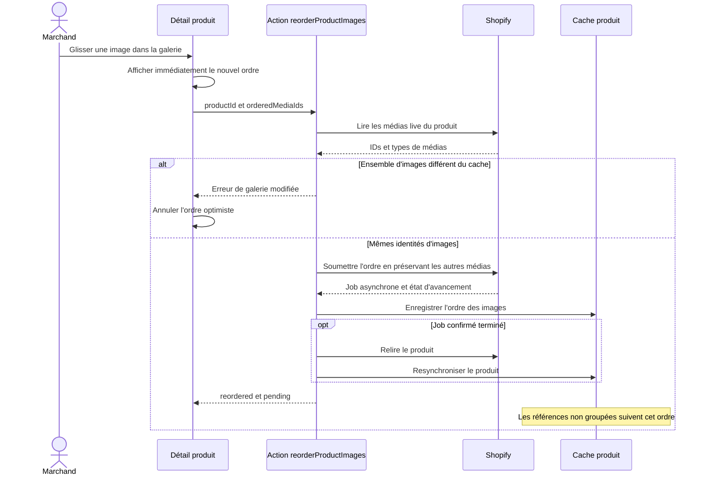

</details>
<!-- uml:uml-image-detail-reorder:end -->

### Groupes visuels et choix de références

#### Configuration

Le marchand choisit une ou plusieurs options Shopify qui changent l’apparence. L’application suggère d’abord une option couleur reconnue (`color`, `colour`, `couleur`, `farbe`, `colore`, `cor`), sinon la première option significative. Les tailles peuvent rester hors des axes visuels. Pour chaque combinaison existante des axes choisis, elle crée un groupe et sa liste de variantes. Les variantes sans toutes les valeurs requises ne créent pas de groupe.

La vignette couleur est déduite de noms connus, puis modifiable. L’UI permet de sélectionner un groupe, consulter ses variantes et références, générer/publier pour ce groupe, et naviguer entre les déclinaisons.

Les axes sont verrouillés lorsque des images de groupe ont commencé à être générées et lorsqu’une famille de produits séparés existe. Avant cela, une reconfiguration reconstruit groupes, liens variantes et références.

<!-- uml:uml-image-group-config:start -->
<a id="uml-image-group-config"></a>

**UML — Groupes visuels : configuration et relations · Classes · Fonctionnement actuel**

Modèle métier simplifié des tables actuelles. Les combinaisons des axes visuels relient des variantes vendables ; les tailles peuvent rester hors des axes. La reconfiguration est refusée après génération de groupe ou création d'une famille.


<details>
<summary>Source Mermaid modifiable</summary>

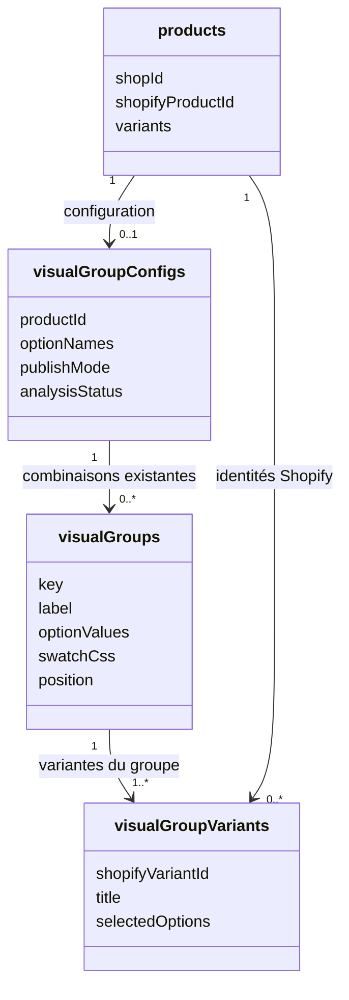

</details>
<!-- uml:uml-image-group-config:end -->

#### Affectation automatique puis manuelle

Ordre d’affectation :

1. Association native média/variante de Shopify : si une photo correspond à un seul groupe, confiance 1 et confirmation automatique.
2. Règle sur l’alt text : si toutes les valeurs visuelles d’un seul groupe apparaissent dans l’alt normalisé, confiance 0,94 et confirmation automatique.
3. Analyse Gemini des références non confirmées : propositions avec groupe, confiance et éventuelle bounding box ; seuls les matches à partir de 0,5 sont retenus. Une photo contenant plusieurs déclinaisons peut fournir plusieurs références recadrées. Ces propositions restent à confirmer.
4. Affectation manuelle si la suggestion manque ou doit être corrigée.

L’UI expose : lancer/reprendre l’analyse IA ; afficher source et confiance ; affecter une référence ; confirmer une référence ou toutes celles d’un groupe ; choisir la référence principale ; déplacer les références avec boutons ou glisser-déposer ; retirer une référence ; gérer les images non affectées ; modifier le swatch.

Une référence garde `sourceUrl` et `referenceUrl` séparément ; un recadrage garde sa géométrie et son parent `sourceReferenceId`. L’analyse ne doit pas modifier les identités de groupes ; elle ne décide pas qu’une image générée est publiable. Un groupe est prêt dès qu’il possède au moins une référence confirmée. Seules les références confirmées et leur ordre sont utilisés pour générer.

<!-- uml:uml-image-reference-assignment:start -->
<a id="uml-image-reference-assignment"></a>

**UML — Références : affectation, confirmation et recadrage · Séquence · Fonctionnement actuel**

Les suggestions Gemini restent non confirmées. Une référence peut produire plusieurs recadrages ; seule une référence confirmée rend son groupe utilisable par la génération.

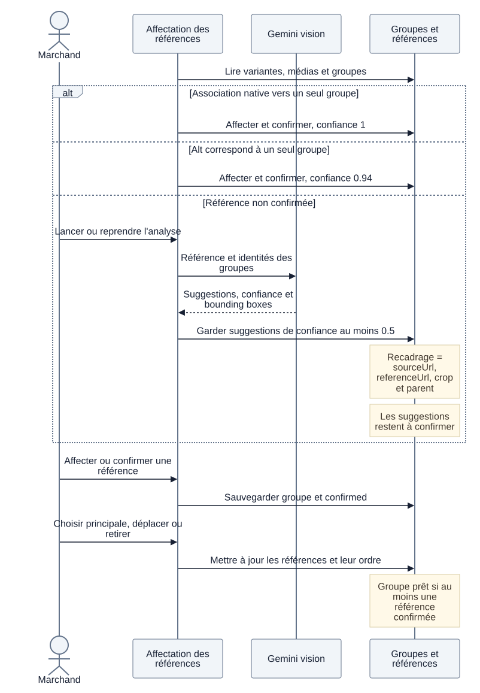

<details>
<summary>Source Mermaid modifiable</summary>

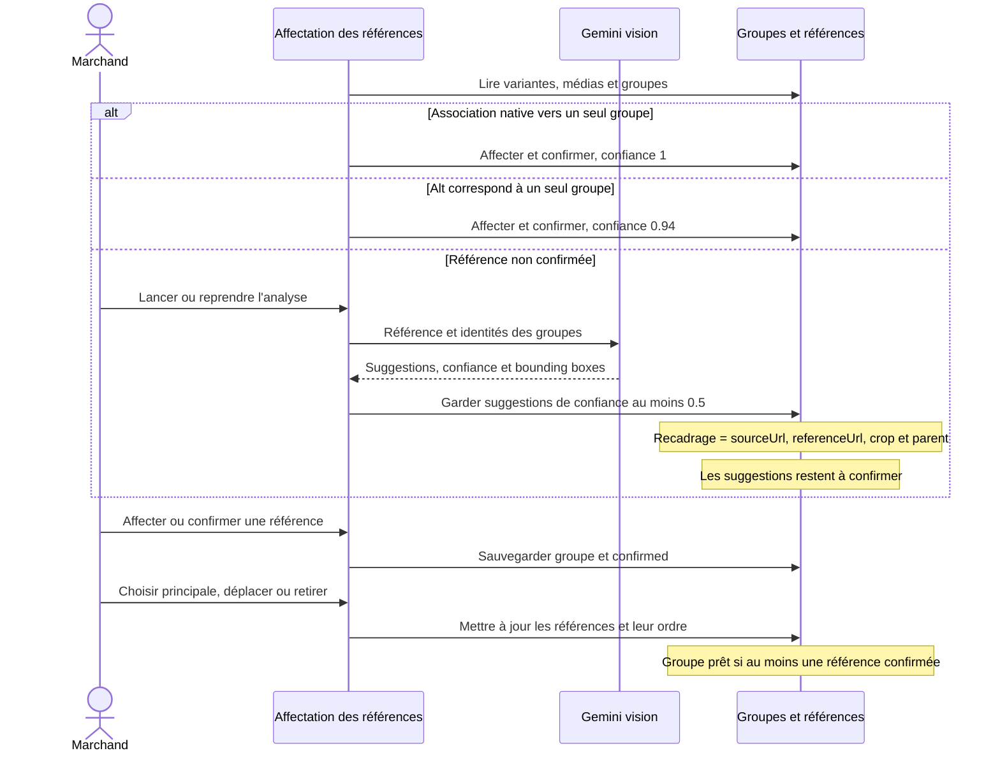

</details>
<!-- uml:uml-image-reference-assignment:end -->

#### Génération première/toutes les variantes

La fenêtre individuelle et bulk présélectionne « Première variante uniquement ». L’ordre est celui des variantes Shopify synchronisées, restreint aux groupes choisis. « Toutes les variantes » crée une tâche par variante admissible et par type d’image, donc des tailles différentes peuvent produire des tâches distinctes même si elles appartiennent au même groupe couleur.

Un choix explicite de groupes exige leur appartenance au produit et au shop, et au moins une référence confirmée. Une configuration visuelle sans groupe prêt ne doit pas silencieusement tomber sur une photo d’une autre déclinaison.

Compatibilité historique : si `variantSelection` est omis, il reste une tâche par produit ou groupe explicitement sélectionné. Les produits déjà séparés utilisent une seule première variante, même s’il reste plusieurs tailles ; depuis leur produit mère, chaque groupe membre de la famille reçoit une image par type.

L’aperçu du nombre d’images et la création appellent le même planificateur. Le nombre affiché avant validation doit donc être celui réellement lancé. L’UI actuelle affiche ce nombre et les erreurs de préparation ; elle n’affiche pas de devis monétaire précis avant lancement. La volonté « montrer le coût avant génération » de `PRODUCT.md` est une intention produit, pas un écran de devis implémenté démontré.

<!-- uml:uml-image-variant-planning:start -->
<a id="uml-image-variant-planning"></a>

**UML — Planifier première variante ou toutes les variantes · Séquence · Fonctionnement actuel**

L'aperçu et la création utilisent le même planificateur. Toutes les variantes inclut les tailles vendables ; le cas sans variantSelection est conservé pour compatibilité.

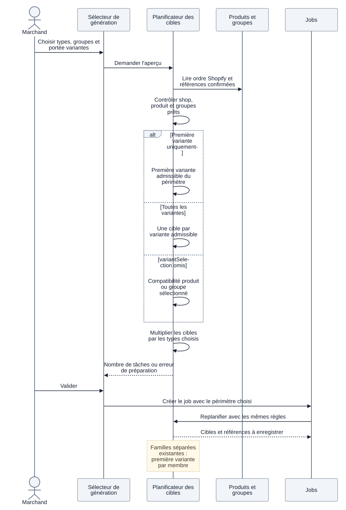

<details>
<summary>Source Mermaid modifiable</summary>

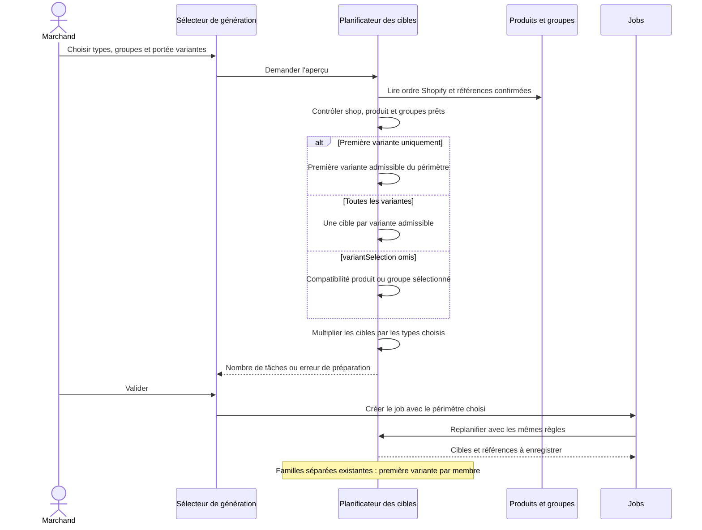

</details>
<!-- uml:uml-image-variant-planning:end -->

### Bibliothèque de prompts

#### Capacités disponibles

`/settings/prompts` permet de gérer un prompt maître par boutique et une liste ordonnée de templates : créer, modifier le nom/type et le texte, activer/désactiver, supprimer, réordonner, marquer preset pour précocher dans le sélecteur, choisir catégorie de prompt, nombre de références, analyse de contexte et détourage. L’unicité du type d’image est par boutique. Une suppression compacte les positions.

Les quatre catégories courantes sont `product_only`, `product_detail`, `product_scene`, `human_model`. Les anciens noms `studio_product`, `detail_product`, `worn_model`, `lifestyle_model` sont des aliases de compatibilité. Par défaut, produit/détail n’ajoutent pas de vibe ; scène/mannequin l’ajoutent. Chaque template peut surcharger ce choix et sélectionner 1 à 4 références.

Le prompt final est construit par concaténation du maître et du template, rendu des variables en une passe, ajout du contrat exact de variante/groupe, éventuelle instruction de correction et contexte de scène. Il stocke le prompt rendu (`promptUsed`), puis celui réellement envoyé après analyse (`finalPromptUsed`). Les valeurs insérées ne doivent jamais être réinterprétées comme nouveaux placeholders.

Variables reconnues : `PRODUCT_TITLE`, `PRODUCT_HANDLE`, `IMAGE_TYPE`, `VARIANT_TITLE`, `VARIANT_OPTIONS`, `OPTION_VALUE:<nom Shopify de l’option>`, `VISUAL_GROUP_LABEL`, `VISUAL_GROUP_VALUES`, `PROMPT_KIND`, `TARGET_AUDIENCE`, `TARGET_GENDER`, `MODEL_REFERENCE_KEY`, `CONTEXT_CONFIDENCE`. Une variable inconnue ou absente rend une chaîne vide. Les valeurs d’options gardent leur texte Shopify original.

<!-- uml:uml-image-prompt-library:start -->
<a id="uml-image-prompt-library"></a>

**UML — Bibliothèque de prompts et construction du texte · Séquence · Fonctionnement actuel**

Les templates et le maître sont propres à la boutique. Le rendu des variables est effectué en une passe ; une valeur insérée n'est pas réinterprétée comme un placeholder.

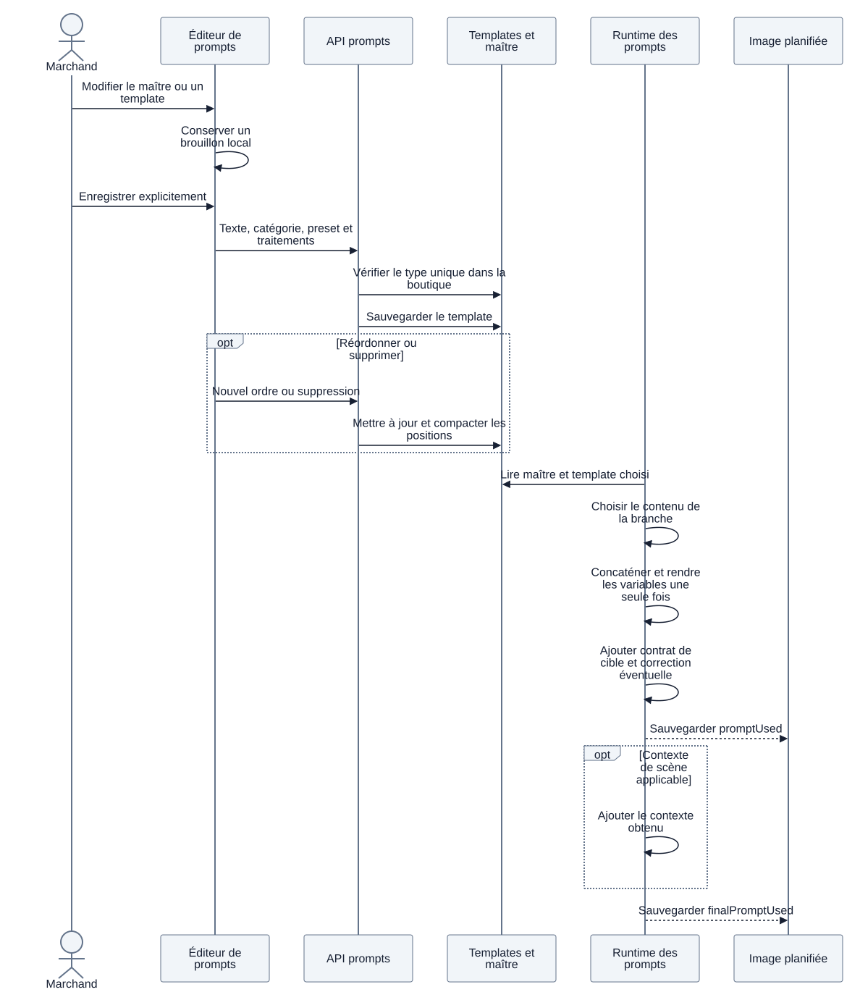

<details>
<summary>Source Mermaid modifiable</summary>

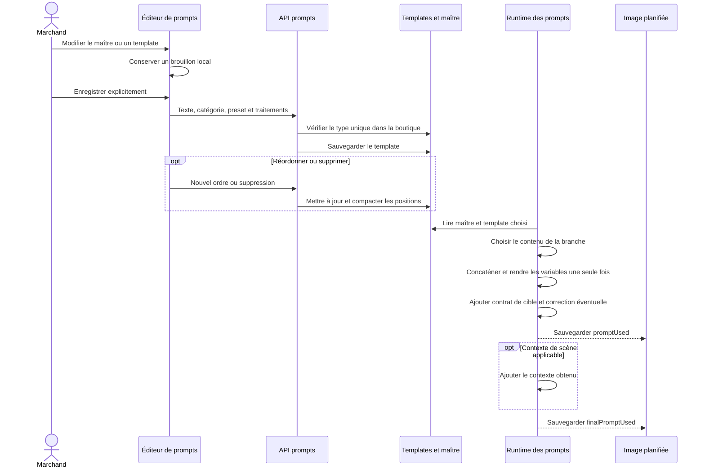

</details>
<!-- uml:uml-image-prompt-library:end -->

#### Prompts conditionnels

Un template peut activer une condition unique sur titre du produit, titre de variante ou valeur d’une option Shopify nommée. Opérateurs : « renseigné », « contient », « égal à ». Comparaisons insensibles à casse et accents ; une valeur absente sélectionne toujours « Sinon ». Le texte existant devient la branche vraie ; le texte Sinon est obligatoire. Le maître, les références et les paramètres IA/détourage sont communs aux deux branches.

Chaque image garde sa branche `main`, `if_true`, `otherwise` et son contexte de cible. L’UI signale variante et branche. Une régénération réévalue le template courant sur le contexte cible sauvegardé ; une reprise technique du job réutilise le prompt déjà préparé.

<!-- uml:uml-image-conditional-prompt:start -->
<a id="uml-image-conditional-prompt"></a>

**UML — Prompts conditionnels : évaluation de la branche · Séquence · Fonctionnement actuel**

Une condition unique choisit la branche. Une régénération réévalue le template courant sur la cible enregistrée ; un retry technique garde le prompt déjà préparé.

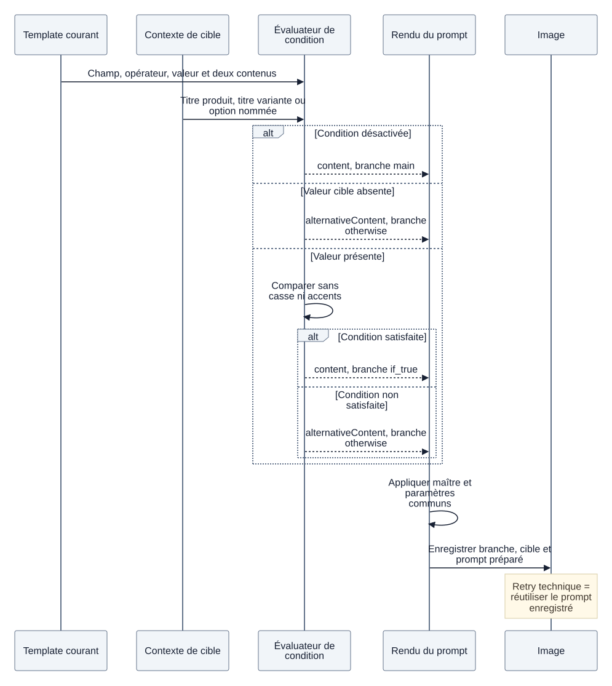

<details>
<summary>Source Mermaid modifiable</summary>

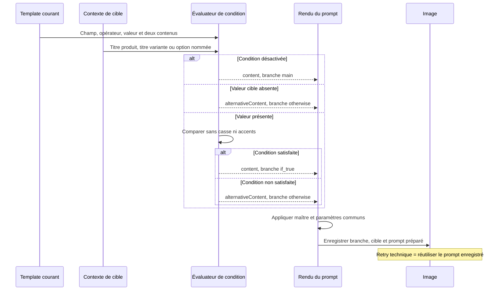

</details>
<!-- uml:uml-image-conditional-prompt:end -->

#### Références de mannequin humain

Le maître peut posséder sept images téléversées : adulte femme/homme/unisexe, enfant fille/garçon/unisexe, défaut. Elles sont stockées en asset SaaS distinct des photos produit. Un contexte audience/genre est inféré de titre, handle, type, vendor, tags, collections, options, variantes et metafields, à l’aide de règles de mots. Audiences : baby, toddler, child, teen, adult, unknown ; genres : female, male, unisex, unknown ; confiance et signaux sont calculés.

Une référence humaine est utilisée uniquement par `human_model`. Un adulte ne doit pas prendre une photo enfant ; les choix femme/homme ont un fallback unisexe du même âge. Inconnu utilise la clé défaut. L’absence de référence ne bloque pas nécessairement une génération. Lorsqu’elle existe, la génération envoie au maximum trois références produit + la référence humaine, soit quatre entrées au total.

Les uploads de références obtiennent une URL d’upload backend, puis enregistrent un `_storage` ID. Le backend relit les métadonnées réelles du fichier et exige un type `image/*`, une existence réelle et une taille ≤10 MiB ; il ne fait pas confiance au type/taille déclarés par le navigateur. Remplacer/retirer une référence met à jour la map ; le code inspecté ne purge pas automatiquement tous les anciens fichiers mannequin orphelins. Une politique de rétention sera à préciser.

L’éditeur conserve des brouillons locaux, indique les changements non enregistrés et permet de prévisualiser le contenu rendu. L’enregistrement reste explicite. Les presets déterminent les types précochés lors d’un lancement.

<!-- uml:uml-image-human-reference:start -->
<a id="uml-image-human-reference"></a>

**UML — Mannequins : upload validé et référence adaptée · Séquence · Fonctionnement actuel**

Sept clés de références existent. Le serveur valide le fichier réel, puis human_model choisit selon audience/genre avec fallback adapté ; la suppression de la map ne garantit pas la purge de tous les anciens assets.

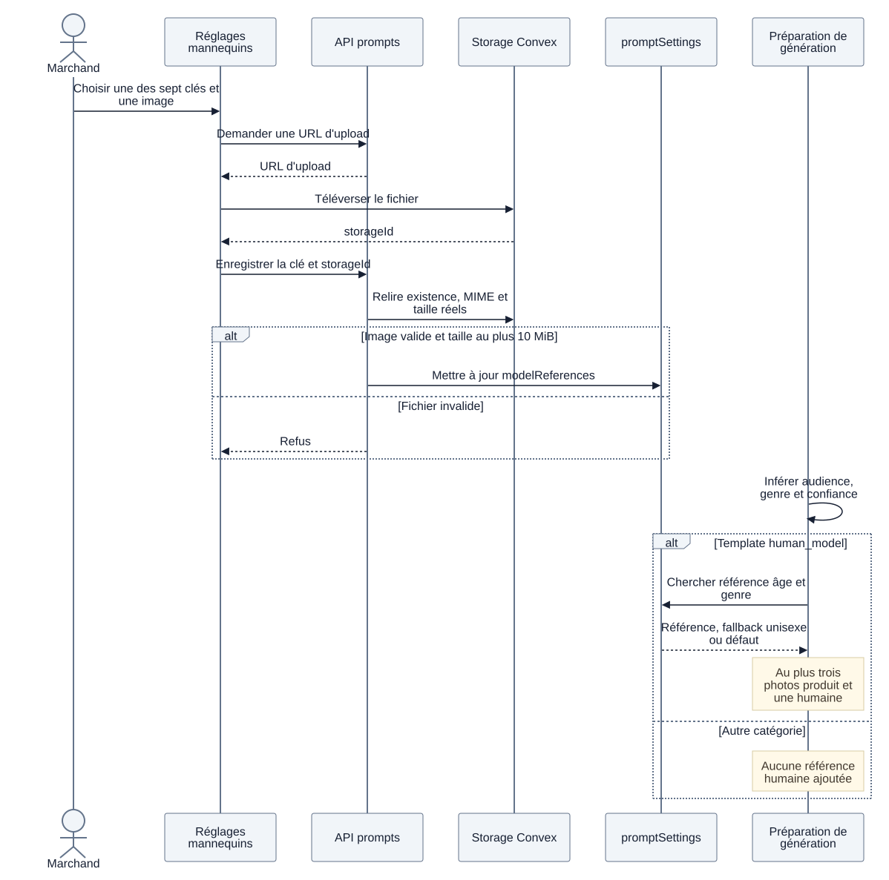

<details>
<summary>Source Mermaid modifiable</summary>

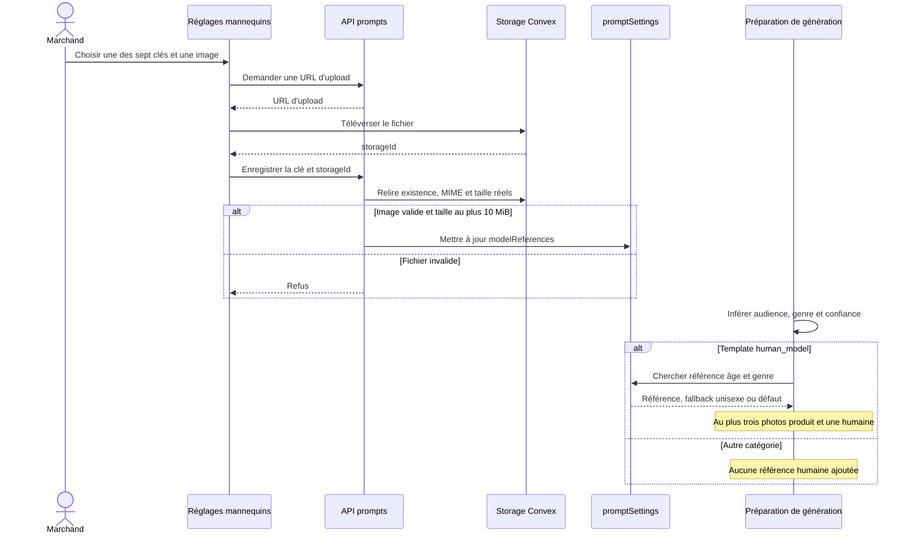

</details>
<!-- uml:uml-image-human-reference:end -->

### Génération et traitements de fichier

#### Paramètres et fournisseurs

Les réglages par boutique pilotent moteur OpenAI/Gemini (nom UI « Nano Banana Pro »), mode realtime/batch, modèle, taille, qualité/format OpenAI, taille/ratio Gemini, analyse de contexte, modèles d’analyse et limites par minute. Defaults codés : OpenAI `gpt-image-2-2026-04-21`, 1024×1024, medium, JPEG ; Gemini `gemini-3-pro-image-preview`, 2K, 1:1 ; analyse `gemini-2.5-flash-lite` ; cadence 5/minute ; exécution realtime. Les clés fournisseurs restent serveur.

Les snapshots présents couvrent cible, prompt, références, moteur/modèle, type et fond ; la taille, qualité, format et cadence ne sont pas tous copiés comme champs du job/image dans le schéma actuel. Certains workers relisent les settings de boutique lorsqu’ils exécutent une étape. La future spécification devrait décider si tous les paramètres doivent être figés au lancement et afficher la version utilisée, plutôt que supposer que le code actuel garantit un snapshot complet de configuration.

Le backend OpenAI realtime appelle Images Edits avec un à quatre fichiers JPEG de référence ; Gemini appelle `generateContent` avec prompt et références inline. Il faut une référence produit ; ce cœur n’est pas un simple générateur text-to-image sans catalogue.

Les références sont téléchargées avec trois tentatives, timeout 20 secondes, retry 408/429/5xx ou réseau, prise en compte bornée de Retry-After, puis décodées avec Sharp (WebP/AVIF compatibles), orientées, réduites à 1024 px sans agrandissement, transparence aplatie sur blanc, JPEG qualité 92, sRGB.

Attention de reconstruction : `GENERATION_CONCURRENCY` est éditable, mais le worker realtime inspecté traite la file séquentiellement à l’intérieur d’un job. La cadence en sommeil est par worker/job ; le code inspecté ne prouve pas une limitation globale de tous les jobs realtime partageant la même clé API. Une nouvelle architecture devra décider et documenter sa régulation globale.

<!-- uml:uml-image-provider-settings:start -->
<a id="uml-image-provider-settings"></a>

**UML — Fournisseurs : paramètres capturés et paramètres relus · Séquence · Fonctionnement actuel**

Le snapshot de génération est partiel. Les clés restent serveur ; certains paramètres techniques peuvent changer entre le lancement et une étape du worker. Le pipeline exige une référence produit.

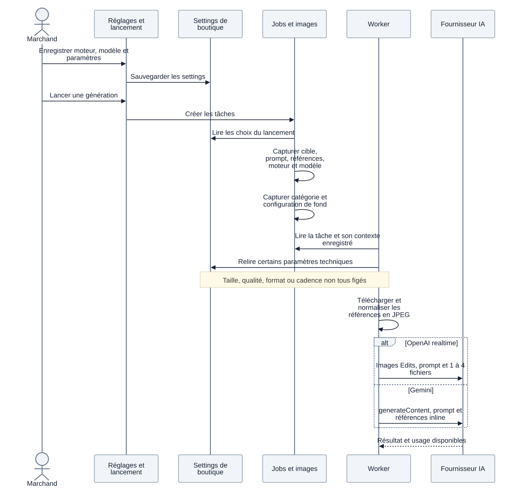

<details>
<summary>Source Mermaid modifiable</summary>

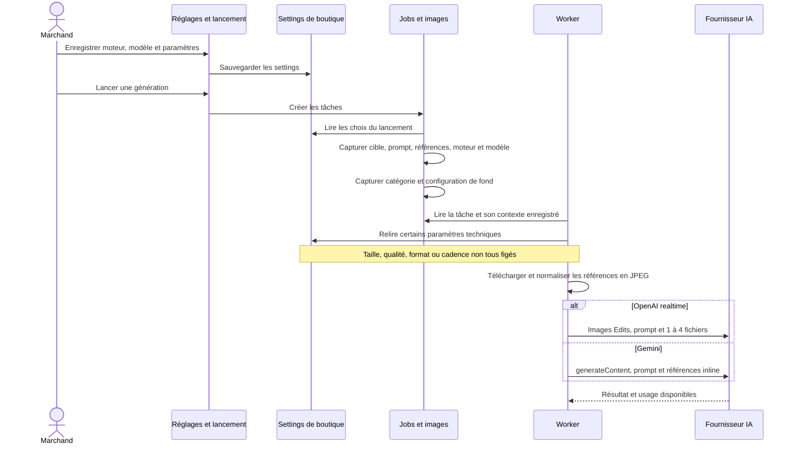

</details>
<!-- uml:uml-image-provider-settings:end -->

#### Analyse de scène « vibe »

Une passe vision Gemini peu coûteuse décrit en une phrase la scène idéale : lieu, public, humeur et palette. Exemple métier : un produit enfant doit pouvoir être mis en scène dans une chambre enfant. Le résultat est mis en cache sur le produit avec coût et date. Le prompt reçoit `Scene context: ...` si le template l’utilise. Timeout 30 secondes ; erreur non bloquante, génération sans contexte. Ce cache est produit, pas variante/groupe : ne pas présenter une personnalisation de scène indépendante par variante comme garantie actuelle.

<!-- uml:uml-image-vibe:start -->
<a id="uml-image-vibe"></a>

**UML — Analyse vibe : cache produit et erreur non bloquante · Séquence · Fonctionnement actuel**

Le cache et le coût de scène sont attachés au produit. Ils ne constituent pas une analyse indépendante par variante ou groupe.

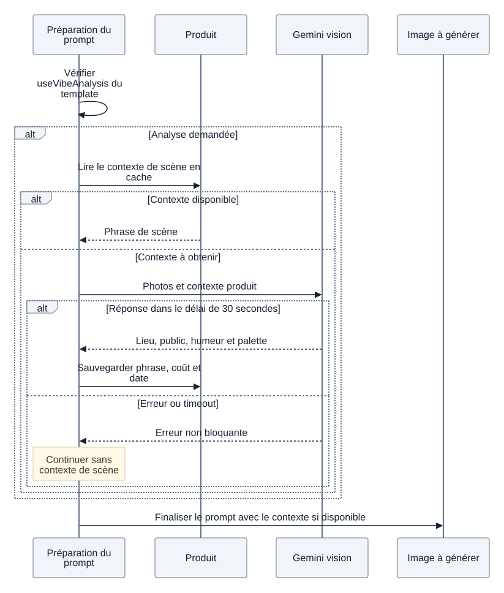

<details>
<summary>Source Mermaid modifiable</summary>

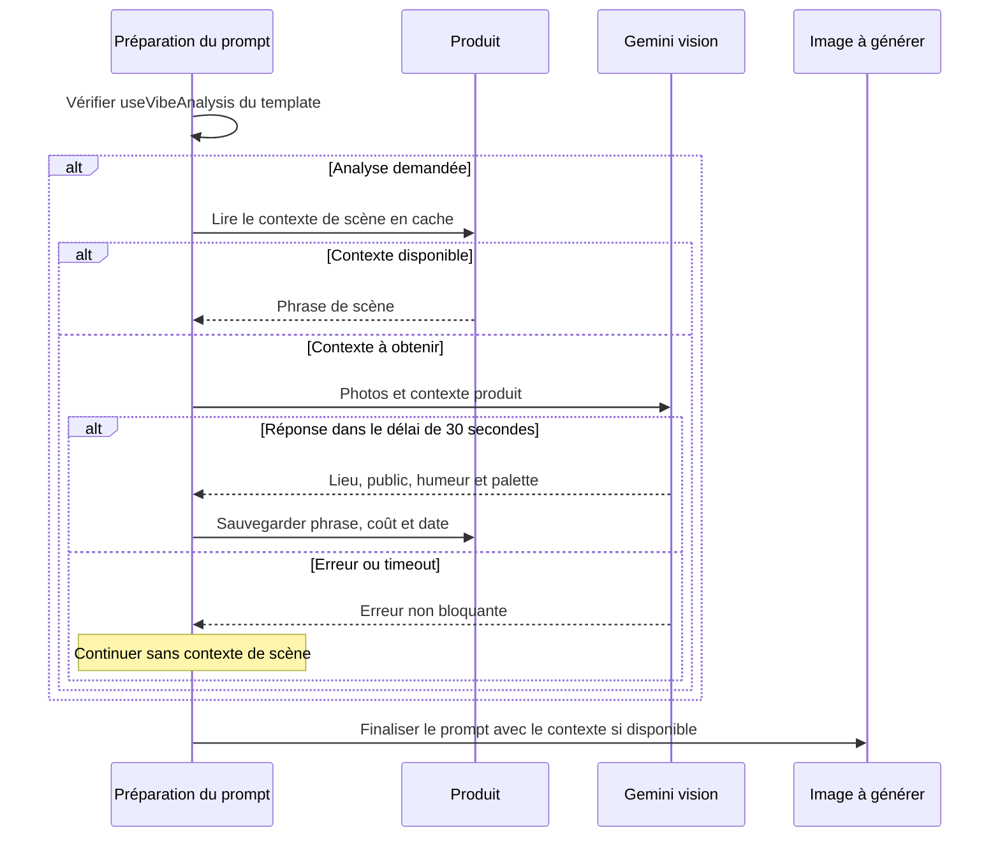

</details>
<!-- uml:uml-image-vibe:end -->

#### Détourage et fond

Chaque template peut demander remove-background via fal.ai / Ideogram. Le pipeline stocke d’abord une image intermédiaire, appelle la queue fal, conserve son request ID, attend son résultat, normalise le cutout transparent puis compose un fond. Choix : transparent ou couleur hexadécimale pleine ; ombre de contact activable (default oui) ; couleur défaut blanche. Le cutout séparé peut être conservé en PNG. Une entrée fal doit être JPEG/PNG/WebP, ≤10 MiB ; sinon préparation WebP ≤2048 px.

Le traitement final utilise WebP optimisé, qualité serveur `WEBP_QUALITY` default 82, retire les métadonnées et respecte l’orientation. En cas d’échec d’optimisation, il conserve le fichier d’origine. Les noms sont SEO-safe à partir du titre et du type, slug sans accents, maximum 100 caractères de base, avec fallback produit.

R2 stocke résultats, références batch, intermédiaires et sauvegardes d’opérations bulk ; les objets ont des URLs publiques et cache immutable d’un an. Les clés incluent identité de l’image et tentative pour éviter qu’un résultat d’une variante écrase celui d’une autre. Les uploads temporaires de mannequin et retouche passent par le storage Convex.

<!-- uml:uml-image-background:start -->
<a id="uml-image-background"></a>

**UML — Détourage, composition du fond et stockage final · Séquence · Fonctionnement actuel**

L'image intermédiaire et le request ID permettent une reprise de détourage. Le fond peut être transparent ou uni, avec ombre facultative ; le traitement final tente une optimisation WebP.

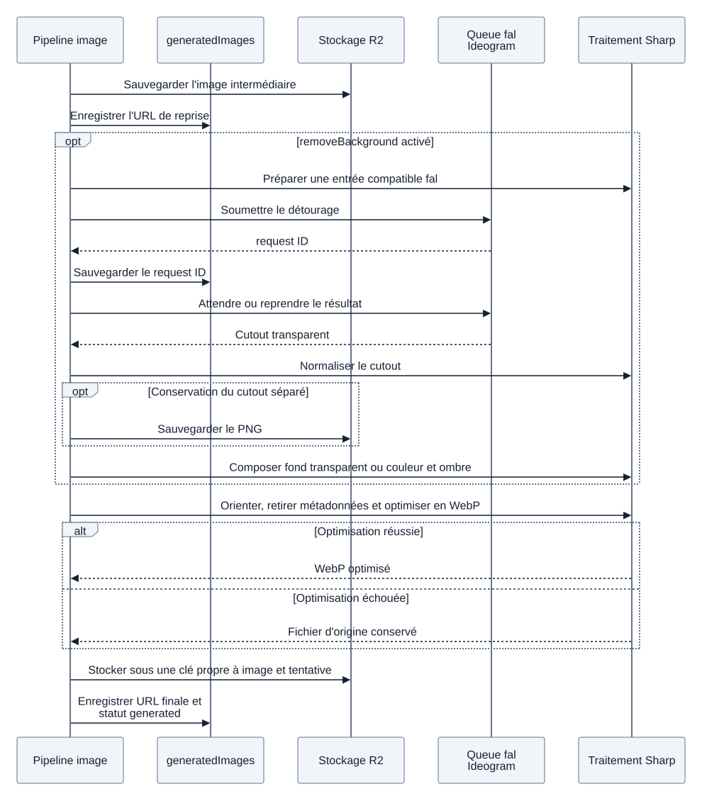

<details>
<summary>Source Mermaid modifiable</summary>

```mermaid
sequenceDiagram
    participant W as Pipeline image
    participant D as generatedImages
    participant R as Stockage R2
    participant F as Queue fal Ideogram
    participant O as Traitement Sharp
    W->>R: Sauvegarder l'image intermédiaire
    W->>D: Enregistrer l'URL de reprise
    opt removeBackground activé
        W->>O: Préparer une entrée compatible fal
        W->>F: Soumettre le détourage
        F-->>W: request ID
        W->>D: Sauvegarder le request ID
        W->>F: Attendre ou reprendre le résultat
        F-->>W: Cutout transparent
        W->>O: Normaliser le cutout
        opt Conservation du cutout séparé
            W->>R: Sauvegarder le PNG
        end
        W->>O: Composer fond transparent ou couleur et ombre
    end
    W->>O: Orienter, retirer métadonnées et optimiser en WebP
    alt Optimisation réussie
        O-->>W: WebP optimisé
    else Optimisation échouée
        O-->>W: Fichier d'origine conservé
    end
    W->>R: Stocker sous une clé propre à image et tentative
    W->>D: Enregistrer URL finale et statut generated
```

</details>
<!-- uml:uml-image-background:end -->

#### Exécution realtime

Créer le job insère ses tâches en `queued` et programme le worker, puis l’utilisateur peut quitter la page. Le worker passe le job running, prend une image, prépare le contexte/mannequin/prompt, génère, détoure éventuellement, optimise, stocke et termine la tâche. Les erreurs passent la tâche failed et conservent son message et ses IDs fournisseur. Reprises automatiques de génération seulement sur erreurs de rate limit détectées, default deux retries ; toutes les erreurs ne déclenchent pas une nouvelle facture.

Le champ `forceRegenerate` existe et est sauvegardé ; l’UI actuelle le transmet toujours à `true`. Dans le code inspecté, aucune branche du moteur ne l’utilise pour ignorer un couple cible/type déjà généré. `jobs.create` planifie/insère toutes les tâches choisies, y compris lorsqu’un résultat existe. Il ne faut donc pas promettre un mode « seulement les images manquantes » à partir de ce seul champ. Les skips réels appartiennent aux transformations, reorders ou règles d’association variante ; les gardes de reprise évitent de rejouer une tâche déjà terminée dans la même tentative.

Si l’intermédiaire de détourage existe, la reprise peut repartir de là au lieu de rappeler le générateur. Une annulation stoppe les tâches locales actives et conserve les images déjà obtenues.

<!-- uml:uml-image-realtime:start -->
<a id="uml-image-realtime"></a>

**UML — Génération realtime : file séquentielle et reprises limitées · Séquence · Fonctionnement actuel**

Le worker traite un job séquentiellement. Seules les erreurs de rate limit déclenchent les retries automatiques de génération prévus ; forceRegenerate ne filtre pas les cibles déjà générées.

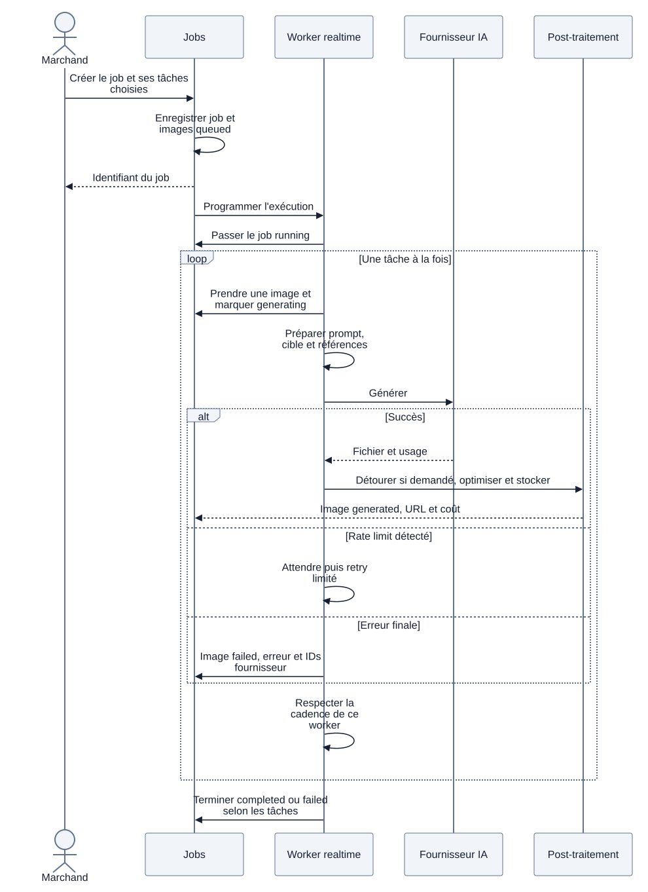

<details>
<summary>Source Mermaid modifiable</summary>

```mermaid
sequenceDiagram
    actor M as Marchand
    participant J as Jobs
    participant W as Worker realtime
    participant A as Fournisseur IA
    participant P as Post-traitement
    M->>J: Créer le job et ses tâches choisies
    J->>J: Enregistrer job et images queued
    J-->>M: Identifiant du job
    J->>W: Programmer l'exécution
    W->>J: Passer le job running
    loop Une tâche à la fois
        W->>J: Prendre une image et marquer generating
        W->>W: Préparer prompt, cible et références
        W->>A: Générer
        alt Succès
            A-->>W: Fichier et usage
            W->>P: Détourer si demandé, optimiser et stocker
            P-->>J: Image generated, URL et coût
        else Rate limit détecté
            W->>W: Attendre puis retry limité
        else Erreur finale
            W->>J: Image failed, erreur et IDs fournisseur
        end
        W->>W: Respecter la cadence de ce worker
    end
    W->>J: Terminer completed ou failed selon les tâches
```

</details>
<!-- uml:uml-image-realtime:end -->

#### OpenAI Batch durable

Les nouveaux jobs OpenAI batch utilisent une orchestration durable avec checkpoints applicatifs. Limites : 900 tâches/job ; segments de 100 par défaut (configurable 1–100) ; deux segments actifs par défaut (1–3), partagé entre jobs sur la même clé du déploiement ; étapes Node limitées à trois workers. Ces paramètres ne sont pas une preuve du quota OpenAI du compte.

Étapes à reproduire :

1. Réserver les tâches et démarrer une orchestration dans la même transaction.
2. Préparer une image par étape. Mettre en cache chaque référence par job + produit + URL source ; vérifier un objet R2 déterministe avant de retélécharger après interruption ; sauvegarder chaque référence avant la suivante.
3. Créer un JSONL de requêtes contenant les URLs R2, pas le base64 des références ; sauvegarder l’ID du fichier uploadé avant le batch.
4. Sauvegarder l’intention avant le POST, avec clé immutable de soumission en métadonnées, job et segment. Sauvegarder le reçu aussitôt reçu, même si une annulation a commencé.
5. Poll programmé sans monopoliser un worker pendant l’attente ; conserver statuts, fichiers succès/erreurs et temps clés. Récupérer aussi les sorties partielles expirées/failed/cancelled.
6. Lire le JSONL de sortie progressivement, deux lignes par étape, avec curseur exact en octets et index de fichier ; valider une ligne avant d’avancer le curseur. Rejouer une ligne après interruption est idempotent.
7. Post-traiter avec lease, identité de tentative et objet final déterministe. Reprendre la récupération au même curseur ou le post-traitement au même intermédiaire selon la phase, plutôt que recommencer la génération.

Lease de 11 minutes et validation de token empêchent un ancien worker de valider le travail d’un nouveau. Les workflows qui épuisent leurs retries sont redémarrés depuis checkpoints. Leurs journaux techniques terminés sont nettoyés après sept jours ; le dossier applicatif reste.

Soumission incertaine : un timeout ou une réponse ambiguë après POST ne prouve pas que le fournisseur a refusé. Aucun second POST automatique. L’orchestrateur recherche une correspondance exacte clé de soumission + fichier d’entrée dans la liste paginée OpenAI. Une correspondance unique est rattachée ; zéro ou plusieurs laissent l’incertitude visible. Une annulation sans confirmation continue à réserver sa place. Le bouton Poll et watchdog ne resoumettent jamais une intention incertaine.

Il existe une reprise opérateur interne distincte, après minimum 30 minutes et scan complet limité à 20 pages ; elle exige confirmation explicite et les identités attendues. Une correspondance de clé OU de fichier, une erreur HTTP, pagination incomplète ou un reçu tardif bloque cette reprise. Une liste vide n’est pas une garantie contractuelle d’absence d’acceptation ; cela reste une décision opérateur.

Bornes codées : références ≤20 MiB et 16 millions de pixels ; input JSONL ≤8 MiB ; output line ≤32 MiB ; download 240 s, upload 120 s, create 60 s. Range validé s’il est honoré ; sans Range, le préfixe déjà lu est jeté progressivement avec mémoire bornée mais volume/durée accrus.

Gemini conserve son pipeline batch segmenté antérieur. Les anciens OpenAI batch conservent des champs de job et une voie de récupération progressive. Ne pas confondre cette compatibilité avec les garanties plus fortes des nouveaux segments durables.

<!-- uml:uml-image-openai-durable:start -->
<a id="uml-image-openai-durable"></a>

**UML — OpenAI Batch durable : checkpoints et ingestion progressive · Séquence · Fonctionnement actuel**

Vue simplifiée du nouveau moteur : au plus 900 tâches par job, segments de 100 par défaut, slots partagés entre jobs, leases et tokens. Les étapes valident leurs checkpoints avant de poursuivre.

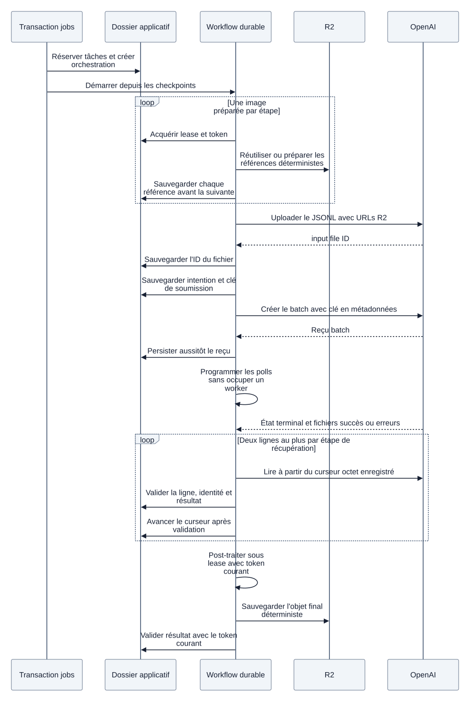

<details>
<summary>Source Mermaid modifiable</summary>

```mermaid
sequenceDiagram
    participant J as Transaction jobs
    participant D as Dossier applicatif
    participant W as Workflow durable
    participant R as R2
    participant O as OpenAI
    J->>D: Réserver tâches et créer orchestration
    J->>W: Démarrer depuis les checkpoints
    loop Une image préparée par étape
        W->>D: Acquérir lease et token
        W->>R: Réutiliser ou préparer les références déterministes
        W->>D: Sauvegarder chaque référence avant la suivante
    end
    W->>O: Uploader le JSONL avec URLs R2
    O-->>W: input file ID
    W->>D: Sauvegarder l'ID du fichier
    W->>D: Sauvegarder intention et clé de soumission
    W->>O: Créer le batch avec clé en métadonnées
    O-->>W: Reçu batch
    W->>D: Persister aussitôt le reçu
    W->>W: Programmer les polls sans occuper un worker
    O-->>W: État terminal et fichiers succès ou erreurs
    loop Deux lignes au plus par étape de récupération
        W->>O: Lire à partir du curseur octet enregistré
        W->>D: Valider la ligne, identité et résultat
        W->>D: Avancer le curseur après validation
    end
    W->>W: Post-traiter sous lease avec token courant
    W->>R: Sauvegarder l'objet final déterministe
    W->>D: Valider résultat avec le token courant
```

</details>
<!-- uml:uml-image-openai-durable:end -->

<!-- uml:uml-image-openai-uncertainty:start -->
<a id="uml-image-openai-uncertainty"></a>

**UML — OpenAI Batch : réponse perdue et réconciliation · Séquence · Fonctionnement actuel**

Une réponse perdue laisse une soumission incertaine, sans nouveau POST automatique. Une reprise opérateur interne distincte exige au moins 30 minutes, un scan complet et les contrôles décrits dans le texte.

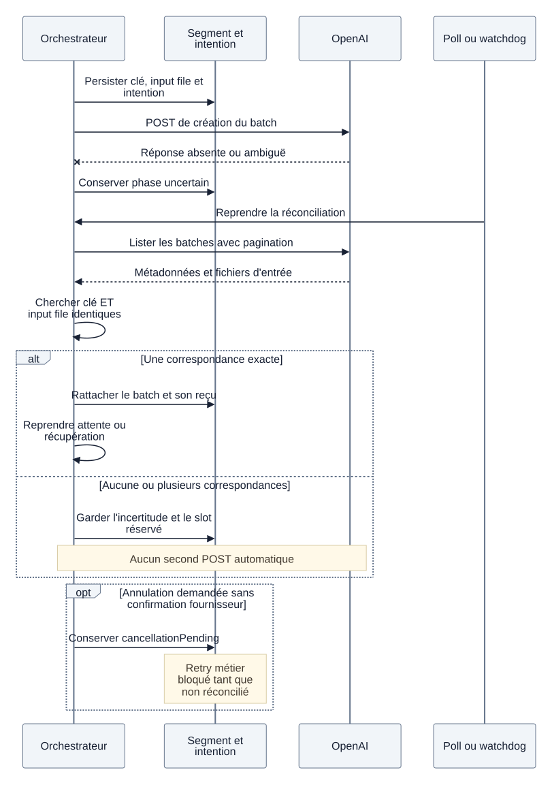

<details>
<summary>Source Mermaid modifiable</summary>

```mermaid
sequenceDiagram
    participant W as Orchestrateur
    participant D as Segment et intention
    participant O as OpenAI
    participant P as Poll ou watchdog
    W->>D: Persister clé, input file et intention
    W->>O: POST de création du batch
    O--xW: Réponse absente ou ambiguë
    W->>D: Conserver phase uncertain
    P->>W: Reprendre la réconciliation
    W->>O: Lister les batches avec pagination
    O-->>W: Métadonnées et fichiers d'entrée
    W->>W: Chercher clé ET input file identiques
    alt Une correspondance exacte
        W->>D: Rattacher le batch et son reçu
        W->>W: Reprendre attente ou récupération
    else Aucune ou plusieurs correspondances
        W->>D: Garder l'incertitude et le slot réservé
        Note over W,O: Aucun second POST automatique
    end
    opt Annulation demandée sans confirmation fournisseur
        W->>D: Conserver cancellationPending
        Note over D: Retry métier bloqué tant que non réconcilié
    end
```

</details>
<!-- uml:uml-image-openai-uncertainty:end -->

### États, review, régénération et historique

#### Machines d’état

| Objet | États persistés |
| --- | --- |
| Job génération | queued → running → completed / failed / cancelled ; retry possible des failed/cancelled avec contrôles fournisseur. |
| Image | queued → generating → postprocessing éventuel → generated → uploaded ; failed/canceled possibles. |
| Review image | pending → approved ou rejected ; décision modifiable sur image exploitable. |
| Génération produit | not_started, generating, complete, incomplete, failed, canceled. |
| Review produit | none, needs_review, partially_approved, approved, rejected. |
| Publication produit | not_ready, ready_to_push, partially_pushed, pushed. |
| Action primaire produit | generate, wait, review, push, fix_errors, done. |
| Segment batch | submitting, running, completed, failed, cancelled ; phases preparing, uploading, submitting, uncertain, waiting, recovering, completed, failed. |
| Publication de job | running, completed, completed_with_errors, failed. |

Les trois dimensions produit sont distinctes. Par exemple une génération complete peut être needs_review et not_ready ; un produit partiellement approuvé peut déjà avoir des images publiées. L’action primaire priorise attente, puis review, puis publication, puis résolution d’erreurs. Les compteurs produit/job sont matérialisés à chaque mutation ; la liste ne charge pas toutes les images pour les recalculer.

Un job termine failed dès qu’il a des tâches échouées, même si d’autres ont réussi. Ce n’est pas « zéro résultat ». Les compteurs d’exécution terminaux restent monotones lorsque des fichiers conservés sont supprimés ; une suppression ne réouvre pas un job terminé.

<!-- uml:uml-image-technical-states:start -->
<a id="uml-image-technical-states"></a>

**UML — Cycle de vie du job et reprise technique · États · Fonctionnement actuel**

Le préfixe J distingue les états du job dans le dessin. Un job failed peut conserver des images réussies. Une reprise OpenAI durable admissible repasse directement running ; les autres retries repassent queued.


<details>
<summary>Source Mermaid modifiable</summary>

```mermaid
stateDiagram-v2
  direction LR
  [*] --> J_queued
  J_queued --> J_running
  J_running --> J_completed: toutes les tâches réussies
  J_running --> J_failed: tâche échouée
  J_queued --> J_cancelled: annuler
  J_running --> J_cancelled: annuler
  J_failed --> J_queued: retry classique
  J_cancelled --> J_queued: retry classique
  J_failed --> J_running: retry durable
  J_cancelled --> J_running: retry durable
  note right of J_failed
    failed ne signifie pas zéro résultat.
    cancelled concerne le job.
  end note
```

</details>
<!-- uml:uml-image-technical-states:end -->

<!-- uml:uml-image-states:start -->
<a id="uml-image-states"></a>

**UML — Cycle technique d’une image générée · États · Fonctionnement actuel**

Le préfixe I distingue les états techniques de l’image dans le dessin. Ils sont indépendants de l’état de review pending/approved/rejected. Le statut canceled d’une image et cancelled d’un job utilisent deux orthographes différentes dans le code.


<details>
<summary>Source Mermaid modifiable</summary>

```mermaid
stateDiagram-v2
  [*] --> I_queued
  I_queued --> I_generating
  I_generating --> I_generated: sans post-traitement séparé
  I_generating --> I_postprocessing: post-traitement requis
  I_postprocessing --> I_generated
  I_generated --> I_uploaded: publication réussie
  I_generating --> I_failed: erreur
  I_postprocessing --> I_failed: erreur
  I_queued --> I_canceled: annulation
  I_generating --> I_canceled: annulation
  I_postprocessing --> I_canceled: annulation
  note right of I_canceled
    Les résultats generated et uploaded
    sont préservés lors des retries.
  end note
```

</details>
<!-- uml:uml-image-states:end -->

#### Contrôle visuel et publication depuis un job

`/jobs` affiche les jobs récents de la boutique, progression, succès/échecs/total, mode, moteur, review, coûts et date. Filtres par produit, état d’exécution, fournisseur, mode et review ; pagination ; historique normal/archivé. Le détail `/jobs/$jobId` propose progression, étape batch, segments, contexte technique, filtre review, approbation visible ou par produit, grille de produits et images, preview navigable, approbation/rejet, régénération avec correction, retouche, publication par produit ou globale, barre d’action fixe, Poll, Cancel, Retry, archive/restauration/suppression.

Review backend : uniquement image avec URL et état generated/uploaded dans la boutique autorisée ; conserve utilisateur et date ; refuse toute mutation pendant une publication `pushRunId`. Une image déjà publiée peut être rejetée localement : rejet n’efface pas immédiatement son média Shopify.

<!-- uml:uml-image-review:start -->
<a id="uml-image-review"></a>

**UML — Review : décision locale et résumés matérialisés · Séquence · Fonctionnement actuel**

Review, exécution et publication sont distincts. Rejeter localement une image déjà publiée ne supprime pas son média Shopify ; une réservation pushRunId bloque la mutation.

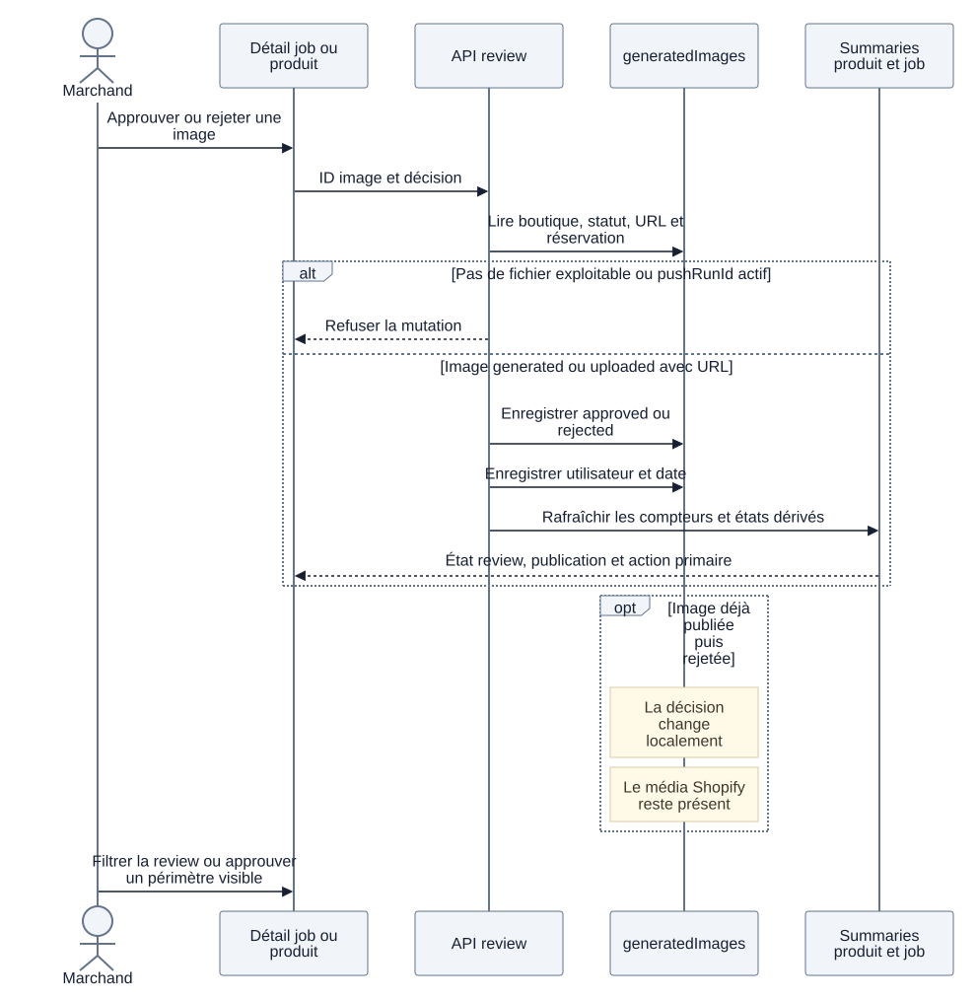

<details>
<summary>Source Mermaid modifiable</summary>

```mermaid
sequenceDiagram
    actor M as Marchand
    participant UI as Détail job ou produit
    participant B as API review
    participant I as generatedImages
    participant S as Summaries produit et job
    M->>UI: Approuver ou rejeter une image
    UI->>B: ID image et décision
    B->>I: Lire boutique, statut, URL et réservation
    alt Pas de fichier exploitable ou pushRunId actif
        B-->>UI: Refuser la mutation
    else Image generated ou uploaded avec URL
        B->>I: Enregistrer approved ou rejected
        B->>I: Enregistrer utilisateur et date
        B->>S: Rafraîchir les compteurs et états dérivés
        S-->>UI: État review, publication et action primaire
    end
    opt Image déjà publiée puis rejetée
        Note over I: La décision change localement
        Note over I: Le média Shopify reste présent
    end
    M->>UI: Filtrer la review ou approuver un périmètre visible
```

</details>
<!-- uml:uml-image-review:end -->

#### Régénération d’une image et reprise d’un bulk

Deux besoins différents :

- Régénérer une image terminée ou failed/canceled avec correction libre ≤2000 caractères. Le template courant est réévalué sur le snapshot de cible et les références enregistrées ; les anciennes images sans snapshot utilisent le produit/groupe courant. Moteur/modèle/mode initiaux restent prioritaires. Un job technique masqué produit la nouvelle image ; l’ancienne reste visible jusqu’au succès. Au succès, son slot existant est remplacé, repasse pending et perd l’association Shopify locale ; les anciens assets applicatifs sont nettoyés. Au failure, le slot initial conserve son résultat et affiche `retryError`. Une nouvelle tentative concurrente est empêchée ; un reçu obsolète ne peut remplacer le résultat d’une tentative plus récente.
- Retry d’un job failed/cancelled : seulement les tâches failed/canceled ; résultats générés/publiés gardés. Prompt préparé conservé ; reprise de résultats/intermédiaire si disponible. Les tâches concurrentes d’autres jobs ne sont superseded que pour la même clé produit + cible + type. Pas de reprise si soumission OpenAI incertaine, annulation non confirmée ou travail fournisseur toujours actif.

<!-- uml:uml-image-regeneration-retry:start -->
<a id="uml-image-regeneration-retry"></a>

**UML — Régénération d'un slot et retry d'un job · Séquence · Fonctionnement actuel**

La régénération remplace le slot seulement après succès, avec template courant et cible enregistrée. Le retry technique garde les prompts préparés et les résultats réussis ; les soumissions incertaines bloquent la reprise.

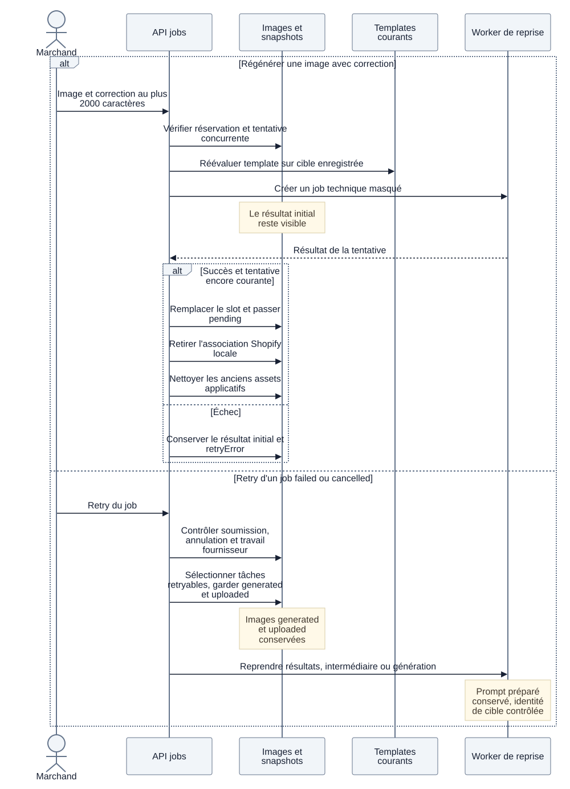

<details>
<summary>Source Mermaid modifiable</summary>

```mermaid
sequenceDiagram
    actor M as Marchand
    participant B as API jobs
    participant I as Images et snapshots
    participant T as Templates courants
    participant W as Worker de reprise
    alt Régénérer une image avec correction
        M->>B: Image et correction au plus 2000 caractères
        B->>I: Vérifier réservation et tentative concurrente
        B->>T: Réévaluer template sur cible enregistrée
        B->>W: Créer un job technique masqué
        Note over I: Le résultat initial reste visible
        W-->>B: Résultat de la tentative
        alt Succès et tentative encore courante
            B->>I: Remplacer le slot et passer pending
            B->>I: Retirer l'association Shopify locale
            B->>I: Nettoyer les anciens assets applicatifs
        else Échec
            B->>I: Conserver le résultat initial et retryError
        end
    else Retry d'un job failed ou cancelled
        M->>B: Retry du job
        B->>I: Contrôler soumission, annulation et travail fournisseur
        B->>I: Sélectionner tâches retryables, garder generated et uploaded
        Note over I: Images generated et uploaded conservées
        B->>W: Reprendre résultats, intermédiaire ou génération
        Note over W: Prompt préparé conservé, identité de cible contrôlée
    end
```

</details>
<!-- uml:uml-image-regeneration-retry:end -->

#### Historique et rétention

Archiver un job est réversible et ne stoppe pas sa génération. Restaurer le remet dans la vue courante. Supprimer de l’historique demande confirmation et masque définitivement le job dans l’interface et le détail public, mais garde son document interne, ses images, coûts, références et reçus ; les images restent utilisables depuis les produits. Un job actif ou possédant segments/soumissions/annulations incertains ne peut être supprimé.

Supprimer une image « partout » est une autre opération : efface son média Shopify s’il est identifié, les assets R2 applicatifs et la ligne locale, puis rafraîchit les summaries. Une suppression utilise le vrai produit destinataire, y compris dans une famille séparée.

Les images rejetées sont nettoyées après cinq jours par lots de 50, toutes les heures : assets R2 et record local, mais jamais le média du marchand sur Shopify. À distinguer de la suppression d’historique : la suppression d’une ligne image appelle un recalcul des summaries depuis les images restantes. Le code inspecté ne démontre donc pas une conservation complète de chaque dépense historique après cette purge ; un ledger comptable séparé est à prévoir si le nouveau produit doit afficher le cumul réellement facturé.

<!-- uml:uml-image-history-retention:start -->
<a id="uml-image-history-retention"></a>

**UML — Historique, purge rejetés et suppression partout · Séquence · Fonctionnement actuel**

Archiver, masquer un job et supprimer une image sont trois opérations différentes. La purge des rejetés supprime des assets applicatifs et la ligne, sans supprimer le média Shopify.

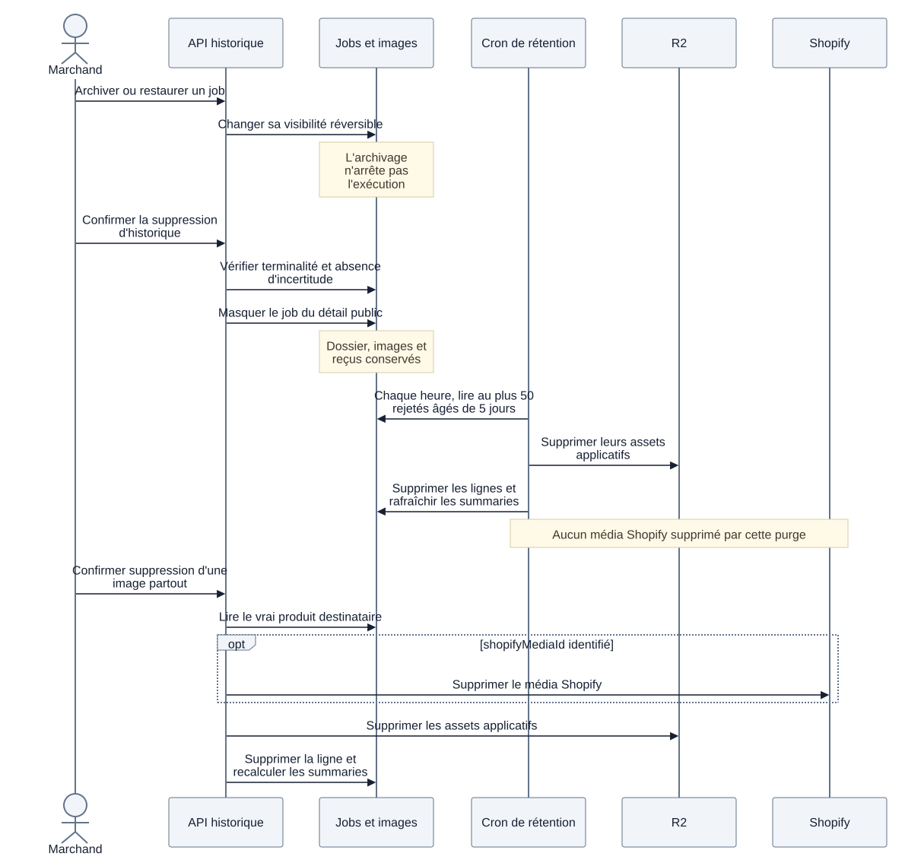

<details>
<summary>Source Mermaid modifiable</summary>

```mermaid
sequenceDiagram
    actor M as Marchand
    participant B as API historique
    participant D as Jobs et images
    participant C as Cron de rétention
    participant R as R2
    participant S as Shopify
    M->>B: Archiver ou restaurer un job
    B->>D: Changer sa visibilité réversible
    Note over D: L'archivage n'arrête pas l'exécution
    M->>B: Confirmer la suppression d'historique
    B->>D: Vérifier terminalité et absence d'incertitude
    B->>D: Masquer le job du détail public
    Note over D: Dossier, images et reçus conservés
    C->>D: Chaque heure, lire au plus 50 rejetés âgés de 5 jours
    C->>R: Supprimer leurs assets applicatifs
    C->>D: Supprimer les lignes et rafraîchir les summaries
    Note over C,S: Aucun média Shopify supprimé par cette purge
    M->>B: Confirmer suppression d'une image partout
    B->>D: Lire le vrai produit destinataire
    opt shopifyMediaId identifié
        B->>S: Supprimer le média Shopify
    end
    B->>R: Supprimer les assets applicatifs
    B->>D: Supprimer la ligne et recalculer les summaries
```

</details>
<!-- uml:uml-image-history-retention:end -->

### Retouche manuelle

L’éditeur intégré fonctionne côté navigateur sur Canvas : pinceau de couleur avec taille et opacité, pipette, main/pan, zoom, undo/redo (12 snapshots), rotation, miroir horizontal et vertical, rechargement de la source, barre d’outils déplaçable. Responsive ; pointer events et raccourcis B/I/H, espace temporaire main, Ctrl/Cmd Z/Y, zoom ±/0, crochets taille, chiffres opacité. Il s’agit d’une édition bitmap manuelle ; aucune fonctionnalité de retouche IA/inpainting n’a été trouvée dans ce parcours.

Le backend prépare une source pour contourner les limites de chargement/CORS du Canvas, stockage temporaire effacé après une heure ; fichier source et upload ≤15 MiB et type image.

Deux sauvegardes :

- Nouvelle version : nouvelle image generated/pending dans le même produit/job, lien `retouchSourceImageId`, original conservé, nouvelle approbation requise, coût IA non dupliqué.
- Écraser : modifie le slot et nettoie ses anciens assets. Si image non publiée, repasse pending. Si déjà publiée et avec média identifié, `fileUpdate` remplace le fichier Shopify en conservant l’ID, puis l’image reste uploaded/approved. C’est une écriture Shopify au moment de sauvegarder la retouche, à rendre claire dans l’UI.

L’identité produit/groupe/variante et le prompt de la source sont conservés. La retouche est interdite pendant une publication active. Le chemin de retouche Shopify est moins durable que le journal de publication moderne : ne pas lui attribuer automatiquement les mêmes garanties de reprise après perte de reçu.

<!-- uml:uml-image-retouch:start -->
<a id="uml-image-retouch"></a>

**UML — Retouche Canvas : copie ou écrasement · Séquence · Fonctionnement actuel**

L'édition est manuelle, sans inpainting. Sauver en écrasement une image publiée appelle Shopify fileUpdate immédiatement. Ce chemin n'a pas toutes les garanties du journal moderne de publication.

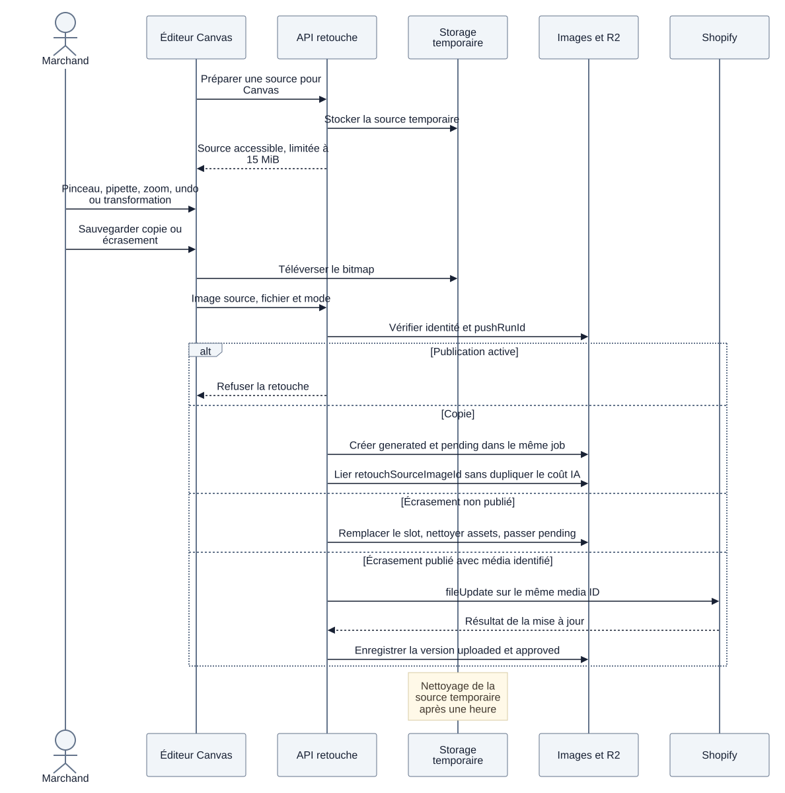

<details>
<summary>Source Mermaid modifiable</summary>

```mermaid
sequenceDiagram
    actor M as Marchand
    participant UI as Éditeur Canvas
    participant B as API retouche
    participant T as Storage temporaire
    participant I as Images et R2
    participant S as Shopify
    UI->>B: Préparer une source pour Canvas
    B->>T: Stocker la source temporaire
    B-->>UI: Source accessible, limitée à 15 MiB
    M->>UI: Pinceau, pipette, zoom, undo ou transformation
    M->>UI: Sauvegarder copie ou écrasement
    UI->>T: Téléverser le bitmap
    UI->>B: Image source, fichier et mode
    B->>I: Vérifier identité et pushRunId
    alt Publication active
        B-->>UI: Refuser la retouche
    else Copie
        B->>I: Créer generated et pending dans le même job
        B->>I: Lier retouchSourceImageId sans dupliquer le coût IA
    else Écrasement non publié
        B->>I: Remplacer le slot, nettoyer assets, passer pending
    else Écrasement publié avec média identifié
        B->>S: fileUpdate sur le même media ID
        S-->>B: Résultat de la mise à jour
        B->>I: Enregistrer la version uploaded et approved
    end
    Note over T: Nettoyage de la source temporaire après une heure
```

</details>
<!-- uml:uml-image-retouch:end -->

### Publication Shopify

#### Règles métier

La sélection doit posséder un fichier generated/uploaded et être approved. Publication dans l’ordre des templates ; types sans template vont à la fin. Defaults UI : ajouter à la galerie existante, remplacer les médias de variantes activé. Choisir « remplacer la galerie » oblige le remplacement des médias variante et supprime les anciens médias seulement après l’envoi et l’association des nouveaux.

Pour une cible variante/groupe ou assignAllVariants, le prompt en position n°1 est la photo primaire. Si le remplacement variante est demandé, exactement une image approuvée de ce prompt doit être sélectionnée pour chaque cible. Variantes supprimées et groupes incohérents sont rejetés avant création de médias. Sans remplacement des médias variante, celles déjà dotées d’un média sont conservées ; celles sans média peuvent recevoir le nouveau.

Le pipeline attend qu’un média soit READY avant association, jusqu’à 60 secondes avec backoff. Il marque chaque résultat uploaded avec `shopifyMediaId` et `publishedShopifyProductId`, puis resynchronise le produit pour actualiser la galerie.

<!-- uml:uml-image-publication-rules:start -->
<a id="uml-image-publication-rules"></a>

**UML — Publier et associer les images aux variantes · Séquence · Fonctionnement actuel**

La validation précède la création de médias. Le remplacement des médias variante exige une seule image du prompt n°1 par cible ; l'ancienne galerie n'est supprimée qu'après publication et association des nouvelles images.


<details>
<summary>Source Mermaid modifiable</summary>

```mermaid
sequenceDiagram
    actor M as Marchand
    participant B as Publication
    participant D as Images, templates et cibles
    participant S as Shopify
    M->>B: Sélection approuvée et options de remplacement
    B->>D: Vérifier generated ou uploaded avec URL
    B->>D: Trier selon l'ordre des templates
    B->>S: Vérifier existence des variantes destinataires
    B->>D: Vérifier appartenance des groupes et photo primaire
    alt Cible incohérente ou primaire ambiguë
        B-->>M: Refus avant création de média
    else Sélection admissible
        B->>S: Créer ou réutiliser les médias
        B->>S: Attendre média READY avec backoff
        B->>S: Associer la photo primaire aux variantes visées
        Note over B,S: Sans remplacement, conserver les médias déjà associés
        opt Remplacer la galerie
            B->>S: Supprimer les anciens médias après association
        end
        B->>D: Enregistrer uploaded, media ID et produit destinataire
        B->>S: Resynchroniser le produit
        S-->>D: Nouvelle galerie Shopify
    end
```

</details>
<!-- uml:uml-image-publication-rules:end -->

#### Publication en arrière-plan depuis un job

La sélection est figée par ID image + URL fichier, shop ID + domaine et options au lancement. Changer la boutique active ou retoucher ultérieurement ne doit pas changer l’opération capturée. Les images sont réservées via `pushRunId`, qui bloque review/retouche/suppression/régénération pendant l’envoi. Une seule publication running par job ; un double clic retourne la même opération.

Bornes : ≤1000 images, ≤500 produits et ≤250 images/produit. Workflow durable, processing produit par produit, pas de replay automatique des actions Shopify échouées. Le résultat persiste progression, nombre d’images publiées, produits réussis/échoués et messages. L’utilisateur peut quitter la page. Un échec de produit ne rend pas invalides ceux déjà publiés.

<!-- uml:uml-image-publication-background:start -->
<a id="uml-image-publication-background"></a>

**UML — Publication de job : snapshot, réservation et suivi · Séquence · Fonctionnement actuel**

La publication est indépendante de l'ouverture de la page. Le snapshot conserve les URLs et la boutique destination ; les images sont réservées pendant le run. Un double clic réutilise le run actif du job.


<details>
<summary>Source Mermaid modifiable</summary>

```mermaid
sequenceDiagram
    actor M as Marchand
    participant UI as Détail job
    participant B as Départ de publication
    participant D as Run et snapshot
    participant W as Workflow de publication
    participant S as Shopify
    M->>UI: Confirmer sélection et options
    UI->>B: Lancer pour le job
    alt Un run du job est déjà running
        B-->>UI: Retourner le run existant
    else Aucun run actif
        B->>D: Vérifier limites images et produits
        B->>D: Capturer IDs, URLs, shop ID, domaine et options
        B->>D: Réserver les images avec pushRunId
        B->>W: Démarrer le workflow durable
        B-->>UI: Identifiant du run
    end
    Note over UI: La page peut être fermée
    loop Un produit du snapshot à la fois
        W->>S: Publier ce produit
        W->>D: Sauvegarder réussite ou erreur et progression
    end
    W->>D: Terminer le run et libérer les réservations
    UI->>D: Lire progression et bilan lors du retour
```

</details>
<!-- uml:uml-image-publication-background:end -->

#### Idempotence et reçus externes

Lease par produit de 11 minutes, fingerprint de sélection et options ; journal d’intention par image + URL + produit destinataire avant création du média ; snapshot des IDs préexistants et identité attendue de l’alt ; IDs reçus persistés immédiatement. Une reprise réutilise les médias déjà publiés et recherche un nouveau média absent du snapshot correspondant à l’identité attendue. Zéro ou plusieurs matches bloquent une deuxième création, car l’absence de reçu n’établit pas un refus externe. Les retouches déjà mises à jour et images uploaded historiques encore présentes peuvent être adoptées.

Ce journal ne garantit pas rétroactivement la non-duplication des effets réalisés avant sa création. En future stack, distinguer une transaction locale d’un appel externe et utiliser outbox/intention, leasing, reconciliation et clé de tentative ; ne pas simplement déclarer un endpoint « idempotent » parce qu’il utilise un UUID local.

<!-- uml:uml-image-publication-receipts:start -->
<a id="uml-image-publication-receipts"></a>

**UML — Publication : intention, reçu et média retrouvé · Séquence · Fonctionnement actuel**

Une lease par produit et un fingerprint protègent le run. La recherche après perte de réponse doit trouver un seul nouveau média correspondant à l'alt attendu ; zéro ou plusieurs bloquent une nouvelle création.


<details>
<summary>Source Mermaid modifiable</summary>

```mermaid
sequenceDiagram
    participant B as Publication
    participant D as Journal applicatif
    participant S as Shopify
    B->>D: Acquérir lease produit et contrôler fingerprint
    B->>S: Lire les IDs médias préexistants
    S-->>B: Baseline des médias
    B->>D: Persister intention image, URL, cible, baseline et alt
    alt Un reçu ou média publié réutilisable existe
        D-->>B: media ID connu
    else Première création autorisée
        B->>S: Créer le média attendu
        alt Réponse reçue
            S-->>B: media ID
            B->>D: Persister immédiatement le reçu
        else Réponse perdue
            S--xB: Aucun reçu exploitable
            B->>S: Relire les médias du produit
            S-->>B: Médias courants
            B->>B: Chercher nouveau ID et alt attendu
            alt Une correspondance unique
                B->>D: Rattacher le média retrouvé
            else Zéro ou plusieurs correspondances
                B->>D: Conserver l'incertitude
                Note over B,S: Ne pas créer une deuxième fois
            end
        end
    end
```

</details>
<!-- uml:uml-image-publication-receipts:end -->

#### Produits séparés : compatibilité, pas nouvelle commande disponible

Le schéma et le backend contiennent des familles de produits séparés par groupe visuel. L’ancien parcours duplique un produit Shopify sans images, statut DRAFT, titre `titre — groupe`, conserve les variantes correspondant au groupe (par exemple tailles d’une couleur), supprime les autres variantes, publie les images du groupe et associe le prompt n°1 aux variantes restantes. Il conserve lien parent/groupe/produit membre et réutilise les produits déjà créés. Une duplication dont le reçu est perdu est incertaine et ne doit pas être répétée automatiquement.

Mais la configuration actuelle force `publishMode: variant_media` dans `singleProductConfig`, y compris les queries utilisées pour la publication, et l’UI ne propose pas d’activer une nouvelle séparation. Les familles déjà existantes restent prises en charge et leurs groupes continuent à publier vers leurs produits membres. Pour refaire l’application : conserver cette compatibilité si les données existantes sont migrées ; décider explicitement si réintroduire la séparation comme nouvelle feature. Ne pas l’inscrire comme un bouton actuellement accessible.

<!-- uml:uml-image-historical-families:start -->
<a id="uml-image-historical-families"></a>

**UML — Familles historiques : destination par groupe · Séquence · Compatibilité historique**

L'ancien backend de séparation subsiste et les familles déjà créées restent utilisables. La configuration actuelle impose variant_media ; l'UI ne permet pas de créer une nouvelle séparation.


<details>
<summary>Source Mermaid modifiable</summary>

```mermaid
sequenceDiagram
    participant P as Ancien parcours de séparation
    participant F as Famille et membres
    participant S as Shopify
    participant B as Publication de groupe
    P->>F: Chercher membre pour le produit et le groupe
    alt Membre déjà enregistré
        F-->>P: Produit Shopify destinataire
    else Ancien parcours de création
        P->>S: Dupliquer sans images en statut DRAFT
        alt Reçu de duplication reçu
            S-->>P: ID du nouveau produit
            P->>F: Enregistrer lien parent, groupe et membre
            P->>S: Garder les variantes du groupe et retirer les autres
        else Réponse perdue
            S--xP: Identité du produit incertaine
            Note over P,S: Ne pas répéter automatiquement la duplication
        end
    end
    opt Produit destinataire identifié
        P->>B: Publier les images du groupe vers ce membre
        B->>S: Associer le prompt n°1 aux variantes restantes
    end
    Note over F: La publication actuelle réutilise les membres existants
```

</details>
<!-- uml:uml-image-historical-families:end -->

### Transformations et réorganisation en masse

#### Miroir horizontal des fichiers Shopify

Depuis les produits sélectionnés, maximum 250 produits, le marchand choisit des positions d’images à appliquer à chaque produit (1–250), avec compte des produits possédant chaque position et miniatures d’exemple, puis lance une préparation. Les vidéos/autres médias ne sont pas transformés. L’inventaire live est contrôlé contre le snapshot de sélection ; images animées ignorées plutôt que perdre leurs frames. Sources ≤25 MiB. Un média partagé entre produits doit être dédupliqué et tous ses produits référents suivis.

Préparation : lire le fichier original Shopify, hash SHA-256, miroir horizontal Sharp, sortie WebP lossless, hash de sortie, sauvegarde de l’original et preview R2. Le marchand contrôle des previews avant publication explicite. La publication utilise `fileUpdate` sur le même media ID : identifiants, ordre et associations restent en place. Quatre workers publient des médias indépendants ; leases par média empêchent des doubles writes ; locks produits empêchent les bulks concurrents sur ces produits.

Vérification live : si hash actuel = source, l’écriture peut commencer ; si hash actuel = sortie, considérer déjà appliqué ; sinon conflict et ne pas écraser une modification indépendante. Le résultat Shopify n’est complet que si hash attendu et statuts fichier/média READY. Perte de reçu et acceptation ambiguë restent en recovery avec délai de stabilisation de 20 minutes. Les caches des produits référents sont actualisés avec un paramètre cache-busting basé sur le hash.

Rollback : lorsque les sauvegardes existent, remettre l’original uniquement si le média contient encore la sortie de cette opération ; déjà original = restauré ; autre modification = conflict. Un pointeur de dernière publication par média empêche qu’un ancien rollback défasse une opération ultérieure. Sauvegardes/previews conservées sept jours ; archiver/abandonner peut lancer leur nettoyage et rendre rollback/preview indisponibles. L’historique reste.

UI : préparation et progression, preview, liste d’erreurs/conflicts, publication avec confirmation, annulation, reprises ciblées transformation/publication/conflict, rollback avec confirmation, archivage/abandon. Il ne s’agit actuellement que de miroir horizontal bulk ; rotation/miroir vertical sont disponibles en retouche individuelle, pas comme opérations bulk.

États job : queued, transforming, ready, publishing, completed, partial, failed, cancelled. Items : queued, transforming, ready, publishing, published, skipped, transform_failed, publish_failed, conflict. Rollback : queued/running/completed/partial ; item queued/restoring/restored/failed/conflict.

<!-- uml:uml-image-bulk-mirror:start -->
<a id="uml-image-bulk-mirror"></a>

**UML — Miroir bulk : préparer, vérifier puis publier · Séquence · Fonctionnement actuel**

La préparation conserve l'original exact et une preview WebP lossless. La publication explicite remplace le même media ID ; le média partagé est traité une fois et ses produits référents sont suivis.


<details>
<summary>Source Mermaid modifiable</summary>

```mermaid
sequenceDiagram
    actor M as Marchand
    participant B as Bulk miroir
    participant S as Shopify
    participant R as R2
    participant D as Items, locks et leases
    M->>B: Choisir produits et positions, puis préparer
    B->>S: Vérifier inventaire live contre le snapshot
    B->>D: Verrouiller les produits et dédupliquer les médias
    Note over B: Ignorer médias non images et images animées
    B->>S: Lire l'original dans les limites prévues
    B->>B: Hash source puis miroir WebP lossless et hash sortie
    B->>R: Sauvegarder original et preview
    B->>D: Enregistrer item ready
    B-->>M: Préviews et bilan de préparation
    M->>B: Confirmer publication
    B->>D: Acquérir lease média
    B->>S: Lire hash et états live
    alt Hash courant égal à la source
        B->>S: fileUpdate avec la sortie sur le même media ID
        B->>S: Vérifier hash attendu et états READY
        B->>D: Enregistrer published et dernière publication
    else Hash courant égal à la sortie
        B->>D: Considérer déjà appliqué
    else Autre hash
        B->>D: Enregistrer conflict sans écriture
    end
    B->>D: Actualiser les caches de tous les produits référents
```

</details>
<!-- uml:uml-image-bulk-mirror:end -->

<!-- uml:uml-image-bulk-mirror-rollback:start -->
<a id="uml-image-bulk-mirror-rollback"></a>

**UML — Miroir bulk : restauration conditionnelle · Séquence · Fonctionnement actuel**

Un ancien rollback ne doit pas défaire une publication ultérieure. Sans sauvegarde conservée ou si une modification indépendante est détectée, la restauration ne remplace pas le fichier.


<details>
<summary>Source Mermaid modifiable</summary>

```mermaid
sequenceDiagram
    actor M as Marchand
    participant B as Rollback miroir
    participant D as Item et dernière publication
    participant R as Sauvegarde R2
    participant S as Shopify
    M->>B: Confirmer rollback
    B->>D: Contrôler disponibilité des assets et dernier run
    alt Sauvegarde absente ou publication ultérieure
        B-->>M: Restauration indisponible ou conflit
    else Restauration encore admissible
        B->>R: Lire l'original sauvegardé
        B->>S: Lire hash actuel sous lease
        alt Hash actuel égal à la sortie de cette opération
            B->>S: Remettre l'original sur le même media ID
            B->>S: Vérifier hash original et états READY
            B->>D: Enregistrer restored
        else Hash actuel égal à l'original
            B->>D: Enregistrer déjà restauré
        else Modification indépendante
            B->>D: Enregistrer conflict sans écriture
        end
        B->>D: Actualiser bilan et caches référents
    end
    Note over R: Rétention de 7 jours, nettoyage possible à l'archive
```

</details>
<!-- uml:uml-image-bulk-mirror-rollback:end -->

#### Permutation de deux positions

Maximum 200 produits ; choisir deux positions distinctes entre 1 et 100, par défaut l’UI utilise 1 ↔ 2. L’opération écrit l’ordre directement dans Shopify en tâche de fond. Un produit sans les deux positions est skipped ; produits absents, réservés et conflits sont comptés. Le worker capture la liste d’IDs dans l’ordre source et l’ordre cible (swap), submit le job de reorder Shopify, poll et vérifie la liste live.

Hash d’image inutile ici : l’invariant est la liste complète d’IDs dans le même ordre. Si liste actuelle = cible, ne pas refaire ; si = source, appliquer ; sinon conflict. Réessayer les erreurs/conflicts, annuler les éléments pas encore appliqués et restaurer l’ordre initial sont disponibles. Une restauration ne passe que depuis l’état attendu cible, ou considère déjà source comme restauré ; elle ne doit pas écraser des changements d’ordre indépendants. Locks produits partagés avec les transformations.

États job : queued, running, cancelling, completed, partial, failed, cancelled. Item : queued, running, completed, skipped, failed, conflict, cancelled. Restore job : queued/running/completed/partial ; restore item queued/running/restored/failed/conflict.

<!-- uml:uml-image-bulk-reorder-restore:start -->
<a id="uml-image-bulk-reorder-restore"></a>

**UML — Permutation bulk et restauration de l'ordre · Séquence · Fonctionnement actuel**

L'invariant est l'ordre complet des IDs médias, sans hash de fichier. La permutation conserve les médias hors images ; la restauration est refusée devant un ordre modifié indépendamment.


<details>
<summary>Source Mermaid modifiable</summary>

```mermaid
sequenceDiagram
    actor M as Marchand
    participant B as Bulk reorder
    participant D as Items, snapshots et locks
    participant S as Shopify
    M->>B: Choisir au plus 200 produits et deux positions distinctes
    B->>D: Réserver les produits avec les locks communs
    B->>S: Lire les médias live
    B->>D: Capturer ordre source et ordre cible
    Note over B: Positions 1 à 100, défaut 1 et 2, manque = skipped
    B->>S: Contrôler l'ordre live avant application
    alt Ordre courant égal à la source
        B->>S: Soumettre le reorder préservant les autres médias
            B->>S: Poll puis vérifier l'ordre cible
        B->>D: Enregistrer completed
    else Ordre courant égal à la cible
        B->>D: Considérer déjà appliqué
    else Autre ordre
        B->>D: Enregistrer conflict sans écriture
    end
    M->>B: Confirmer restauration
    B->>S: Relire l'ordre complet
    alt Ordre cible toujours présent
        B->>S: Soumettre source, poll et vérifier
        B->>D: Enregistrer restored
    else Ordre source déjà présent
        B->>D: Enregistrer déjà restauré
    else Ordre modifié indépendamment
        B->>D: Enregistrer conflit de restauration
    end
```

</details>
<!-- uml:uml-image-bulk-reorder-restore:end -->

#### Historique commun

`/bulk-operations` réunit miroir et reorder de la boutique active : type, statut, positions, nombre de produits, progression, réussites, skipped/failed/conflict, date, état de restauration, marque archivé et ouverture du suivi. Filtre Toutes/Réorganisation/Miroir ; pagination par curseur de 20 items ; cards mobile et tableau desktop. Le suivi est persistent et ne dépend pas d’un dialogue resté ouvert.

<!-- uml:uml-image-bulk-history:start -->
<a id="uml-image-bulk-history"></a>

**UML — Historique bulk : vue commune et suivi persistant · Séquence · Fonctionnement actuel**

La page réunit les deux familles d'opérations par boutique avec pagination de 20 items. Fermer le détail n'arrête pas le traitement ; les flags d'assets conditionnent preview, retry et restauration.


<details>
<summary>Source Mermaid modifiable</summary>

```mermaid
sequenceDiagram
    actor M as Marchand
    participant UI as Historique bulk
    participant B as API bulk operations
    participant T as Jobs miroir
    participant R as Jobs reorder
    M->>UI: Ouvrir historique et choisir un type
    UI->>B: Boutique, type et curseur
    B->>T: Lire le périmètre miroir demandé
    B->>R: Lire le périmètre reorder demandé
    B-->>UI: Page de 20 opérations et curseur suivant
    M->>UI: Ouvrir une opération
    UI->>B: Lire détail, progression et état de restauration
    B-->>UI: Items, erreurs, conflits et disponibilité des assets
    M->>UI: Fermer le détail
    Note over T,R: Le traitement continue depuis ses états persistés
    M->>UI: Revenir sur le suivi
    UI->>B: Relire l'état courant
```

</details>
<!-- uml:uml-image-bulk-history:end -->

### Coûts et observabilité

Les coûts génération sont estimés à partir des usage tokens réels quand ils sont disponibles. Le code différencie tokens texte/image en entrée OpenAI et sortie ; Gemini a un tarif unifié d’entrée et sortie. Table locale : GPT Image 5 USD/M tokens texte, 8 USD/M image input, 30 USD/M output ; Gemini 3 Pro Image 2/120 ; Gemini 3.1 Flash-Lite 0,25/1,5 ; Flash-Lite 0,1/0,4. Coefficient batch 0,5 codé. Le détourage a une estimation fixe codée de 0,01 USD par image, stockée séparément et additionnée dans la summary d’image. Modèle/usage inconnus peuvent afficher zéro : ce n’est pas une preuve d’appel gratuit.

La page jobs distingue génération realtime/batch, compte d’images tarifées, tokens, analyse vibe et total. Les archives et suppressions d’historique ne retirent pas la dépense. Attention : le total d’analyse montré est celui du champ vibe des produits ; l’analyse d’affectation des groupes conserve son propre coût en config et ne doit pas être supposée incluse dans ce total.

Ce dashboard est un suivi estimatif des images/états retenus, pas un rapprochement complet de facture : les régénérations remplacent les coûts du slot et certaines suppressions recalculent depuis les lignes restantes ; jobs techniques masqués et lignes intermédiaires ne constituent pas un ledger immuable. La refonte peut ajouter un journal séparé de tous les appels payants, reçus, usage et coûts, indépendant de la vie du fichier.

Journaux structurés `[gen:<scope>]` et IDs fournisseur permettent de remonter d’une image à requête/batch, prompt et groupe. Un système futur doit avoir métriques d’étapes, délais, files, erreurs, coûts incomplets, soumissions incertaines et reprises opérateur.

Watchdogs actuels : batches et postprocessing 15 min ; transformations et permutations bloquées 15 min ; purge rejected 1 h ; stale références OpenAI 12 h ; assets bulk expirés 1 h. Les jobs batch actifs planifient eux-mêmes leurs polls adaptatifs ; cron est le filet de récupération.

<!-- uml:uml-image-cost-observability:start -->
<a id="uml-image-cost-observability"></a>

**UML — Coûts : estimations par image et limites du total · Séquence · Fonctionnement actuel**

Les tarifs et le coefficient batch sont codés localement, sans certification des prix actuels. Les summaries suivent les lignes conservées ; elles ne constituent pas un ledger immuable de toute dépense.


<details>
<summary>Source Mermaid modifiable</summary>

```mermaid
sequenceDiagram
    participant A as Fournisseur IA
    participant P as Calcul tarifaire local
    participant I as Image et produit
    participant S as Summaries et dashboard
    A-->>P: Usage tokens et modèle si disponibles
    alt OpenAI
        P->>P: Distinguer input texte, input image et output
    else Gemini
        P->>P: Appliquer input et output unifiés
    end
    opt Mode batch
        P->>P: Appliquer le coefficient codé 0.5
    end
    P->>I: Enregistrer estimation de génération
    opt Détourage
        P->>I: Ajouter l'estimation fixe de détourage
    end
    opt Analyse vibe
        P->>I: Stocker coût et date sur le produit
    end
    I->>S: Rafraîchir compteurs, tokens et totaux
    Note over S: Usage inconnu peut afficher zéro sans prouver gratuité
    Note over S: Coût d'affectation visuelle non inclus dans vibe
    opt Régénération réussie ou purge d'une ligne
        I->>I: Remplacer le coût du slot ou supprimer la ligne
        I->>S: Recalculer depuis les lignes restantes
    end
    Note over S: Archive ou masque historique conserve le dossier
```

</details>
<!-- uml:uml-image-cost-observability:end -->

### Surface API métier (à convertir REST ou RPC)

| Domaine | Opérations publiques trouvées |
| --- | --- |
| Produits | `products.list`, `navigation`, `facets`, `get`, `getWithImages`, `byIds`. |
| Shopify catalogue/galerie | `shopify.syncProducts`, `syncProduct`, `reorderProductImages`, `pushProductImages`, `deleteImage`. |
| Génération/jobs | `jobs.preview`, `create`, `list`, `get`, `costSummary`, `reviewImages`, `regenerateImage`, `retry`, `setArchived`, `remove` ; `generation.pollJob`, `cancelJob` ; mutation locale `jobs.cancel` également présente. |
| Publication job | `jobImagePublishing.start`, `latest`. |
| Références/groupes | `visualGroups.getForProduct`, `configure`, `setGroupSwatch`, `assignReference`, `setPrimaryReference`, `reorderReferences`, `confirmReference`, `confirmGroupReferences`, `removeReference` ; `visualGroupAnalysis.analyze`. |
| Prompts | `prompts.list`, `master`, `updateMaster`, `create`, `update`, `setActive`, `setPreset`, `remove`, `reorder`, `generateModelReferenceUploadUrl`, `saveModelReference`, `removeModelReference`. |
| Retouche | `retouch.prepareRetouchSource`, `saveRetouchedImage` ; `jobs.generateRetouchUploadUrl`. |
| Settings | `settings.list`, `set`, `shopInfo`. |
| Transformations | `bulkTransforms.selectionOptions`, `productLocks`, `start`, `get`, `list`, `latestUndismissed`, `publish`, `rollback`, `retryFailures`, `cancel`, `dismiss`. |
| Permutation | `bulkReorders.start`, `get`, `latestUndismissed`, `retry`, `restore`, `cancel`, `dismiss`. |
| Historique bulk commun | `bulkOperations.list`, `hasUndismissed`. |

Les fonctions internes de checkpoints/leases/résultats ne sont pas endpoints utilisateur. Dans une architecture microservices, séparer API UI, worker génération, adaptateurs IA, traitement bitmap, publisher Shopify et planificateur est une option ; ce découpage est une proposition de reconstruction, pas la topologie actuelle (Convex + actions Node).

<a id="catalogues"></a>

## 6. Collecte, édition, export et import de catalogues

### Finalité métier

Le module permet de récupérer le catalogue public d'une boutique Shopify source, d'en comprendre la structure commerciale, de préparer les données dans un espace de travail éditable, puis de télécharger un export JSON ou de créer les objets correspondants dans une boutique Shopify de destination appartenant à l'utilisateur connecté.

La source est une URL de boutique publique ; elle ne demande pas les identifiants administrateur de la source. La destination est une boutique déjà connectée à l'application. Ce module conserve les produits, leurs variantes et images, les descriptions, les rubriques HTML complémentaires, les collections et la hiérarchie du menu relative aux collections. Il ne fournit pas les chiffres de vente : le rang est l'ordre public observé via le tri Shopify `best-selling` à une date donnée.

Deux périmètres sont proposés : tout le catalogue (`ALL`, choix initial de l'écran), ou les N meilleures ventes (`TOP_N`, N entier positif, champ initial à 25). Dans les deux modes, toutes les collections et la structure de menu pertinente restent conservées, même lorsque aucune fiche sélectionnée n'appartient à une collection. Le Top N est global à la boutique, pas N produits par collection.

L'IA intervient ici pour proposer un tag anglais distinct par collection. Elle ne décide pas seule des règles des collections et ne traduit pas les titres ou descriptions. La validation humaine des tags constitue une étape obligatoire avant la collecte des fiches et l'import Shopify.

### Concepts métier à reproduire

| Concept | Signification et responsabilité |
| --- | --- |
| Catalogue | Espace de travail appartenant à un utilisateur, lié à un domaine source, comprenant sélection, structure, fiches, corrections, compteurs, opérations et version. |
| Produit source | Identité observée sur la boutique source, initialement repérée par handle/URL puis consolidée par identifiant Shopify source. |
| Fiche sélectionnée | Produit effectivement collecté et affiché ; tous les produits repérés ne sont pas nécessairement sélectionnés en Top N. |
| Ligne URL seule | Référence légère qui permet de connaître toutes les appartenances sans télécharger les fiches hors sélection. |
| Alias de produit | Autre handle menant à une identité source déjà connue ; petite référence vers la fiche canonique, sans double comptage. |
| Rang | Position globale dans le classement public des meilleures ventes ; rang inconnu explicite lorsque le classement est incomplet. |
| Collection | Collection source, avec identité, contenu descriptif, image, un tag proposé/validé, appartenances vérifiées et nombre source/nombre sélectionné. |
| Collection hors menu | Collection trouvée dans les sitemaps mais absente du menu retenu ; elle est conservée et identifiable dans l'interface. |
| Groupe de traitement | Une collection de rattachement technique par produit, ou `~none` ; il organise les workers sans modifier les appartenances multiples métier. |
| Menu | Arbre de rubriques vers les collections, avec parents structurels éventuels ; pages, produits et destinations externes sont retirés de ce menu importé. |
| Tag hérité | Tag d'une collection validée auquel le produit appartient ; sert à reconstruire les collections automatiques dans Shopify. |
| Correction manuelle | Valeur séparée de la donnée source : titre, tags, exclusion de l'import ; elle survit aux reprises et ne réécrit pas le JSON original. |
| Valeur effective | Résolution partagée de source + collections validées + correction manuelle, utilisée par lecture, export et import. |
| Version | Révision des données métier, nécessaire aux contrôles de concurrence et à l'invalidation d'export. |
| Génération | Époque d'un travail ; changer de génération invalide les écritures des anciens workers. |
| Bail | Jeton et date d'expiration accordant temporairement le droit à un worker de traiter le catalogue. |
| Export | Document final privé correspondant à une version figée, jamais source de l'édition courante. |
| Import | Opération vers une destination, avec version figée, correspondances objets source/destination et vérification finale. |
| Soumission incertaine | Appel Shopify dont la réponse a été perdue ; exige une réconciliation plutôt qu'une nouvelle création aveugle. |

### Écrans et interactions

#### Accueil `/catalog-import`

- Saisie de l'URL publique de la boutique source.
- Choix « Tout le catalogue » / « Les meilleures ventes » avec N entier positif.
- Bouton « Analyser la boutique » : création du catalogue et démarrage de découverte asynchrone, puis navigation vers l'espace de travail.
- Erreur de lancement affichée ; état occupé du formulaire.
- Historique des 50 catalogues les plus récents du propriétaire : domaine source, mode/Top N, nombre de fiches réussies/total, état et dernière mise à jour.
- États visibles : En cours, Tags à valider, Disponible, Partiel, À relancer.

<!-- uml:uml-catalogue-creation:start -->
<a id="uml-catalogue-creation"></a>

**UML — création et périmètre de collecte · Séquence · Fonctionnement actuel**

Le code utilise ALL pour le catalogue entier et TOP_N pour les N meilleures ventes globales. La découverte continue côté serveur après fermeture de la page.


<details>
<summary>Source Mermaid modifiable</summary>

```mermaid
sequenceDiagram
  actor U as Utilisateur
  participant UI as Accueil catalogue
  participant API as API authentifiée
  participant DB as catalogues
  participant W as Worker durable
  U->>UI: URL publique et mode
  alt Mode ALL
    UI->>API: create(url, ALL)
  else Mode TOP_N
    UI->>API: create(url, TOP_N, N)
    API->>API: Vérifier entier N strictement positif
  end
  API->>API: Vérifier propriétaire et origine HTTPS
  API->>DB: Insérer working, phase menu, génération 1
  API->>W: Planifier découverte
  API-->>UI: Identifiant catalogue
  UI-->>U: Ouvrir espace de travail
  W->>DB: Sauvegarder phases et progression
  Note over UI,W: Fermer la page ne stoppe pas le worker
  UI->>API: Lire les 50 catalogues du propriétaire
  API-->>UI: Mode, état, compteurs et date
```

</details>
<!-- uml:uml-catalogue-creation:end -->

#### Espace `/catalog-import/$exportId`

- Retour vers tous les catalogues ; titre domaine, mode et nombre de produits ajoutés après la sélection initiale.
- Bandeau de phase, nom de collection en cours de collecte, compteurs réussites/échecs, erreurs et avertissements.
- L'opération continue lorsque la page est fermée ; la réouverture reprend l'observation de son état.
- Bouton de reprise de l'étape en échec ; bouton de relance des fiches en échec et accès rapide au filtre correspondant.
- Exporter JSON, régénérer après modification ou télécharger lorsque la version exportée est encore courante.
- Préparer l'import Shopify, désactivé tant que les tags ne sont pas validés ou qu'une opération verrouille le catalogue.
- Bilan du dernier import : boutique destination, réussites, créations, produits existants, échecs et fiches non importées ; résultat détaillé sur chaque produit.
- Trois vues : Produits, Collections, Menu. Une vue de validation/correction des tags peut être ouverte avant collecte ou ultérieurement depuis les collections.

<!-- uml:uml-catalogue-confirmations:start -->
<a id="uml-catalogue-confirmations"></a>

**UML — suivi de l’espace et confirmations de sortie · Séquence · Fonctionnement actuel**

L’espace observe les phases, compteurs, erreurs et le dernier bilan par abonnements. L’acceptation partielle ne rend pas les fiches incomplètes importables ; une destination est obligatoire pour Shopify.


<details>
<summary>Source Mermaid modifiable</summary>

```mermaid
sequenceDiagram
  actor U as Utilisateur
  participant UI as Confirmation
  participant API as API catalogue
  participant DB as Base
  UI->>API: Abonnement catalogue et dernier import
  API-->>UI: Phase, compteurs, erreurs et résultat
  U->>UI: Exporter ou préparer import
  UI->>UI: Calculer erreurs, manques et avertissements
  opt Catalogue partiel
    UI-->>U: Demander acceptation explicite
    U->>UI: Accepter le caractère partiel
  end
  alt Export JSON
    UI->>API: exportJson(id, allowPartial)
    API->>DB: Vérifier propriétaire et disponibilité
    API->>API: Refuser si partiel non accepté
    API->>DB: Lancer génération de l'export
  else Import Shopify
    U->>UI: Choisir boutique destination
    UI-->>U: Récapitulatif, brouillons et exclusions
    UI->>API: startImport(id, shopId, version, allowPartial)
    API->>DB: Vérifier propriétaire, version et tags
    API->>API: Refuser si partiel non accepté
    API->>DB: Vérifier destination sans autre import ouvert
    API->>DB: Figer version et lancer import
  end
```

</details>
<!-- uml:uml-catalogue-confirmations:end -->

#### Validation des tags

- Toutes les collections sont listées avec titre source, tag anglais éditable, nombre sélectionné/nombre source et présence dans le menu.
- Recherche de collection par sous-chaîne de titre, insensible à la casse.
- L'IA peut reproposer les tags des collections non modifiées et non validées seulement.
- Une correction marque la collection comme modifiée et invalide sa précédente validation.
- Le système refuse les tags vides, les collisions entre collections, les caractères autres que minuscules ASCII/chiffres/espace/tiret et les tags de plus de 100 caractères. Le contrat métier demande l'anglais, mais la validation syntaxique seule ne reconnaît pas la langue de manière sémantique.
- Les corrections peuvent être enregistrées sans valider ni collecter.
- « Valider les X tags et collecter » valide explicitement et démarre la collecte ; aucune proposition IA ne vaut validation.
- L'absence de Gemini ou une réponse IA invalide laisse la saisie manuelle disponible.

<!-- uml:uml-catalogue-tags:start -->
<a id="uml-catalogue-tags"></a>

**UML — propositions IA et validation des tags · Séquence · Fonctionnement actuel**

Gemini propose ; la validation humaine reste obligatoire. Le serveur vérifie syntaxe et unicité, mais ne démontre pas sémantiquement que chaque mot est anglais.


<details>
<summary>Source Mermaid modifiable</summary>

```mermaid
sequenceDiagram
  actor U as Utilisateur
  participant UI as Éditeur de tags
  participant API as API catalogue
  participant AI as Gemini
  participant DB as catalogues
  UI->>API: suggestTags(id)
  API->>AI: Collections non modifiées et non validées
  AI-->>API: Propositions de tags anglais
  API-->>UI: Propositions de tags
  alt IA indisponible
    UI-->>U: Saisie manuelle disponible
  end
  U->>UI: Corriger un tag
  UI->>UI: edited=true et validated=false
  U->>UI: Enregistrer ou valider et collecter
  UI->>API: saveTags(version, valeurs, validate, collect)
  API->>DB: Vérifier propriétaire, disponibilité et version
  alt Validation demandée et tag invalide ou collision
    API-->>UI: Refuser la validation
  else Valeurs acceptables
    API->>DB: Enregistrer, incrémenter version
    opt Validation explicite
      API->>DB: Marquer les tags validés
    end
    opt Collecte demandée et tous les tags validés
      API->>DB: Lancer travail collect
    end
  end
```

</details>
<!-- uml:uml-catalogue-tags:end -->

#### Liste produits et inspecteur

- La liste porte sur les produits sélectionnés, jamais toutes les lignes légères d'appartenances.
- Recherche exacte de sous-chaîne dans le titre effectif insensible à la casse ; pas de recherche sémantique, de stemming ou de synonymes.
- Filtres collection, Sans collection, et états Complètes/À relancer/À récupérer.
- Tris meilleures ventes/rang, nom et état.
- Pages affichées de 25 correspondances ; poursuite automatique de plusieurs lots bornés lorsque les filtres sont rares. Une correspondance de prélecture indique si une page suivante existe ; ne pas arrêter au premier lot contenant seulement quelques résultats.
- Ligne avec rang, image/titre, tags et état de collecte ; clic ouvre la fiche. Précédent/Suivant dans la page courante, fermeture, Échap et retour du focus.
- Sur grand écran, inspecteur à côté de la liste ; sur petit écran, fiche pleine largeur. Les onglets restent défilables dans leur zone.
- Fiche : lien vers source, statut JSON/HTML, collections et tags, description HTML nettoyée, variantes (titre/prix/devise/SKU), rubriques complémentaires et warnings.
- La rubrique `Produktdetails` est ouverte par défaut lorsqu'elle existe ; le module est plus général que cette fixture allemande et peut extraire d'autres accordéons.
- Volet sources : JSON intact affiché/copiable, date de collecte, langue source lorsqu'elle existe, date d'observation du classement et rappel qu'aucun chiffre de vente n'est fourni.
- Résultat d'import : créé en brouillon, existant retrouvé, vérification en cours ou erreur.
- Correction possible hors travail actif : titre, tags manuels séparés par virgule, exclusion de l'import Shopify. Action de retour aux valeurs source.
- Les tags manuels remplacent tous les tags hérités pour la fiche, ils ne s'y ajoutent pas. Un tableau manuel vide signifie donc aucun tag hérité effectif.

<!-- uml:uml-catalogue-liste-inspecteur:start -->
<a id="uml-catalogue-liste-inspecteur"></a>

**UML — pagination des correspondances et inspecteur · Séquence · Fonctionnement actuel**

Une page visible contient jusqu’à 25 correspondances, assemblées sur plusieurs lots bornés ; un lot non vide ne suffit pas à terminer la page. Le détail complet est lu seulement à l’ouverture de la fiche.


<details>
<summary>Source Mermaid modifiable</summary>

```mermaid
sequenceDiagram
  actor U as Utilisateur
  participant UI as Liste et inspecteur
  participant API as products et product
  participant DB as produits sélectionnés
  U->>UI: Recherche, collection, état ou tri
  UI->>UI: Réinitialiser pages et sélection
  loop Jusqu'à 25 correspondances et une prélecture, ou fin
    UI->>API: products(filtres, tri, curseur)
    API->>DB: Lire lot borné à 50 lignes et 2 Mo
    API->>API: Filtrer titre par sous-chaîne exacte
    API->>API: Filtrer collection et état
    API-->>UI: Lignes légères, curseur et métadonnées
    UI->>UI: Accumuler même si le lot est peu rempli
  end
  UI-->>U: Page de 25 résultats et navigation
  U->>UI: Ouvrir une fiche
  UI->>API: product(catalogueId, productId)
  API->>DB: Vérifier propriétaire et sélection
  API-->>UI: Fiche effective, source, corrections, résultat distant
  UI-->>U: Inspecteur et JSON original
  U->>UI: Échap ou fermer
  UI->>UI: Retour du focus à la ligne
  Note over UI,API: Les abonnements conservent les lots réactifs
```

</details>
<!-- uml:uml-catalogue-liste-inspecteur:end -->

#### Collections et menu

- Vue collections : toutes, vides dans le catalogue, hors menu ou appartenances en échec ; affichage collection, tag, sélection/source, menu et état.
- Le compteur sélectionné ouvre la liste des produits correspondants. Une collection vide reste visible et sera créée dans Shopify.
- « Ajouter les produits manquants » ouvre une confirmation et sélectionne/collecte les produits non présents de cette collection, sans doublon. Le catalogue Top N peut dès lors dépasser N ; les réussites déjà collectées sont conservées.
- Vue menu : arbre dépliable avec lien vers les produits d'une collection et libellé « Regroupement » pour parent sans collection directe.
- Liste distincte des collections hors menu, ouvrant leur filtre de produits.
- Aucun éditeur arbitraire de hiérarchie de menu ni de contenu de collection n'est exposé dans ce composant courant ; les tags sont éditables.

<!-- uml:uml-catalogue-collections-menu:start -->
<a id="uml-catalogue-collections-menu"></a>

**UML — collections, menu et ajout hors Top N · Séquence · Fonctionnement actuel**

Les collections vides et hors menu sont conservées. L’ajout d’une collection étend la sélection initiale sans doublon et peut dépasser N.


<details>
<summary>Source Mermaid modifiable</summary>

```mermaid
sequenceDiagram
  actor U as Utilisateur
  participant UI as Collections et menu
  participant API as API catalogue
  participant W as Worker add
  participant S as Boutique source
  participant DB as catalogues et produits
  UI-->>U: Arbre menu et collections hors menu
  U->>UI: Ouvrir les produits d'une collection
  UI->>UI: Appliquer le filtre de collection
  U->>UI: Ajouter les produits manquants
  UI-->>U: Confirmation et dépassement possible de N
  U->>API: addCollection(id, key)
  API->>DB: Vérifier disponibilité et tags validés
  API->>W: Nouvelle génération, phase members
  W->>S: Pages publiques de la collection
  W->>DB: Fusionner appartenances et sélectionner manquants
  W->>S: Reprendre le classement global
  W->>DB: Mettre à jour rangs sans doublons
  W->>S: Collecter les fiches encore pending
  W->>DB: Conserver les fiches déjà réussies
  DB-->>UI: Nouveaux compteurs et état final
  Note over UI,DB: Une collection sans sélection reste conservée
```

</details>
<!-- uml:uml-catalogue-collections-menu:end -->

#### Confirmations export/import

- Un catalogue est partiel dès qu'il contient échecs, fiches manquantes, warnings de structure ou appartenances non vérifiées. L'utilisateur doit accepter explicitement ce caractère partiel avant export/import.
- Confirmation export : compte des fiches incomplètes et warnings ; le JSON conserve ce qui est disponible ainsi que les erreurs/manques.
- Confirmation import : choix obligatoire d'une boutique du propriétaire, recap produits/collections, exclusions, créations en brouillon, conservation des tags marchands existants, menu séparé non affecté au thème, absence de publication automatique.
- Les fiches incomplètes sont exclues de l'import, même si un export partiel peut les contenir.
- Un lien de l'ancien moteur n'est pas converti : écran « Catalogue indisponible », retour à liste et Réessayer.

<!-- uml:uml-renvoi-catalogue-confirmations:start -->
Schéma UML associé : [suivi et confirmations export/import](#uml-catalogue-confirmations).
<!-- uml:uml-renvoi-catalogue-confirmations:end -->

### Workflow source, du début à la fiche

1. Normaliser l'entrée en origine HTTPS, sans identifiants, sans port personnalisé, avec domaine public ; les chemins de l'URL initiale ne deviennent pas une restriction du catalogue.
2. Lire la page d'accueil et extraire le meilleur arbre de navigation disponible en évitant les doublons desktop/mobile. Reconnaître Shopify et conserver seulement les collections du même domaine et les parents structurels nécessaires.
3. Parcourir `sitemap.xml`, ses sitemaps produits/collections et leurs URL par tranches. Repérer les produits et toutes les collections, y compris hors menu. Une collection du menu absente du sitemap est ajoutée avec warning.
4. Lire `/collections/all?sort_by=best-selling`, suivre la pagination, dédupliquer les handles et attribuer les rangs globaux. En ALL, tous les produits source sont sélectionnés ; en TOP_N, sélectionner les N premiers produits distincts et suspendre le reste du classement si N est atteint.
5. Parcourir les pages publiques de toutes les collections pour reconstruire toutes les appartenances. En TOP_N, les produits hors sélection restent des lignes légères sans téléchargement de fiche. Extraire titre, description et image de collection.
6. Proposer les tags IA et s'arrêter à la validation humaine. L'échec IA n'empêche pas la saisie manuelle.
7. Après validation, traiter les collections successivement puis le groupe Sans collection. Chaque produit appartient à plusieurs collections mais un groupe de travail canonique évite de collecter plusieurs fois la même fiche.
8. Lire la source produit `.json` et la page HTML. Le JSON fournit notamment variantes/images/options/description ; le HTML apporte rubriques complémentaires, devise, langue et SEO. Les deux sources sont obligatoires pour déclarer la fiche complète et pour importer.
9. Essayer jusqu'à trois fois les fiches incomplètes. Conserver les réussites et le JSON intact déjà exploitable ; une relance ciblée remet les fiches échouées en attente. Un JSON syntaxiquement valide mais structurellement incomplet doit être téléchargé de nouveau.
10. Consolider l'identité source réelle. Deux handles correspondant au même identifiant source fusionnent appartenances, corrections et meilleur rang ; l'autre ligne devient alias non sélectionné. Des corrections divergentes bloquent une fusion ambiguë. En Top N, remplacer l'alias dédupliqué par le produit distinct suivant, quitte à reprendre les pages de classement différées.
11. Passer à Disponible ou Partiel ; permettre inspection, corrections, extension par collection, export/import.

Anomalies explicites : sitemap XML invalide/hors source, classement indisponible ou incomplet, page de classement/collection répétée, pagination invalide, grille de collection non reconnue ou vide sans indication explicite, produit trouvé hors sitemap, nombre distinct inférieur à N, collection du menu absente du sitemap, HTML sans h1, absence de rubrique reconnue, devise inconnue et erreur réseau. Le classement indisponible ne doit pas être silencieusement remplacé par l'ordre du sitemap.

<!-- uml:uml-catalogue-decouverte:start -->
<a id="uml-catalogue-decouverte"></a>

**UML — découverte, rang global et identités distinctes · Séquence · Fonctionnement actuel**

La sélection Top N utilise le classement public global, jamais l’ordre du sitemap. Les appartenances hors sélection sont recensées sans télécharger leurs fiches. La consolidation des identités source intervient après collecte JSON/HTML.


<details>
<summary>Source Mermaid modifiable</summary>

```mermaid
sequenceDiagram
  participant W as Worker catalogue
  participant S as Boutique source publique
  participant DB as catalogues et produits
  W->>S: Lire accueil et menu
  W->>DB: Conserver collections et parents structurels
  W->>S: Lire sitemap et sous-sitemaps
  W->>DB: Recenser URL produits et toutes collections
  loop Pages de meilleures ventes globales
    W->>S: collections/all tri best-selling
    W->>DB: Dédupliquer handles et attribuer rangs
    alt ALL
      W->>DB: Sélectionner tous les produits repérés
    else TOP_N
      W->>DB: Sélectionner N premières fiches candidates
    end
  end
  loop Toutes les collections
    W->>S: Lire pages d'appartenances
    W->>DB: Fusionner membres, y compris non sélectionnés
  end
  Note over W,DB: Pause pour validation des tags
  W->>S: Collecter JSON et HTML des fiches sélectionnées
  opt Plusieurs handles pour la même identité
    W->>DB: Fusionner fiche et appartenances, créer alias
    W->>DB: Réduire compteurs sans double comptage
    opt TOP_N devenu inférieur à N
      W->>S: Reprendre classement différé si nécessaire
      W->>DB: Sélectionner le produit distinct suivant
    end
  end
```

</details>
<!-- uml:uml-catalogue-decouverte:end -->

<!-- uml:uml-catalogue-collecte:start -->
<a id="uml-catalogue-collecte"></a>

**UML — collecte JSON et HTML avec reprises ciblées · Séquence · Fonctionnement actuel**

Chaque fiche requiert JSON valide et HTML interprétable. Le JSON intact exploitable est réutilisé après échec HTML ; les fiches réussies ne sont pas recollectées lors d’une relance ciblée.


<details>
<summary>Source Mermaid modifiable</summary>

```mermaid
sequenceDiagram
  participant W as Worker collecte
  participant DB as produits
  participant S as Source publique
  participant E as Extracteurs purs
  loop Groupes collections puis Sans collection
    W->>DB: Lire page de fiches sélectionnées
    loop Fiches pending seulement
      W->>DB: Lire éventuel JSON source déjà valide
      par JSON manquant ou structure invalide
        W->>S: GET produit.json
      and Compléments HTML
        W->>S: GET page produit
      end
      W->>E: JSON, HTML et erreurs réseau
      E-->>W: Fiche normalisée et états JSON/HTML
      W->>DB: Conserver JSON intact et fiche disponible
      alt JSON et HTML complets, aucune erreur
        W->>DB: state complete
      else Moins de trois tentatives
        W->>DB: state pending et nouvelle passe
      else Trois tentatives atteintes
        W->>DB: state failed avec erreur
      end
    end
  end
  Note over W,DB: Les fiches complete restent conservées
  opt Relance utilisateur
    W->>DB: Remettre uniquement les failed en pending
  end
```

</details>
<!-- uml:uml-catalogue-collecte:end -->

### Données et relations

Le moteur courant emploie deux tables métier. Le choix physique peut changer à la reconstruction, mais les responsabilités et invariants doivent subsister.

**Catalogue** : propriétaire (`users`), origine, mode/N, état, phase, structure sérialisée, travail courant sérialisé, version, génération, jeton/date de bail, erreur, travail de reprise éventuel, compteurs total/réussites/échecs/source/sélection initiale, version/clé du dernier export, dernier import, dates création/mise à jour/classement. Index par propriétaire, état, origine+état.

**Structure** : arbre du menu, tableaux de collections, warnings et éventuelle continuation de classement. Une collection stocke key/URL/titre/description/image, tag, validation, modification manuelle, hors-menu, état d'appartenances (`pending`, `complete`, `failed`), nombre source/sélectionné et erreur. Le modèle accepte aussi certaines références destination optionnelles ; le worker actif conserve surtout les mappings dans le travail d'import.

**Produit** : catalogue, identité, handle/URL, sélection, clés des collections, groupe, rang, titre effectif et titre normalisé pour recherche/tri, état (`pending`, `complete`, `failed`), nombre de tentatives, JSON source intact en chaîne, fiche normalisée sérialisée, corrections séparées, erreur, dernier résultat distant, présence sitemap, alias vers fiche canonique. Index catalogue+handle, catalogue+identité, catalogue+sélection+rang/titre/état/groupe.

**Fiche normalisée** : identifiant/key et sourceId, handle/URL, titre, description HTML nettoyée, langue source éventuelle, vendor, productType, tags source bruts, options avec valeurs, variantes avec id/titre/SKU/prix/devise/prix barré/options/poids/unité/imageId, images avec id/URL/alt/position, sections titre+HTML, SEO titre/description/canonique, collections, états JSON/HTML, erreurs/warnings et date de lecture.

**Correction** : titre optionnel, tableau tags optionnel, excluded optionnel, reviewed optionnel. `reviewed` existe dans le contrat backend/résolveur mais aucun contrôle d'interface courant n'en fait un workflow de validation ; ne pas le présenter comme une revue complète existante.

**Travail durable** : kind (`discover`, `collect`, `add`, `export`, `import`), phase, URL/maps/visited/offset/collection/cursor/rank/fingerprint, ajout/replenishment, génération, tentatives/retryAt, cadence source, destination/devise/version d'import, mappings, bulk token/ids/date/id/offset de résultats, multipart upload id/parts/compteur, compteurs de bilan, acceptation partielle et marqueur de nouvelle passe. Il contient les points de reprise nécessaires sans table tâche/snapshot/lot séparée.

**Résultat distant par produit** : boutique, état (`pending`, `uncertain`, `verifying`, `complete`, `failed`), id/handle destination, erreur, créé ou existant, date de départ, version de catalogue. Les états les plus réellement utilisés par le worker sont verifying/complete/failed ; l'incertitude de bulk est également persistée au niveau du travail.

**Résolution effective** : titre manuel sinon titre source ; tags manuels lorsqu'ils sont définis sinon tags de toutes les collections validées du produit ; tri/déduplication/normalisation NFC des tags ; exclusion et reviewed faux par défaut. Les `sourceTags` originaux sont conservés comme provenance, ils ne sont pas automatiquement les tags d'import. Cette résolution est commune à la fiche UI, au JSON final et au payload Shopify.

<!-- uml:uml-catalogue-corrections:start -->
<a id="uml-catalogue-corrections"></a>

**UML — édition, version et valeurs effectives · Séquence · Fonctionnement actuel**

La source reste distincte de la correction. Le même résolveur sert à l’interface, à l’export et à Shopify ; un tableau manuel vide remplace également les tags hérités.


<details>
<summary>Source Mermaid modifiable</summary>

```mermaid
sequenceDiagram
  actor U as Utilisateur
  participant UI as Inspecteur
  participant API as saveProduct
  participant DB as Base transactionnelle
  participant E as Résolveur effective
  U->>UI: Modifier titre, tags ou exclusion
  UI->>API: override et version attendue
  API->>DB: Vérifier propriétaire et verrouillage
  alt Version devenue obsolète
    API-->>UI: Refuser et demander de relire
  else Version courante
    API->>API: Valider titre, tags et taille
    API->>DB: Sauver override sans toucher jsonSource
    API->>DB: Actualiser titre et incrémenter version
    Note over DB: exportVersion différent rend l'export obsolète
  end
  DB->>E: Fiche source, collections validées, override
  E->>E: Titre manuel sinon titre source
  E->>E: Tags manuels sinon tags hérités
  E->>E: Normaliser, dédupliquer et trier tags
  E-->>UI: Valeurs effectives
  Note over E: Le même résultat alimente export et Shopify
```

</details>
<!-- uml:uml-catalogue-corrections:end -->

<!-- uml:uml-catalogue-modele:start -->
<a id="uml-catalogue-modele"></a>

**UML — les deux tables et leurs documents embarqués · Classes · Fonctionnement actuel**

catalogues et produits sont les deux tables métier du module. Structure, fiche, correction et travail sont des valeurs embarquées sérialisées ; ces classes ne représentent pas des tables supplémentaires.


<details>
<summary>Source Mermaid modifiable</summary>

```mermaid
classDiagram
  class catalogues {
    ownerId_origin_mode_topN
    status_phase_version_generation
    lease_leaseUntil
    structure_work
    counters_exportKey_exportVersion
  }
  class produits {
    catalogueId
    identity_handle_url
    selected_rank_group_collections
    state_attempts
    jsonSource_data_override
    aliasOf_remote
  }
  class Structure
  class Collection
  class MenuNode
  class Work
  class CatalogProduct
  class ProductOverride
  catalogues "1" --> "0..*" produits : contient
  catalogues *-- Structure : JSON embarqué
  catalogues *-- "0..1" Work : travail durable embarqué
  Structure *-- "0..*" Collection
  Structure *-- "0..*" MenuNode
  produits *-- "0..1" CatalogProduct : data normalisée
  produits *-- "0..1" ProductOverride : corrections
  produits "0..*" --> "0..1" produits : alias vers canonique
```

</details>
<!-- uml:uml-catalogue-modele:end -->

### États, concurrence et reprise

- États catalogue : `working` (opération en cours), `tags` (validation requise), `ready` (disponible), `partial` (incomplet/anomalies), `blocked` (relance requise).
- Phases de découverte : menu → sitemap → ranking → members → suggestion → tags. Après validation : collect. Autres phases : export ; setup → collections → products/bulk → results → links → summary → finish pour l'import.
- L'état métier des fiches est distinct de l'état distant Shopify. Un produit complet à la collecte peut échouer à l'import et doit rester inspectable.
- Une correction utilisateur contient la version attendue ; une version devenue obsolète est refusée avec demande de relire, plutôt que d'écraser un travail concurrent.
- Toute écriture worker vérifie le triplet catalogue/génération/jeton de bail. Une action périmée ne peut pas modifier les données courantes.
- Bail de 180 secondes ; sérialisation des actions de catalogues actifs sur une même origine ; autre worker réessayé après 15 secondes si la source est déjà occupée. Le cron de reprise passe toutes les cinq minutes et réveille les travaux actifs au bail expiré.
- Chaque action traite un petit segment et sauvegarde son curseur/étape ; les boucles collecte/export se bornent aussi à environ 45 secondes par action.
- Les reprises de découverte/rangs/alias ne doivent pas gonfler les fiches ou compteurs. La somme des appartenances et les totaux sont mise à jour avec les écritures correspondantes.
- En cas d'échec on reprend là où l'opération a échoué ; pas de remise à zéro automatique. Une exportation partielle peut intervenir après acceptation en conservant la reprise de collecte bloquée.
- Collecte et export/import verrouillent les modifications pendant l'opération. Un import reste verrouillé même s'il est bloqué à cause d'une soumission incertaine. La même boutique destination ne peut recevoir deux imports actifs ou bloqués en attente de réconciliation.
- Isolation de snapshot obtenue en figeant la version et les données durant export/import ; pas de table snapshot métier dans le modèle courant.
- Les données proposées sont contrôlées contre une marge de taille document à 900 000 octets. Le dépassement conserve la donnée précédemment disponible et signale un échec, sans tronquer le JSON source.

<!-- uml:uml-catalogue-etats:start -->
<a id="uml-catalogue-etats"></a>

**UML — cycle de vie du catalogue · États · Fonctionnement actuel**

Les sorties ready/partial dépendent des compteurs, avertissements et appartenances. blocked conserve le point de reprise ; un import bloqué conserve son verrou. La collecte de chaque fiche possède son propre cycle, montré dans le schéma suivant. Nouveau travail désigne ajout, collecte, export ou import ; les sorties partielles doivent être explicitement acceptées.


<details>
<summary>Source Mermaid modifiable</summary>

```mermaid
stateDiagram-v2
  direction LR
  [*] --> working: création
  working --> tags: découverte
  tags --> working: valider et collecter
  working --> ready: fin complète
  working --> partial: fin partielle
  working --> blocked: blocage
  blocked --> working: reprendre
  ready --> working: nouveau travail
  partial --> working: reprise ou sortie
  note right of blocked
    Import bloqué : verrou conservé.
    Aucun bouton pause ou annulation
    dans le module courant.
  end note
```

</details>
<!-- uml:uml-catalogue-etats:end -->

<!-- uml:uml-catalogue-fiche-etats:start -->
<a id="uml-catalogue-fiche-etats"></a>

**UML — cycle de collecte d’une fiche · États · Fonctionnement actuel**

L’état complete exige JSON et HTML exploitables et décrit la collecte, pas le succès d’un import Shopify. Les fiches échouées peuvent être relancées sans recollecter les fiches réussies. Une troisième tentative incomplète passe la fiche à failed.


<details>
<summary>Source Mermaid modifiable</summary>

```mermaid
stateDiagram-v2
  [*] --> pending
  pending --> pending: nouvel essai (<3)
  pending --> complete: JSON et HTML valides
  pending --> failed: échec après 3 essais
  failed --> pending: relancer
  note right of complete
    État de collecte seulement.
    Réconciliation Shopify séparée.
  end note
```

</details>
<!-- uml:uml-catalogue-fiche-etats:end -->

<!-- uml:uml-catalogue-bail:start -->
<a id="uml-catalogue-bail"></a>

**UML — bail, protection des écritures et réveil · Séquence · Fonctionnement actuel**

Le triplet catalogue, génération et jeton de bail est contrôlé sur chaque écriture worker. Le cron de cinq minutes ne relance que les travaux actifs au bail expiré.


<details>
<summary>Source Mermaid modifiable</summary>

```mermaid
sequenceDiagram
  participant C as Cron cinq minutes
  participant W as Worker
  participant DB as catalogues
  C->>DB: Rechercher working avec travail et bail expiré
  C->>W: Planifier génération courante
  W->>DB: claim(id, génération, nouveau jeton)
  alt Génération périmée ou bail déjà vivant
    DB-->>W: Aucun travail à prendre
  else Autre catalogue occupe cette origine
    DB-->>W: Replanifier après quinze secondes
  else Travail disponible
    DB->>DB: Accorder bail de 180 secondes
    DB-->>W: Contexte et étape persistée
    W->>W: Exécuter segment borné
    W->>DB: Écriture avec id, génération, jeton
    DB->>DB: Vérifier fence avant toute mutation
    alt Fence valide
      DB->>DB: Sauver résultats, compteurs et curseur
      DB->>W: Planifier étape suivante
    else Ancien worker
      DB-->>W: Action périmée, écriture refusée
    end
  end
  Note over W,DB: Une relance utilisateur incrémente la génération
```

</details>
<!-- uml:uml-catalogue-bail:end -->

### Contrat réseau et sécurité source

- HTTPS public seulement, sans login/password/port alternatif ; blocage des IP privées/réservées, loopback et plages IPv6 spéciales.
- Résolution DNS vérifiée, adresse validée épinglée pour la connexion afin d'éviter le DNS rebinding ; redirections revalidées, maximum cinq.
- Timeout 30 secondes et réponse maximum 12 Mio ; pas de navigateur distant exécutant JavaScript.
- Budget source maximum quatre requêtes simultanées, départs espacés de 450 ms par défaut. JSON et HTML d'une même fiche peuvent être lus en parallèle dans ce budget.
- Détection de challenges/captcha/« verify you are human » ; 403 bloque explicitement.
- 429/503 et erreurs temporaires : backoff exponentiel, prise en compte de Retry-After, cadence source ralentie jusqu'à 3 secondes et point de reprise persisté ; après trois tentatives de travail, état bloqué.
- HTML nettoyé par liste autorisée de balises éditoriales, attributs limités des liens et protocoles http/https/mailto ; aucun script/style/image arbitraire des descriptions n'est conservé dans le HTML rendu/importé. Les images produit sont modélisées séparément.
- Isolation utilisateur et ownership vérifiés serveur pour lecture/édition/import ; destination doit appartenir au même propriétaire. Les secrets et le stockage privé ne sont pas exposés au client.

<!-- uml:uml-catalogue-reseau:start -->
<a id="uml-catalogue-reseau"></a>

**UML — transport public protégé et backoff · Séquence · Fonctionnement actuel**

Le connecteur ne rend pas le JavaScript des thèmes et n’effectue aucun contournement de challenge. DNS/IP, redirections et limites de lecture sont vérifiés avant exploitation de la réponse.


<details>
<summary>Source Mermaid modifiable</summary>

```mermaid
sequenceDiagram
  participant W as Worker
  participant B as Budget source
  participant N as Réseau protégé
  participant D as DNS
  participant S as Serveur distant
  W->>B: Demander GET public
  B->>B: Maximum quatre actifs et espacement initial 450 ms
  B->>N: Exécuter requête autorisée
  N->>N: HTTPS, sans credentials ni port alternatif
  N->>D: Résoudre toutes les adresses
  D-->>N: IP
  N->>N: Refuser IP privées ou réservées
  N->>S: Connexion épinglée sur IP validée
  alt Redirection
    S-->>N: Nouvelle URL
    N->>N: Revalider, maximum cinq redirections
  else Réponse
    S-->>N: Statut et contenu
    N->>N: Timeout 30 s et maximum 12 Mio
    N->>N: Détecter challenge humain
  end
  alt HTTP 403 ou challenge
    N-->>W: Bloquer explicitement
  else HTTP 429 ou 503
    N-->>W: Retry-After et erreur temporaire
    W->>W: Backoff persisté et cadence ralentie
  else Contenu accepté
    N-->>W: JSON, XML ou HTML à extraire
  end
```

</details>
<!-- uml:uml-catalogue-reseau:end -->

### Export JSON

- Un seul objet final par catalogue : `catalogues/<id>/catalogue.json`, formatVersion 2. L'export n'alimente pas la liste ni les corrections : la base reste la source courante.
- En-tête : origine, mode/N, version, structure, total/réussites/échecs/sourceCount. Produits : identité, URL, collections, rang ou null, état/erreur, JSON source comme objet et texte intact, fiche effective et corrections.
- Champs source inconnus conservés dans le JSON original ; fiches échouées exportables avec leur provenance/manques si acceptation partielle.
- R2 privé dans un bucket catalogue distinct du bucket d'images ; cache private/no-store. Téléchargement signé valable cinq minutes après contrôle du propriétaire et de la version.
- Génération en streaming multipart : lectures paginées et parts autour de 5 Mio, upload id/ETags/numéros de parties/cursor persistés. Rejouer une partie remplace le même numéro.
- Token métadonnée identifiant catalogue/génération/version pour reconnaître une finalisation réussie dont la réponse s'est perdue. Les uploads orphelins ne sont repris/nettoyés que sur cette clé finale.
- Après correction/structure modifiée, `exportVersion !== version` invalide le téléchargement et impose régénération.

<!-- uml:uml-catalogue-export:start -->
<a id="uml-catalogue-export"></a>

**UML — export figé, multipart et téléchargement privé · Séquence · Fonctionnement actuel**

Il existe une seule clé finale privée par catalogue. La métadonnée token permet de reconnaître une finalisation réussie dont le reçu a été perdu ; la version courante conditionne le téléchargement.


<details>
<summary>Source Mermaid modifiable</summary>

```mermaid
sequenceDiagram
  actor U as Utilisateur
  participant API as API catalogue
  participant DB as catalogues et produits
  participant W as Worker export
  participant R2 as R2 privé
  U->>API: exportJson et acceptation partielle éventuelle
  API->>DB: Verrouiller catalogue à sa version
  API->>W: Lancer export
  W->>R2: Vérifier objet final et token génération/version
  alt Token final déjà présent
    W->>DB: Confirmer export sans nouvel upload
  else Export à générer
    W->>R2: Ouvrir multipart sur catalogue.json
    W->>DB: Persister uploadId et curseur
    loop Parties et pages de produits
      W->>DB: Lire source intacte, fiche effective et corrections
      W->>R2: Écrire même numéro de partie lors d'un rejeu
      W->>DB: Persister ETag, compteur et curseur
    end
    W->>R2: Finaliser avec token métadonnée
    Note over W,R2: Reçu perdu reconnu par token à la reprise
    W->>DB: exportKey et exportVersion, libérer travail
  end
  U->>API: download(id)
  API->>DB: Vérifier propriétaire, version courante et aucun travail
  API->>R2: Signer GET valable cinq minutes
  API-->>U: URL temporaire de téléchargement
  Note over DB: Toute correction exige un nouvel export
```

</details>
<!-- uml:uml-catalogue-export:end -->

### Import Shopify détaillé

1. **Destination et diagnostic** : identifiants serveur de boutique, diagnostic access scopes/currency/domaine. Scopes partagés requis : write_products, write_files, write_online_store_navigation. Refus de devise source inconnue ou différente de la destination ; aucune conversion implicite.
2. **Identité stable produit** : namespace `imagen_catalog`, key `source_id`, value `<domaine sans www>:<id source>`. Définition produit de type `id`, valeurs uniques activées ; définition existante incompatible bloque. Le même tuple est utilisé dans customId et metafields de productSet, sans ajouter un champ type au tuple. Ce contrat retrouve aussi des produits issus des imports historiques.
3. **Collections automatiques** : toutes les collections, même vides ; contenu source nettoyé, image éventuelle, règle TAG EQUALS tag validé (conjonction). Handle déterministe dérivé de key/origine/règle et marqueur `imagen_catalog/source_id` ; retrouver une collection par handle exige que son marqueur corresponde, sinon collision bloquante. Le changement du tag/règle peut produire une nouvelle identité/handle de collection.
4. **Produits existants** : retrouver par identifiant source stable. Ajouter uniquement les tags effectifs requis absents. Ne pas écraser le contenu marchand, les variantes ou le statut existant ; ne pas invoquer productSet pour ce chemin. Les autres tags sont conservés.
5. **Créations** : fiches complètes, non exclues seulement. Adaptation aux champs Shopify inscriptibles : titre/handle/description+sections/status DRAFT/tags/vendor/type/SEO, options, variantes et images. Pas de duplication aveugle de tous les champs JSON source.
6. **Variantes et images** : prix/prix barré/SKU/options, poids/unité convertie vers enum Shopify, inventoryItem tracked:false/requiresShipping:true ; image associée à variante lorsqu'un imageId correspond ; fichiers produit avec URL source/alt/contentType IMAGE. Maximum 2048 variantes dans le garde courant ; une ligne JSONL >4 Mo ou bulk >8 Mo est refusé.
7. **Bulk** : petits lots de produits envoyés en JSONL directement au staged upload Shopify, sans objet R2 intermédiaire. Avant soumission, sauvegarder token+ids+date. Poll des opérations bulk. Réponse perdue : rechercher l'opération récente contenant le token ; zéro ou plusieurs correspondances laisse l'import bloqué et ne resoumet aucun produit aveuglément.
8. **Réconciliation produit** : même après un bulk partiel, lookup par identifiant stable constitue la preuve d'existence. Puis vérifier identité, tags attendus, variantes, statut DRAFT pour créations, nombre/état des médias, collections attendues et pagination des contrôles. Attendre jusqu'à dix minutes les médias/appartenances encore en cours ; média FAILED, données manquantes ou pagination restante entraîne échec explicite.
9. **Adaptation des liens des créations** : concaténer description et sections sous titres h2, nettoyer HTML ; remapper les liens internes source vers collections/produits réellement importés de la destination. Retirer href d'un produit source non importé ou d'un lien interne non adapté. Conserver les liens externes autorisés. Ne pas réécrire le contenu des produits marchands existants.
10. **Menu** : créer/retrouver un menu séparé déterministe par catalogue+version, titres source, ressources collections destination, parents structurels de type HTTP `#`. Limite trois niveaux acceptés par Shopify. Le menu est créé sans l'affecter au thème ; aucune publication automatique de produits.
11. **Bilan** : réussites, créations, existants, échecs, fiches ignorées (incomplètes/exclues), boutique/version/menu/date. Le succès ne doit pas être annoncé sur la seule présence d'un produit après création : les médias et appartenances doivent être conformes.

<!-- uml:uml-catalogue-import:start -->
<a id="uml-catalogue-import"></a>

**UML — import, produits existants et soumission incertaine · Séquence · Fonctionnement actuel**

Le même identifiant source stable est utilisé pour retrouver les produits historiques et nouveaux. Une réponse bulk perdue conserve le verrou catalogue/destination et n’autorise aucune resoumission aveugle.


<details>
<summary>Source Mermaid modifiable</summary>

```mermaid
sequenceDiagram
  actor U as Utilisateur
  participant API as API catalogue
  participant DB as Base et travail durable
  participant W as Worker import
  participant S as Shopify destination
  U->>API: Destination, version et acceptation éventuelle
  API->>DB: Vérifier propriétaire, version, tags et verrou destination
  API->>DB: Figer version et lancer import
  W->>S: Vérifier scopes, devise et identité unique source_id
  W->>S: Créer ou retrouver collections par handle et marqueur source
  loop Fiches complètes et non exclues
    W->>S: Chercher produit par customId stable
    alt Produit existant
      W->>S: Ajouter seulement tags effectifs manquants
      Note over W,S: Contenu, variantes et statut existants préservés
    else Nouvelle création
      W->>S: Staged upload JSONL des champs inscriptibles
      W->>DB: Sauver intention token, ids et date
      W->>S: Soumettre bulk productSet avec status DRAFT
      alt Reçu de soumission perdu
        W->>S: Chercher opération récente par token
        alt Zéro ou plusieurs correspondances
          W->>DB: blocked avec intention et verrou conservés
        else Une opération retrouvée
          W->>DB: Sauver id bulk et poursuivre réconciliation
        end
      end
    end
  end
```

</details>
<!-- uml:uml-catalogue-import:end -->

<!-- uml:uml-catalogue-verification-menu:start -->
<a id="uml-catalogue-verification-menu"></a>

**UML — preuve Shopify, liens et menu séparé · Séquence · Fonctionnement actuel**

L’existence d’un produit ne suffit pas au succès. Les créations doivent rester DRAFT ; les médias et appartenances sont contrôlés avant le bilan et la création du menu séparé.


<details>
<summary>Source Mermaid modifiable</summary>

```mermaid
sequenceDiagram
  participant W as Worker import
  participant DB as Fiches et mappings
  participant S as Shopify destination
  W->>S: Poll bulk puis retrouver produits par identité stable
  loop Fiches avec résultat distant à vérifier
    W->>S: Lire identité, tags, variantes, médias et collections
    alt Média ou appartenance encore en cours, moins de dix minutes
      W->>DB: Conserver verifying et nouvelle passe
    else Échec média ou conformité non prouvée
      W->>DB: Résultat failed et erreur explicite
    else Données conformes
      W->>DB: Résultat complete
    end
  end
  Note over W,S: Créations contrôlées DRAFT, médias et nombre de variantes
  loop Produits créés et vérifiés
    W->>DB: Lire handles destination confirmés
    W->>W: Remapper liens internes ou retirer href non résolu
    W->>S: Mettre à jour description et sections nettoyées
  end
  W->>DB: Calculer réussites, créés, existants, failed et skipped
  W->>S: Retrouver ou créer menu par catalogue et version
  Note over W,S: Maximum trois niveaux et regroupements HTTP #
  Note over S: Menu non affecté au thème, aucune publication automatique
  W->>DB: Persister bilan et menuId, terminer travail
  DB-->>W: ready ou partial selon résultats
```

</details>
<!-- uml:uml-catalogue-verification-menu:end -->

### API et responsabilités à conserver dans une nouvelle stack

#### Exemples de contrat d'export et d'identité

L'enveloppe suivante est un exemple valide du format courant pour un catalogue sans fiche. `topN` est absent en mode ALL lorsque sa valeur est indéfinie ; les propriétés optionnelles indéfinies sont omises par JSON.stringify, tandis que la fiche `data` et les deux représentations du JSON source valent explicitement null lorsqu'elles manquent dans une entrée produit.

```json
{
  "formatVersion": 2,
  "origin": "https://source.example.com",
  "mode": "ALL",
  "version": 7,
  "structure": {
    "menu": [],
    "collections": [],
    "warnings": []
  },
  "total": 0,
  "complete": 0,
  "failed": 0,
  "sourceCount": 0,
  "products": []
}
```

L'entrée produit est construite exactement avec les clés suivantes : `identity`, `url`, `collections`, `rank`, `state`, `error` (optionnelle), `jsonSource`, `jsonSourceText`, `data`, `override`. `data` est la fiche normalisée complète augmentée de `tags`, `excluded`, `reviewed` par le résolveur effectif ; ce n'est pas le JSON Shopify brut. Exemple illustratif de cette différence, affiché en projection sur quelques champs seulement :

```json
{
  "identity": "source.example.com:123",
  "jsonSource": {
    "product": {
      "id": 123,
      "title": "Titre original",
      "tags": "source-tag",
      "unknown_source_field": { "keep": true }
    }
  },
  "jsonSourceText": "{\"product\":{\"id\":123,\"title\":\"Titre original\",\"tags\":\"source-tag\",\"unknown_source_field\":{\"keep\":true}}}",
  "data": {
    "title": "Titre corrigé",
    "sourceTags": ["source-tag"],
    "tags": ["manual-tag"],
    "excluded": false,
    "reviewed": false
  },
  "override": {
    "title": "Titre corrigé",
    "tags": ["manual-tag"]
  }
}
```

L'exemple de projection ci-dessus omet volontairement les autres champs de fiche/entrée ; il n'est pas un fixture d'import complet. Le champ inconnu reste dans `jsonSource`/`jsonSourceText` ; la correction apparaît dans `override` et `data.title`, sans changer la source. Les tags source restent provenance ; les tags manuels remplacent les collections dans `data.tags`. Sans tags manuels, des collections validées `cats` et `soft-toys` donnent deux tags hérités distincts.

Le tuple Shopify pour ce produit est exactement :

```json
{
  "namespace": "imagen_catalog",
  "key": "source_id",
  "value": "source.example.com:123"
}
```

Il doit apparaître dans `identifier.customId` et dans `input.metafields` à la création ; la définition produit fournit son type `id`, donc le payload productSet n'ajoute pas `type` au tuple. Les identifiants/URLs signés de R2 ou staged upload Shopify sont des informations de transport temporaires, pas les identités métier à sauvegarder dans un futur catalogue.

| Groupe | Opérations actuelles |
| --- | --- |
| API catalogue authentifiée | create, list, get, products (pagination + filtres), product (détail), saveProduct, saveTags, retry, addCollection, exportJson, destinationShops, startImport. |
| Actions utilisateur | suggestTags, download du lien signé. |
| Coordination worker | context, shop, claim, checkpoint, links, page, byId, targetHandle, result, resume, hold, rankPage, fillTop. |
| Parsing pur | URL source, produit/collection, nettoyage HTML, menus, collections, fiches/sections, description d'import. |
| Connecteurs | Réseau public protégé, Gemini tags, stockage S3/R2 privé, Shopify GraphQL/staged uploads/bulk. |

Pour FastAPI/Node et microservices, séparer les capacités n'impose pas de changer les règles : API/espace de travail ; worker de découverte/collecte ; service de proposition tags ; export privé ; adaptateur Shopify/import et réconciliation ; scheduler de reprise. Conserver un stockage transactionnel ou des transactions/outbox capables de préserver version, génération, ownership, compteurs et scheduling. Les frontières sont une proposition de reconstruction, pas des microservices déjà présents.

### Périmètre historique, limites et risques de migration

- L'ancien moteur catalogue a été retiré, pas simplement renommé. Ses dix tables, index de suffixes, fichiers R2 intermédiaires, tâches/checkpoints/rapports/snapshots/lots et scripts ne décrivent plus l'architecture courante. Les anciens exports ne deviennent pas automatiquement de nouveaux espaces éditables.
- Le nettoyage documenté concerne dev curious-greyhound-437. La documentation indique que production youthful-bandicoot-479 n'avait pas reçu cette refonte ni le nettoyage. Une reconstruction doit inventorier les données réelles de chaque environnement avant toute transition, avec décision explicite de conserver/transférer/supprimer. Les anciennes données dev supprimées n'ont pas de dump.
- Conserver la convention d'identité Shopify, y compris pour les objets issus de l'ancien moteur ; la changer ferait perdre le rapprochement et pourrait recréer des doublons.
- Les types/helpers `CollectionPlan` conservent des champs historiques (targetTitle, keyword, SEO collection, sélection, match all/any, provenance, minSizeCm). Ils ne correspondent pas à un éditeur SEO/replanification complet de collections actif dans la refonte : le worker courant utilise menu + Collection du modèle actuel, une règle/tag.
- Pas d'import d'un fichier JSON/CSV vers l'espace de travail exposé dans le module courant ; l'entrée est une boutique source publique.
- Pas de bouton catalogue pour annuler, mettre en pause ou supprimer dans les API/UI actives inspectées ; reprise, extension, édition, export et import sont présentes.
- Pas de synchronisation continue planifiée d'une boutique source, de stock/inventaire exact, de commandes/clients/chiffres de vente, de conversion devise ou de publication au thème dans ce module.
- Pas d'exécution JavaScript distante ni de contournement des challenges ; certains thèmes exigent une adaptation d'extraction et doivent produire des erreurs visibles.
- La langue est la langue déclarée par la source HTML lorsqu'elle existe ; ne pas en inventer une. Tags anglais et contenu source multilingue sont deux contrats indépendants.
- Recherche rare : bien que les lectures soient bornées, parcourir des pages jusqu'à une sous-chaîne rare multiplie les lectures. Reproduire l'exactitude puis mesurer ; un moteur de recherche de remplacement doit préserver les attentes de sous-chaîne exacte ou annoncer une évolution.
- Les arrays sérialisés de menu/collections/work partagent actuellement les contraintes de taille du catalogue ; décider d'une normalisation relationnelle est possible, tout en maintenant atomiquement la version et les règles.
- L'export représente une version ; le remplacer par un fichier mutable indépendant de la base casserait l'invalidation et les corrections. Préserver snapshot/freeze et provenance source/override.
- Référence frontend Convex api.* : proxy d'identité instable. Le catalogue courant utilise les abonnements natifs ; éviter les boucles de subscriptions lors d'une reconstruction des mécanismes temps réel. `use-catalog-query.ts` subsiste pour invalidation liée à l'auth et ne constitue pas l'architecture catalogue courante.
- La qualification documentée est composée de tests Convex avec identités simulées, Shopify simulé, banc UI mémoire et petit export synthétique réel R2. Elle n'est pas un parcours navigateur authentifié ni un import Shopify réel. Pas de nouvelle mesure exhaustive des 964 produits/115 collections du pilote avec ce moteur, pas de performance réseau grand volume démontrée. Les benchmarks historiques ne qualifient pas automatiquement la refonte.

<a id="modules"></a>

## 7. Google Shopping, politiques et interface transversale

### Identité du produit et structure de navigation

L'application s'appelle **Image Studio**. C'est un espace d'administration pour préparer les catalogues et contenus d'une ou plusieurs boutiques Shopify : produits, génération et publication d'images, transformations de médias, enrichissement d'attributs Google, import de catalogue et documents de boutique. Les actions Shopify appartiennent à des parcours distincts des préparations locales.

Il n'existe pas de tableau de bord d'accueil autonome : `/` redirige vers `/products`. Les écrans principaux sont :

| Adresse | Écran | Fonction |
|---|---|---|
| `/login` | Connexion / demande d'accès | Authentification, création initiale de l'admin, demande d'accès utilisateur |
| `/products` | Produits | Catalogue Shopify et point d'entrée des actions sur produits et médias |
| `/products/$productId` | Produit | Espace de travail détaillé sur un produit |
| `/jobs` | Générations | Historique et suivi des jobs de génération |
| `/jobs/$jobId` | Job | Suivi, contrôle et publication d'un job |
| `/bulk-operations` | Bulk operations | Historique unifié des réorganisations et miroirs |
| `/google-feed` | Flux Google — catalogue | Attributs produit/variante, filtres, brouillons |
| `/google-feed/rules` | Flux Google — règles | Construction et évaluation de règles déterministes |
| `/google-feed/preview` | Flux Google — prévisualisation | Différences avant publication Shopify |
| `/google-feed/history` | Flux Google — historique | Évaluations et publications avec résultats ligne par ligne |
| `/catalog-import` | Import de catalogue | Liste des catalogues sources / imports |
| `/catalog-import/$exportId` | Catalogue | Espace de travail d'un catalogue importé |
| `/settings/prompts` | Prompts | Templates, master prompt, références et ordre de publication |
| `/policy-generator` | Générateur de politiques | Production de six documents HTML traduits |
| `/settings` | Paramètres | Connexion des boutiques, autorisations, moteur et réglages |

Navigation bureau : barre latérale rétractable en icônes, logo vers Produits, boutique active, liens de modules, déconnexion. Navigation mobile : barre supérieure fixe et panneau latéral avec les mêmes liens, boutique active et déconnexion. Le raccourci `Ctrl/Cmd+B` bascule la barre latérale. Un cookie `sidebar_state` de sept jours est écrit à chaque bascule, mais le composant racine n'en relit pas la valeur pour initialiser l'état : ne pas promettre une restauration complète de ce réglage entre sessions.

Le fil d'Ariane bureau affiche le contexte boutique et l'écran courant ; détail produit = « Produit », détail job = suffixe de six caractères du job. Les imports de catalogue ne disposent actuellement pas d'un libellé particulier dans cette logique, qui retombe sur « Page ».

Thème clair/sombre : préférence `image-studio-theme` dans localStorage, sinon préférence système ; application initialisée côté serveur en sombre puis ajustée côté client. Bouton présent en bureau et mobile. Toasts de succès/erreur/avertissement, infobulles, états de chargement, états vides, liens d'accès rapide au contenu, modales accessibles et mises en page adaptées aux petits écrans font partie de l'UX transversale.

La barre supérieure affiche « Clés API serveur » et « Coût suivi par job » : ce sont des badges informatifs statiques, pas des panneaux de santé ni un calcul global de dépenses. Aucune fonctionnalité de messagerie, notifications email, facturation abonnement, calendrier, gestion de stock/commandes/clients n'a été observée dans ces écrans.

Sources : `app/routes/index.tsx`, `app/components/app-shell/navigation.tsx`, `AppShell.tsx`, `DesktopNav.tsx`, `MobileTopbar.tsx`, `DesktopTopbar.tsx`, `AppBreadcrumbs.tsx`, `ThemeToggle.tsx`, `app/components/ui/sidebar.tsx`, `app/routes/__root.tsx`.

<!-- uml:uml-secondary-navigation:start -->
<a id="uml-secondary-navigation"></a>

**UML — Navigation, boutique active et préférence de thème · Séquence · Fonctionnement actuel**

Vue synthétique de la coque actuelle. Le thème est mémorisé localement ; la boutique active est un contexte serveur. Les traitements Google longs présentent l'exception d'isolation détaillée plus bas.


<details>
<summary>Source Mermaid modifiable</summary>

```mermaid
sequenceDiagram
  actor U as Utilisateur
  participant UI as Coque React
  participant Auth as AuthGate
  participant DB as Backend
  participant LS as localStorage
  U->>UI: Ouvrir une adresse
  UI->>Auth: Vérifier session et approbation
  alt Session absente
    Auth-->>UI: Rediriger vers login avec retour interne
  else Utilisateur approuvé
    Auth-->>UI: Afficher coque et route
    UI->>DB: Lire boutiques et boutique active
    DB-->>UI: Liste et contexte utilisateur
  end
  Note over UI: La racine ouvre Produits
  U->>UI: Changer de boutique
  UI->>DB: setActive(shopId)
  DB-->>UI: Contexte actif mis à jour
  U->>UI: Basculer clair ou sombre
  UI->>LS: Écrire image-studio-theme
  UI->>UI: Appliquer classe dark et colorScheme
  Note over UI,LS: Sans préférence mémorisée, thème système
  U->>UI: Naviguer via barre latérale ou menu mobile
```

</details>
<!-- uml:uml-secondary-navigation:end -->

### Flux Google : finalité exacte

Ce module prépare et publie **trois attributs Google stockés dans des metafields Shopify**. Son but est de compléter/cohérer le catalogue pour son exploitation par l'écosystème Google. Il ne génère pas de fichier de flux XML/CSV, ne configure pas Merchant Center, n'envoie pas de produits à l'API Google et ne prouve pas la présence ou l'activité de l'application Google & YouTube. `googleAppStatus` reste `unverified`.

| Attribut | Édition métier | Propriétaire écrit dans Shopify | Valeurs |
|---|---|---|---|
| `google_product_category` | Produit | `PRODUCT` | Catégorie ; sélecteur de taxonomie officielle, ID en pratique |
| `gender` | Produit, propagé aux variantes | `PRODUCTVARIANT` | `male`, `female`, `unisex` |
| `age_group` | Variante | `PRODUCTVARIANT` | `newborn`, `infant`, `toddler`, `kids`, `adult` |

**Principe essentiel : les saisies et règles produisent des brouillons. L'écriture Shopify est une étape explicite, précédée d'une prévisualisation.**

#### Diagnostic et synchronisation

Le bouton Synchroniser et le bouton Diagnostiquer/Revérifier appellent le même parcours : diagnostic des définitions Shopify, puis synchronisation produits avec `limit:250`. La limite 250 est un paramètre de cet appel, pas une preuve que toute boutique serait chargée intégralement.

Le diagnostic lit jusqu'à 50 définitions par attribut et vérifie clé, type, propriétaire produit/variante et accès Admin API. Le namespace n'est pas codé en dur : la définition retenue fournit namespace, clé, type, ID et ownerType. Catégorie compatible avec `single_line_text_field` ou `number_integer` ; genre et âge avec `single_line_text_field`. Dans le mapping effectivement utilisé, ownerAppId n'est pas fourni, donc la compatibilité d'écriture dépend de `PUBLIC_READ_WRITE`.

États d'un attribut : `ready`, `missing`, `ambiguous`, `incompatible`. État global : `ready` si 3/3 prêts, `partial` si certains prêts, `blocked` sinon. Bandeau 0/3 à 3/3, date et détail par attribut. Un attribut sans coordonnée compatible empêche l'édition/publication de cet attribut.

Une ambiguïté est signalée avec un message demandant une sélection explicite de définition ; **aucune UI de choix d'une définition ambiguë n'a été observée**. Le document de reconstruction doit traiter ce choix comme un besoin à terminer, pas comme une fonctionnalité déjà aboutie.

<!-- uml:uml-secondary-google-diagnostic-sync:start -->
<a id="uml-secondary-google-diagnostic-sync"></a>

**UML — Diagnostic des définitions puis synchronisation Google · Séquence · Fonctionnement actuel**

Le diagnostic et Synchroniser déclenchent actuellement le même parcours. Les états décrivent les définitions Shopify accessibles ; ils ne prouvent aucune installation Google & YouTube ni connexion Merchant Center.


<details>
<summary>Source Mermaid modifiable</summary>

```mermaid
sequenceDiagram
  actor U as Opérateur
  participant UI as Flux Google
  participant API as Actions backend
  participant S as Shopify Admin API
  participant DB as Base application
  U->>UI: Diagnostiquer ou Synchroniser
  UI->>API: runDiagnostic()
  API->>DB: Résoudre boutique possédée et credentials
  API->>S: Lire définitions catégorie, genre et âge
  S-->>API: Type, namespace, clé et accès Admin
  API->>API: Vérifier type et PUBLIC_READ_WRITE
  alt Trois attributs prêts, chacun avec définition unique
    API->>DB: Diagnostic ready
  else Un ou deux attributs prêts
    API->>DB: Diagnostic partial
  else Aucun attribut prêt
    API->>DB: Diagnostic blocked
  end
  API-->>UI: Diagnostic et date du contrôle
  UI->>API: syncProducts(limit=250)
  API->>S: Lire produits et valeurs des metafields
  API->>DB: Actualiser produits et variantes locales
  API-->>UI: Nombre synchronisé
  Note over UI: Ambiguïté signalée sans sélecteur de définition terminé
```

</details>
<!-- uml:uml-secondary-google-diagnostic-sync:end -->

#### Catalogue des attributs

Liste avec titre, vignette, données produit, catégorie, résumé genre, résumé âges, nombres de variantes, brouillons, conflits et synchronisation. Chaque produit peut être développé pour montrer ses variantes : titre, SKU, options, genre et âge courant, proposition d'âge, sélection de variantes.

Filtres : Tous / Incomplets / Conflits / Modifiés ; recherche titre, handle ou SKU ; collection, type produit, statut Shopify, genre, tranche d'âge. Recherche à 300 ms ; matching du texte par sous-chaîne sans distinction de casse, sans normalisation d'accents dans le catalogue. Filtres genre/âge portent sur les valeurs courantes synchronisées des variantes. Réinitialisation des filtres avancés, URLs avec filtres/page/taille pour navigation et partage. Pagination 20 ou 50 produits.

Genre agrégé : une seule valeur non vide dans les variantes = valeur produit affichée ; plusieurs = genres différents/incohérents. Âges affichés comme distribution `{valeur, nombre}`, avec compte des manquants. État produit priorise conflits, puis modifications, puis incomplet, puis complet. Un produit peut conserver un nombre de brouillons même si la proposition égale déjà la valeur actuelle ; seules les différences sont publiables.

Actions : définir catégorie produit, définir genre produit et donc toutes ses variantes, définir âge d'une variante. Cela crée/met à jour le brouillon identifié par `(boutique, propriétaire Shopify, attribut)`, avec valeur actuelle, digest de concurrence, proposition et source manuelle. Valeur vide interdite ; listes genre/âge strictes.

Sélection : produit individuel, toute la page, tous les résultats filtrés via lectures successives ; variantes individuellement en sous-liste ; nombre de produits et variantes concernés dans une barre fixe. La sélection multi-page existe ; changer le périmètre de filtres l'efface. Actions de sélection : catégorie/genre pour les produits choisis, âge pour les variantes explicitement sélectionnées, appliquer les règles, ouvrir Prévisualiser, effacer la sélection. Choisir un produit inclut ses variantes pour le comptage/évaluation, mais la commande groupée d'âge ne vise que `selectedVariants` dans le code actuel.

<!-- uml:uml-secondary-google-catalog-selection:start -->
<a id="uml-secondary-google-catalog-selection"></a>

**UML — Catalogue, sélection multi-page et éditions manuelles · Séquence · Fonctionnement actuel**

Les lectures servent une copie Shopify synchronisée, avec le plafond actuel de 1 000 produits. Sélectionner un produit compte ses variantes et les inclut dans l'évaluation ; l'édition groupée de l'âge ne vise que les variantes explicitement choisies.


<details>
<summary>Source Mermaid modifiable</summary>

```mermaid
sequenceDiagram
  actor U as Opérateur
  participant UI as Catalogue Google
  participant DB as Backend et base
  U->>UI: Recherche et filtres
  UI->>DB: catalog(offset, taille 20 ou 50, filtres)
  DB-->>UI: Produits, résumés et hasNext
  U->>UI: Sélectionner produit, page ou variantes
  UI->>UI: Conserver ensembles de sélection
  opt Tous les résultats filtrés
    loop Tant que hasNext
      UI->>DB: catalog(offset, limit=50, mêmes filtres)
      DB-->>UI: Page de produits
      UI->>UI: Ajouter IDs si périmètre inchangé
    end
  end
  alt Périmètre de filtres modifié
    UI->>UI: Effacer la sélection
  else Éditer une valeur
    alt Catégorie ou genre d'un produit
      UI->>DB: setProductDraft(productId, attribut, valeur)
      Note over DB: Genre crée un brouillon par variante
    else Âge d'une variante explicitement sélectionnée
      UI->>DB: setVariantDraft(variantId, valeur)
    end
    DB-->>UI: Brouillon manuel enregistré
  end
  Note over UI,DB: Aucune écriture Shopify à cette étape
```

</details>
<!-- uml:uml-secondary-google-catalog-selection:end -->

<!-- uml:uml-secondary-extra-google-taxonomy:start -->
<a id="uml-secondary-extra-google-taxonomy"></a>

**UML — Recherche et sélection dans la taxonomie Google · Séquence · Fonctionnement actuel**

Le sélecteur attend 250 ms, puis le backend télécharge la taxonomie officielle Google EN-US à chaque recherche. Il renvoie au plus 30 résultats pour cet écran, avec version source ; le plafond API est 50. Les anciennes réponses sont ignorées lorsque la recherche change. Sélectionner transmet un ID au parent du composant ; la validation métier de catégorie ne vérifie ensuite que la non-vacuité, sans contrôle d’appartenance à la taxonomie.


<details>
<summary>Source Mermaid modifiable</summary>

```mermaid
sequenceDiagram
  actor U as Opérateur
  participant UI as Sélecteur catégorie
  participant A as searchTaxonomy
  participant DB as Base application
  participant G as Taxonomie officielle Google
  U->>UI: Ouvrir et saisir ID ou libellé
  UI->>UI: Attendre 250 ms après la saisie
  UI->>A: Rechercher query, limit 30
  A->>DB: Vérifier utilisateur et boutique active possédée
  A->>A: Normaliser accents, casse et espaces
  A->>G: Télécharger la taxonomie EN-US
  alt Source inaccessible
    G-->>A: Réponse HTTP en erreur
    A-->>UI: Erreur de recherche
  else Source accessible
    G-->>A: Texte complet et version
    A->>A: Parser puis filtrer ID exact ou sous-chaîne du libellé
    A-->>UI: Jusqu'à 30 résultats et version
    UI->>UI: Afficher résultats ou état vide
    U->>UI: Choisir une catégorie
    UI->>UI: Transmettre ID au parent et fermer
  end
  Note over UI,A: Réponse devenue obsolète ignorée côté composant
  Note over A,G: Nouveau téléchargement pour chaque appel backend
```

</details>
<!-- uml:uml-secondary-extra-google-taxonomy:end -->

#### Règles d'attribution

Règle : nom, active/inactive, priorité entière ≥0, cible produit/variante, attribut, mode toutes conditions (`and`) ou au moins une (`or`), 1 à 10 conditions, valeur, politique `only_if_empty` / `replace_existing`, boutique, auteur, dates.

Actions : créer, sélectionner/éditer, enregistrer, activer/désactiver, dupliquer, supprimer confirmé, appliquer à tout le catalogue ou à la sélection, voir l'aperçu. Dupliquer crée une copie inactive nommée « — copie » avec priorité +1. Supprimer une règle conserve les brouillons déjà créés. Enregistrer une règle ne la publie pas et ne l'évalue pas automatiquement.

Champs conditionnels : titre produit, type produit, vendeur, tags, collections (titres), titre variante, nom option, valeur option, SKU, valeur courante de l'attribut. Opérateurs : égal, différent, contient, ne contient pas, commence par, se termine par, appartient à une liste, vide, non vide, entre min et max. `in` = valeurs séparées par virgules dans l'UI. `between` extrait un seul nombre du texte, décimale point/virgule, et teste bornes incluses ; plusieurs nombres = absence de correspondance.

Matching des règles : trim, suppression des accents, minuscules françaises, espaces multiples réduits. Pour les tableaux, une condition positive correspond si au moins une valeur correspond ; négative si toutes satisfont le négatif. Les champs de variante ne portent aucune valeur dans une règle produit.

Contrats de cible : catégorie et genre utilisent des conditions produit ; âge des conditions variante. Règle genre matching produit se décline sur ses variantes. Des propositions manuelles protégées empêchent l'écrasement par les règles, y compris lorsqu'un brouillon manuel est confirmé. `only_if_empty` utilise la valeur courante Shopify synchronisée. Les règles actives produisant une valeur autorisée sont triées par priorité croissante puis ID pour stabilité. Plusieurs règles donnant la même valeur ne créent pas de conflit ; valeurs distinctes sur une même cible/attribut = conflit, même si une règle est prioritaire. La valeur de la première règle est proposée mais le conflit doit être corrigé avant publication.

Évaluation du catalogue par pages de 20 ; elle enregistre un run et des lignes d'audit avec ruleId/noms/règles correspondantes, puis des brouillons. Aucune intelligence artificielle n'intervient dans ces règles.

<!-- uml:uml-secondary-google-rules:start -->
<a id="uml-secondary-google-rules"></a>

**UML — Évaluation des règles, priorité et protection manuelle · Séquence · Fonctionnement actuel**

Moteur déterministe actuel, sans IA. La priorité choisit la proposition initiale, mais des valeurs distinctes provenant de plusieurs règles constituent toujours un conflit ; un brouillon manuel, même confirmé, protège l'attribut.


<details>
<summary>Source Mermaid modifiable</summary>

```mermaid
sequenceDiagram
  actor U as Opérateur
  participant A as evaluateRules
  participant DB as Base application
  participant M as Moteur déterministe
  U->>A: Appliquer au catalogue ou à la sélection
  A->>DB: Charger règles actives et créer run
  loop Pages de 20 produits
    A->>DB: Lire produits, variantes et brouillons manuels
    DB-->>A: Contexte et attributs protégés
    A->>M: Normaliser accents, casse et espaces
    M->>M: Évaluer conditions AND ou OR
    Note over M: Catégorie et genre sur produit, âge sur variante
    alt Attribut manuel ou valeur non vide protégée par only_if_empty
      M-->>A: Aucune proposition pour cette cible
    else Règles applicables
      M->>M: Regrouper par propriétaire et attribut
      M->>M: Trier priorité croissante puis ID
      alt Plusieurs valeurs proposées distinctes
        M-->>A: Première valeur et status conflict
      else Valeur unique
        M-->>A: Première valeur et status ready
      end
      A->>DB: Upsert brouillon et ligne d'audit
    end
  end
  A->>DB: Terminer run avec compteurs
  Note over A,DB: Enregistrer une règle seul ne l'évalue pas
```

</details>
<!-- uml:uml-secondary-google-rules:end -->

<!-- uml:uml-secondary-extra-google-rules-management:start -->
<a id="uml-secondary-extra-google-rules-management"></a>

**UML — Créer, modifier, dupliquer et supprimer une règle Google · Séquence · Fonctionnement actuel**

L’éditeur conserve les changements localement jusqu’à Enregistrer, y compris le commutateur active/inactive. Chaque mutation vérifie la boutique active possédée et, pour une règle existante, son appartenance à cette boutique. Une duplication produit une copie inactive nommée « — copie », de priorité +1, puis sélectionne son ID. La suppression conserve les brouillons existants. La liste lit au plus 100 règles ; aucune de ces mutations ne déclenche évaluation ou publication.


<details>
<summary>Source Mermaid modifiable</summary>

```mermaid
sequenceDiagram
  actor U as Opérateur
  participant UI as Éditeur de règles
  participant A as Mutations Google
  participant DB as Base application
  U->>UI: Nouvelle règle ou sélectionner une règle
  UI->>UI: Modifier localement champs et état active/inactive
  alt Enregistrer
    U->>UI: Enregistrer
    UI->>A: saveRule avec ruleId facultatif
    A->>DB: Vérifier boutique possédée et règle éventuelle
    A->>A: Valider nom, 1 à 10 conditions, cible et valeur
    alt Saisie valide
      A->>DB: Insérer ou mettre à jour, priorité entière au moins 0
      A-->>UI: ID enregistré et toast succès
    else Saisie invalide
      A-->>UI: Erreur et toast, sans écriture
    end
  else Dupliquer
    U->>UI: Dupliquer la règle sélectionnée
    UI->>A: duplicateRule(ruleId)
    A->>DB: Vérifier boutique et insérer copie inactive, priorité +1
    A-->>UI: Nouvel ID sélectionné
  else Supprimer
    U->>UI: Confirmer la suppression dans la modale
    UI->>A: deleteRule(ruleId)
    A->>DB: Vérifier boutique puis supprimer seulement la règle
    A-->>UI: Effacer sélection et réinitialiser formulaire
  end
  Note over A,DB: Brouillons conservés, aucune évaluation ni écriture Shopify
```

</details>
<!-- uml:uml-secondary-extra-google-rules-management:end -->

#### Prévisualisation et publication

Écran des différences avec filtre Toutes / Prêtes / Conflits / Invalides / Exclues, compteurs, pagination 50, ligne/table bureau et cartes mobile. Chaque ligne : inclusion, produit/variante, attribut, valeur Shopify actuelle, proposition éditable, origine manuelle/règle, état, erreur éventuelle, supprimer proposition. Corriger une proposition la convertit en correction manuelle, retire le lien à la règle, la réinclut et la remet en `draft`. Exclure préserve le brouillon ; retirer le supprime.

États de brouillon : `draft`, `conflict`, `invalid`, `publishing`, `confirmed`, `failed`. Publiable = inclus, `draft` ou `failed`, valeur proposée différente de valeur actuelle. Les brouillons confirmés disparaissent de l'aperçu actif. La vue Invalides et l'état invalid existent dans les contrats/UI, mais les mutations usuelles rejettent une valeur invalide immédiatement ; aucune voie standard d'alimentation de cet état n'a été trouvée dans les fonctions étudiées.

Bouton Publier N modifications et barre fixe ; l'action concerne toutes les modifications publiables de la boutique, pas seulement les lignes de la page courante. La publication réclame les lignes transactionnellement, les marque publishing et les associe au run. Lots de **25 metafields** maximum ; chaque écriture utilise `compareDigest` enregistré avec la valeur actuelle pour éviter d'écraser silencieusement une modification Shopify concurrente. Les erreurs temporaires réseau/throttle/timeouts sont réessayées jusqu'à trois fois avec délais 250/500 ms. Des erreurs métier Shopify font échouer les éléments du lot atomique, avec leur détail quand disponible.

Une relecture Shopify par namespace/clé suit chaque écriture : seule la valeur distante exactement égale à la proposition permet `confirmed`. Écriture envoyée mais relecture impossible = échec, qui doit être distingué d'une absence d'écriture distante. En succès, le cache local produit/variante et son digest sont mis à jour ; sinon erreur stockée sur brouillon et ligne de run. L'UI montre succès ou publication partielle puis ouvre l'historique.

<!-- uml:uml-secondary-google-preview:start -->
<a id="uml-secondary-google-preview"></a>

**UML — Inclure, corriger ou retirer une proposition · Séquence · Fonctionnement actuel**

L'inclusion est un booléen indépendant de l'état du brouillon. Les vues preview couvrent au maximum les 5 000 derniers brouillons ; seules les différences incluses en draft ou failed sont publiables.


<details>
<summary>Source Mermaid modifiable</summary>

```mermaid
sequenceDiagram
  actor U as Opérateur
  participant UI as Prévisualisation
  participant DB as Backend et base
  UI->>DB: preview(filtre, offset, limit=50)
  DB-->>UI: Avant, proposition, origine, état et compteurs
  alt Exclure ou réinclure
    U->>UI: Cocher ou décocher Inclure
    UI->>DB: setDraftInclusion(included)
    DB->>DB: Changer le booléen, conserver l'état
  else Corriger la proposition
    U->>UI: Choisir une nouvelle valeur
    UI->>DB: updateDraftValue(valeur)
    DB->>DB: Valider valeur et coordonnée diagnostiquée
    DB->>DB: Source manuelle, état draft, included=true
    DB->>DB: Retirer règle source et erreur
  else Retirer la proposition
    U->>UI: Supprimer
    UI->>DB: discardDraft()
    DB->>DB: Supprimer uniquement le brouillon
  end
  DB-->>UI: Liste et compteurs réactifs
  Note over UI,DB: confirmed disparaît de l'aperçu actif
  Note over UI,DB: invalid est déclaré mais les saisies invalides sont rejetées
```

</details>
<!-- uml:uml-secondary-google-preview:end -->

<!-- uml:uml-secondary-google-publication:start -->
<a id="uml-secondary-google-publication"></a>

**UML — Publication des metafields avec digest et relecture · Séquence · Fonctionnement actuel**

La publication actuelle envoie des lots de 25 et confirme par relecture. Un échec peut suivre une écriture distante réellement envoyée. Les retries réseau sont bornés ; la boucle de réclamation normale peut reprendre des failed sans borne par run, limite à corriger dans la reconstruction. La lecture préalable de 100 candidats par état, avant les filtres, peut empêcher une publication exhaustive.


<details>
<summary>Source Mermaid modifiable</summary>

```mermaid
sequenceDiagram
  actor U as Opérateur
  participant A as publish
  participant DB as Base application
  participant S as Shopify Admin API
  U->>A: Publier toutes les différences incluses
  A->>DB: Lire contexte puis créer run
  loop Tant qu'un lot publiable est réclamé
    A->>DB: Claim 25 drafts ou failed dans fenêtres de 100 par état
    DB->>DB: Marquer publishing et créer lignes d'audit
    DB-->>A: Coordonnées, proposition et digest courant
    A->>S: metafieldsSet avec compareDigest
    Note over A,S: Erreur temporaire: au plus 3 essais réseau
    alt Erreur métier ou erreur d’appel
      S-->>A: userErrors ou réponse réseau indisponible
      A->>DB: Marquer failed, conserver détail et incertitude possible
    else Réponse d’écriture reçue
      A->>S: Relire les valeurs par namespace et clé
      alt Relecture égale à la proposition
        S-->>A: Valeur et nouveau digest
        A->>DB: confirmed et cache local actualisé
      else Relecture impossible ou différente
        A->>DB: failed, acceptation distante possiblement réelle
      end
    end
  end
  Note over A,DB: Risque actuel: failed peut recandidater dans cette boucle
  A->>DB: Si aucun lot ne reste, terminer run completed, partial ou failed
```

</details>
<!-- uml:uml-secondary-google-publication:end -->

#### Historique et modèle de données

Runs triés récents d'abord, pagination 20. Type Évaluation/Publication ; source Règles/Manuel/Relance ; statut running/completed/partial/failed ; progression et comptes réussis/ignorés/erreurs/conflits. Panneau de détail : propriétaire Shopify, attribut, avant/après, origine, résultat, message d'erreur. En cas d'échecs, « Relancer les erreurs » ouvre un nouveau run visant les brouillons échoués associés au run précédent. Pas de rollback Google dédié exposé : l'audit conserve l'ancienne valeur, mais une restauration implique une nouvelle proposition/publication.

Entités à reproduire :

- `productVariants` : shop, product local, ID variante Shopify, titre, SKU, options, genre+digest, âge+digest, synchro/date.
- `googleFeedConfigs` : boutique, diagnostic global, Google app non vérifiée, tableau des coordonnées et diagnostics par attribut, dates.
- `googleFeedRules` : configuration de règle décrite ci-dessus.
- `googleFeedDrafts` : boutique, auteur, produit/variante, propriétaire Shopify/type, attribut, valeur+digest courants, proposition, source manuelle/règle, règle source/règles matches, inclus, état, erreur, dernier run, dates. Une seule ligne par boutique/propriétaire/attribut.
- `googleFeedRuns` : boutique/auteur, kind, source, état, compteurs, dates.
- `googleFeedRunItems` : run, brouillon, produit/variante, propriétaire, attribut, ancienne/nouvelle valeur, source, état, erreur, dates.

<!-- uml:uml-secondary-google-history-retry:start -->
<a id="uml-secondary-google-history-retry"></a>

**UML — Historique Google et relance ciblée des erreurs · Séquence · Fonctionnement actuel**

L'historique garde les anciennes/nouvelles valeurs et les erreurs. La relance crée un nouveau run visant les brouillons failed dont lastRunId correspond au run choisi ; ce parcours n'est pas une restauration des anciennes valeurs. La lecture préalable de 100 candidats par état, avant les filtres, peut empêcher une relance exhaustive. Chaque ligne réclamée change de lastRunId et ne recandidate plus au même retry ciblé.


<details>
<summary>Source Mermaid modifiable</summary>

```mermaid
sequenceDiagram
  actor U as Opérateur
  participant UI as Historique Google
  participant DB as Backend et base
  participant A as publish
  U->>UI: Ouvrir Historique
  UI->>DB: history(cursor, page de 20)
  DB-->>UI: Runs et compteurs
  U->>UI: Voir une exécution
  UI->>DB: runDetails(runId, limit=300)
  DB-->>UI: Avant, après, source, résultats et erreurs
  opt Le run comporte des échecs
    U->>UI: Relancer les erreurs
    UI->>A: publish(retryRunId)
    A->>DB: Créer nouveau run, source retry
    A->>DB: Claim failed inclus avec lastRunId égal au run choisi
    DB->>DB: Associer les lignes au nouveau run
    A->>A: Publier avec digest puis relire
    A->>DB: Persister résultats et terminer le nouveau run
    A-->>UI: Confirmées et erreurs
  end
  Note over UI,DB: L'historique n'expose pas de rollback Google dédié
```

</details>
<!-- uml:uml-secondary-google-history-retry:end -->

<!-- uml:uml-secondary-google-model:start -->
<a id="uml-secondary-google-model"></a>

**UML — Modèle des six entités du flux Google · Classes · Fonctionnement actuel**

Relations actuelles simplifiées ; toutes les entités sont rattachées à une boutique. Seuls quelques champs réels sont affichés, et produit/boutique restent référencés par ID hors du diagramme. Un draft est unique par boutique, propriétaire Shopify et attribut ; champs complets dans l'annexe.


<details>
<summary>Source Mermaid modifiable</summary>

```mermaid
classDiagram
  class productVariants {
    +string productId
    +string shopId
  }
  class googleFeedConfigs {
    +string shopId
    +string status
  }
  class googleFeedRules {
    +int priority
    +string overwritePolicy
  }
  class googleFeedDrafts {
    +string attribute
    +string currentDigest
  }
  class googleFeedRuns {
    +string kind
    +string status
  }
  class googleFeedRunItems {
    +string oldValue
    +string newValue
  }
  productVariants "0..1" <-- "0..*" googleFeedDrafts : variante
  googleFeedRules "0..1" <-- "0..*" googleFeedDrafts : règle source
  googleFeedRuns "1" *-- "0..*" googleFeedRunItems : audit
  googleFeedDrafts "0..1" <-- "0..*" googleFeedRunItems : proposition
  googleFeedRuns "0..1" <-- "0..*" googleFeedDrafts : dernier run
```

</details>
<!-- uml:uml-secondary-google-model:end -->

#### Limites actuelles à traiter explicitement

- **Contrôle du changement de boutique pendant une action** : les queries/mutations UI valident à chaque appel la boutique active et la propriété de l'objet ; `getRulesForEvaluation`, `getActionContext`, `createRun` et `evaluationPage` relisent chacun `user.activeShopId`. Une évaluation capture les règles une fois mais relit la boutique à chaque page ; `saveEvaluationProposals` vérifie que la règle retenue appartient au run. La publication capture les credentials une fois, puis crée le run via une autre lecture de la boutique active ; les lots suivants s'appuient sur `run.shopId`, sans vérifier que la boutique active est restée la même. Ces contrôles ne constituent pas une isolation de snapshot complète face à un changement de boutique entre appels. **Exigence proposée pour la réécriture** : capturer shopId au démarrage, l'utiliser pour règles/produits/credentials/run, et valider toutes les références contre ce shopId ; le changement d'écran/boutique ne doit pas déplacer l'opération en cours.
- Catalogue Google : lecture plafonnée aux 1 000 produits les plus récents ; ce n'est pas une recherche exhaustive sur une boutique plus grande.
- 250 variantes et 500 brouillons par produit ; liste/évaluation des règles plafonnée à 100 règles (pas de quota de création explicitement garanti par cette seule constante).
- Prévisualisation plafonnée aux 5 000 derniers brouillons ; détail run 300 lignes demandé par UI, API jusqu'à 500.
- Taxonomie Google EN-US : téléchargée depuis la source officielle à chaque recherche backend ; recherche par ID exact ou sous-chaîne normalisée du libellé, 30 résultats UI, max API 50. La sélection catalogue montre version source ; éditeur de règle catégorie accepte un ID saisi directement et la validation backend de catégorie ne vérifie que la non-vacuité, pas l'appartenance à la taxonomie.
- Plusieurs définitions compatibles restent bloquantes sans sélecteur UI terminé.
- Les parcours Google sont des actions longues avec état de run ; pas de crons/reprise automatique Google identifiés dans ces fichiers.
- Point de robustesse détecté à la lecture : la publication normale peut réclamer de nouveau les états `failed` dans sa boucle, alors qu'un échec ne retire pas la candidature. Pour la réécriture, borner les tentatives par run, garantir un curseur et exclure les lignes déjà tentées ; il ne faut pas reproduire un risque de boucle sur échec persistant.
- Les plafonds/scan de brouillons et les droits propriétaire diffèrent du catalogue import refondu ; ne pas transposer ces implémentations de scan à une architecture destinée aux grands volumes.

Sources : `app/features/google-feed/components/*`, `hooks/use-google-feed-sync.ts`, `lib/search.ts`, `constants.ts`, `convex/googleFeed.ts`, `convex/googleFeedActions.ts`, `convex/googleFeed/model.ts`, `shopify.ts`, `graphql.ts`, `validators.ts`, `convex/schema.ts`. Tests existants pertinents : `convex/tests/googleFeed/model.test.ts`, `workflow.test.ts`, `shopify.test.ts` (existence et lecture des sources, non exécutés dans cette analyse).

<!-- uml:uml-secondary-google-shop-isolation:start -->
<a id="uml-secondary-google-shop-isolation"></a>

**UML — Changement de boutique entre lectures d'une action Google · Séquence · Fonctionnement actuel**

Contre-exemple possible à la lecture statique, pas incident reproduit : les credentials et le run ne sont pas construits à partir d'un même snapshot imposé. La reconstruction doit figer un shopId pour l'action entière ; cette garantie n'est pas complète dans ce parcours actuel.


<details>
<summary>Source Mermaid modifiable</summary>

```mermaid
sequenceDiagram
  actor U as Opérateur
  participant A as Action publish
  participant DB as Base application
  participant S as Shopify
  A->>DB: getActionContext(userId)
  DB-->>A: Boutique A et credentials A
  U->>DB: setActive(boutique B)
  DB->>DB: activeShopId devient B
  A->>DB: createRun(userId)
  DB->>DB: Relire activeShopId
  DB-->>A: Run lié à B
  A->>DB: claimPublishBatch(runId)
  DB-->>A: Brouillons et coordonnées de B
  A->>S: Appel avec credentials A déjà capturés
  Note over A,S: Risque de contexte incohérent, pas preuve d'écriture acceptée
  Note over A,DB: Les lots suivants utilisent run.shopId
  Note over A,DB: L'évaluation relit aussi activeShopId à chaque page
```

</details>
<!-- uml:uml-secondary-google-shop-isolation:end -->

### Historique unifié Bulk operations

#### But et écran

Page de suivi des opérations de masse portant sur les médias de la boutique active : **réorganisation des images** et **miroir horizontal**. Elle permet de retrouver une opération après navigation/fermeture d'une modal, comprendre sa progression et reprendre les actions autorisées. Ce n'est pas une liste de toutes les générations ou imports : ces modules possèdent leurs historiques propres.

Filtres Tous / Miroirs / Réorganisations. Historique trié par date de création décroissante avec curseur unifié et pages de 20. Bureau : table ; mobile : cartes. Champs affichés : opération, statut, archive, nombre produits, positions visées, progression, résultat/alertes, création, bouton Suivre/Voir. Bouton Choisir des produits renvoie vers Produits, où le bulk est lancé.

La progression suit la phase : inventaire produits, préparation des miroirs, publication, restauration ; une réorganisation utilise progression produit, un miroir compte des fichiers/image-items. Le résultat expose préparation/publication réussies et erreurs, conflits, non supportés, ignorés, verrous/indisponibles. Une opération archivée reste consultable dans cet historique avec badge Archivé ; l'archivage supprime surtout sa présence comme dernière opération non masquée.

<!-- uml:uml-secondary-bulk-history:start -->
<a id="uml-secondary-bulk-history"></a>

**UML — Historique unifié et dialogues des opérations bulk · Séquence · Fonctionnement actuel**

L'historique UI fusionne miroirs et permutations par boutique. Les actions métier détaillées restent dans les dialogues spécifiques ; fermer un dialogue ne termine pas le job. L'archivage conserve une entrée consultable.


<details>
<summary>Source Mermaid modifiable</summary>

```mermaid
sequenceDiagram
  actor U as Opérateur
  participant UI as Bulk operations
  participant API as bulkOperations.list
  participant DB as Base application
  participant D as Dialogue spécifique
  U->>UI: Ouvrir historique ou changer filtre
  UI->>API: list(cursor, limit=20, type)
  API->>DB: Lire jobs miroir et réorganisation
  DB-->>API: Pages par type et boutique
  API->>API: Fusionner par date décroissante
  API-->>UI: Page, progression et curseur
  U->>UI: Suivre ou Voir
  UI->>D: Ouvrir l'opération choisie
  D->>DB: Lire détail seulement si ouvert
  DB-->>D: Phase, erreurs et actions permises
  opt Action actuellement autorisée
    U->>D: Publier, annuler, restaurer, reprendre ou archiver
    D->>D: Confirmation et verrou de commande si nécessaires
    D->>DB: Commande avec contrôle d'état
    DB-->>D: État et progression actualisés
  end
  U->>D: Fermer
  Note over D,DB: Le traitement backend poursuit son cycle
  Note over UI: Changer boutique ou filtre réinitialise la pagination
```

</details>
<!-- uml:uml-secondary-bulk-history:end -->

#### Réorganisation

- Sélection jusqu'à 200 produits.
- Choisir deux positions (défaut 1 et 2) à intervertir ; sélection doit être distincte et certains produits doivent avoir les positions requises.
- Inventaire des positions et aperçus, nombre produits éligibles, verrous produits et disponibilités.
- Lancement = écrit effectivement l'ordre Shopify, avec contrôle avant/après ; ne pas confondre avec la préparation de miroirs sans écriture.
- États : queued, running, cancelling, completed, partial, failed, cancelled.
- Détail et erreurs par produit ; relance de failed/conflict lorsque terminal, non archivé et hors restauration.
- Annulation : queued/running ; stoppe les prochains produits, les produits déjà réorganisés restent modifiés.
- Restaurer l'ordre original : seulement opération terminale avec réussites, non archivée et pas encore restaurée ; uniquement si l'ordre Shopify correspond encore au résultat du bulk, sinon conflit préservé.
- États de restauration queued/running/completed/partial ; possibilité de relancer erreurs/conflits de restauration partielle.
- Archiver : après état terminal, confirmation ; les résultats ne sont pas supprimés.

<!-- uml:uml-renvoi-image-bulk-reorder-restore:start -->
Schéma UML associé : [permutation et restauration de l’ordre](#uml-image-bulk-reorder-restore).
<!-- uml:uml-renvoi-image-bulk-reorder-restore:end -->

#### Miroir horizontal

- Sélection jusqu'à 250 produits.
- Choix des positions image : toutes par défaut, sélectionner/désélectionner une position, tout sélectionner/vider, aperçu des positions.
- Le démarrage exige inventaire valide, produits disponibles et non verrouillés, sélection non vide et token d'instantané de sélection : les positions vues ne peuvent pas être utilisées aveuglément après une modification concurrente.
- **Préparation** de copies miroir sans écriture Shopify. Prévisualisation des images sources/transformées et erreurs.
- États queued (inventaire), transforming, ready, publishing, completed, partial, failed, cancelled.
- Publier/remplacer = action confirmée à part, uniquement ready avec images prêtes, contrôle du fichier Shopify avant remplacement.
- Relance des erreurs de transformation/publication/conflits tant que ressources conservées, résultat non archivé, pas annulé et pas déjà en restauration.
- Annuler : inventaire/préparation/prêt/publication ; les images déjà remplacées restent en place, suite arrêtée.
- Restaurer les originaux exacts : opération terminale avec images publiées, ressources encore disponibles, résultat non archivé ; chaque image vérifiée avant republication de l'original. Restauration partielle relançable pour certains échecs.
- Archiver : terminal avec confirmation. Les flags de nettoyage d'assets peuvent rendre retry/rollback impossibles ; cette disponibilité doit être visible dans l'état et ne pas être promise après nettoyage.

<!-- uml:uml-renvoi-image-bulk-mirror:start -->
Schéma UML associé : [préparation et publication du miroir](#uml-image-bulk-mirror), [restauration des originaux](#uml-image-bulk-mirror-rollback).
<!-- uml:uml-renvoi-image-bulk-mirror:end -->

#### Garanties UX transversales

Modal principale puis modal de confirmation pour publication/annulation/restauration/archive, commandes bloquées pendant exécution, contrôles d'état au moment de l'action, messages d'erreur persistants et toasts. Les requêtes de détail ne tournent que lorsque le détail/confirmation est ouvert. Fermer le détail est indépendant de l'exécution backend ; l'historique permet de revenir. L'historique repart sur la première page lorsque type d'opération ou boutique change. Les verrous concernent des produits en opération miroir ou réorganisation, et doivent empêcher la collision entre ces deux familles.

Sources : `app/features/bulk-operations/components/BulkOperationsPage.tsx`, `convex/bulkOperations.ts`, `app/features/products/hooks/useBulkImageReorder.ts`, `useBulkImageTransform.ts`, `lib/bulkImageReorderViewModel.ts`, `bulkImageTransformViewModel.ts`, `components/BulkImageReorderDialogs.tsx`, `BulkImageTransformDialogs.tsx`. Le détail des traitements médias et de leurs snapshots figure au chapitre 5.

<!-- uml:uml-renvoi-secondary-bulk-history:start -->
Schéma UML associé : [dialogues et historique unifié](#uml-secondary-bulk-history).
<!-- uml:uml-renvoi-secondary-bulk-history:end -->

### Générateur de politiques de boutique

#### Finalité et documents

Outil de production de textes de boutique réutilisables dans Shopify : l'utilisateur remplit les coordonnées de l'entreprise et modalités commerciales ; six documents sont calculés immédiatement à partir de modèles HTML déterministes.

1. Retours et remboursements.
2. Confidentialité.
3. Livraison.
4. Contact.
5. Mentions légales.
6. Conditions générales de vente et d'utilisation (CGV/CGU).

Six langues : français, anglais, allemand, espagnol, italien, néerlandais. Les modèles HTML et packs de phrases traduits sont présents dans le dépôt (36 modèles). Il n'y a ni appel IA ni traduction automatique à la volée.

<!-- uml:uml-renvoi-secondary-policy-html-generation:start -->
Schéma UML associé : [génération des six documents](#uml-secondary-policy-html-generation).
<!-- uml:uml-renvoi-secondary-policy-html-generation:end -->

#### Formulaire complet

Six groupes en accordéons ; les groupes comportant des erreurs s'ouvrent automatiquement lors d'une validation/export.

| Groupe | Champs |
|---|---|
| Boutique et entreprise | Nom site, URL site, éditeur/raison sociale, responsable publication facultatif, statut juridique, SIRET, adresse siège, email, téléphone, date mise à jour |
| Retours et produits | Produits vendus, délai commercial retour/échange, payeur frais retours, adresse retour facultative, délai traitement demandes, conditions extension commerciale, emballage, résumé retours refusables, motifs remboursement partiel/refus, produits exclus, options échanges, responsabilité transport retour |
| Livraison | Délai préparation, délai acheminement, pays/zone, frais EUR, délai envoi suivi après expédition |
| Service client | Jours ouverts, heure ouverture, fermeture, délai réponse en heures ouvrées |
| Création et hébergement | Créateur/adresse/email/téléphone facultatifs, adresse hébergeur Shopify, téléphone hébergeur |
| Liens pages | Page contact, politique retours, confidentialité : chemin interne ou HTTPS complet |

Préréglages de passages produits : Articles génériques ou Chaussures. Le profil chaussures adapte description, conditions, emballage, exclusions, échanges, transport. Appliquer un profil change les passages produits dans toutes les langues et conserve les autres overrides existants.

Valeurs préremplies : retour commercial 30 jours, frais retour client, préparation 1–3 jours ouvrés, acheminement 6–9 jours ouvrés, livraison France, frais 0 EUR, suivi 24 h, support lundi–vendredi 09:00–18:00, réponse 24 h, chemins Shopify standard, hébergeur Shopify. Date par défaut = date courante Europe/Paris. Changer de langue remplace les passages par leurs valeurs du pack correspondant ; les modifications libres de ces passages sont retenues par langue, les coordonnées structurées sont partagées.

<!-- uml:uml-secondary-policy-form-languages:start -->
<a id="uml-secondary-policy-form-languages"></a>

**UML — Formulaire, profils produits et overrides par langue · Séquence · Fonctionnement actuel**

Les coordonnées structurées sont partagées ; les passages libres sont conservés par langue pendant la présence de la page. Le profil générique/chaussures met à jour les passages produits pour les six langues, sans traduire automatiquement les textes saisis.


<details>
<summary>Source Mermaid modifiable</summary>

```mermaid
sequenceDiagram
  actor U as Opérateur
  participant UI as Formulaire politiques
  participant State as State React
  participant Packs as Packs locaux de langue
  UI->>State: Initialiser coordonnées et date Europe/Paris
  UI->>Packs: Lire defaults de la langue active
  Packs-->>UI: Passages et libellés localisés
  alt Éditer une donnée structurée
    U->>UI: Coordonnée, montant ou délai numérique
    UI->>State: Modifier sharedValues
  else Éditer un passage libre
    U->>UI: Modifier texte localisé
    UI->>State: Modifier textOverrides[langue][champ]
  end
  U->>UI: Choisir profil générique ou chaussures
  loop Les six langues
    UI->>Packs: getProductProfile(langue, profil)
    Packs-->>UI: Passages produits du profil
    UI->>State: Fusionner dans les overrides de cette langue
  end
  U->>UI: Changer de langue
  UI->>State: setLanguage
  UI->>Packs: Charger pack de la nouvelle langue
  UI->>UI: Fusionner valeurs partagées, pack et overrides
  Note over UI,State: Les autres overrides de langue restent en mémoire
```

</details>
<!-- uml:uml-secondary-policy-form-languages:end -->

#### Validation et génération

Bouton Vérifier les informations ; compteur de champs à corriger ; export/copie bloqués tant que le formulaire est invalide. Champs requis excepté responsable publication, adresse retour, coordonnées créateur. Vérifications : email, téléphone, URL HTTPS sans credentials, SIRET de 14 chiffres (pas de vérification administrative/registre ni contrôle Luhn dans le code), date réelle ISO, liens internes sûrs ou HTTPS, heures valides et fermeture après ouverture, payeur client/boutique. Numériques : retour 15–365 jours (extension commerciale au-delà du modèle de rétractation), suivi 1–720 h, réponse 1–720 h, frais ≥0 avec au plus deux décimales ; autres nombres entiers.

Le modèle conserve certains délais légaux fixes ; le formulaire règle les dispositions commerciales. La validation vérifie la forme/cohérence de saisie, pas la conformité juridique, la validité des pratiques commerciales ou l'actualisation du droit. Pour la reconstruction, séparer contenu modèle versionné et validation de données ; la présence de textes traduits ne constitue pas une adaptation juridictionnelle.

Tokens échappés HTML, retours lignes convertis en `<br>`, listes « une ligne = un item », liens internes résolus depuis l'origine du site, email/téléphone en liens, frais EUR formatés selon langue, date longue localisée. Responsable publication vide = éditeur ; créateur vide = coordonnées éditeur. Adresse retour vide = phrase « communiquée par email après validation » dans la langue. Payeur retour et livraison gratuite/payante choisissent des blocs de phrases différents.

<!-- uml:uml-secondary-policy-validation:start -->
<a id="uml-secondary-policy-validation"></a>

**UML — Validation des saisies et autorisation d'export · États · Fonctionnement actuel**

États UI de validation, sans portée de certification juridique. Les HTML d'aperçu sont recalculés pendant la saisie, même lorsque l'export doit rester bloqué.


<details>
<summary>Source Mermaid modifiable</summary>

```mermaid
stateDiagram-v2
  [*] --> Saisie
  state "Saisie, erreurs masquées au départ" as Saisie
  state "Vérifier le formulaire" as Verification
  state "Champs invalides visibles" as Invalide
  state "Saisie complète, export permis" as Valide
  Saisie --> Saisie : Éditer / recalculer l'aperçu
  Saisie --> Verification : Vérifier, copier ou télécharger
  Verification --> Invalide : Erreurs de forme ou cohérence
  Verification --> Valide : Aucune erreur
  Invalide --> Invalide : Ouvrir groupes invalides
  Invalide --> Verification : Corriger ou retenter l'export
  Invalide --> Saisie : Réinitialiser
  Valide --> Verification : Copier ou télécharger
  Valide --> Saisie : Modifier ou réinitialiser
  note right of Verification
    Requis, email, téléphone, HTTPS, SIRET 14 chiffres
    Date, liens, heures et limites numériques
    Pas de validation juridique du contenu
  end note
```

</details>
<!-- uml:uml-secondary-policy-validation:end -->

<!-- uml:uml-secondary-policy-html-generation:start -->
<a id="uml-secondary-policy-html-generation"></a>

**UML — Génération déterministe des six documents HTML · Séquence · Fonctionnement actuel**

Les modèles et traductions sont des fichiers locaux. La génération échappe les saisies et compose les blocs conditionnels ; elle ne fait aucun appel IA ou publication Shopify.


<details>
<summary>Source Mermaid modifiable</summary>

```mermaid
sequenceDiagram
  participant State as Valeurs et langue actives
  participant G as generatePolicies
  participant P as Pack de phrases
  participant T as Templates HTML locaux
  State->>G: Valeurs localisées et langue
  G->>G: Trim et placeholders pour champs vides
  G->>G: Échapper textes et attributs HTML
  G->>G: Convertir listes et retours de ligne
  G->>G: Résoudre URLs, coordonnées et fallbacks
  G->>G: Formater date, heures et montant EUR
  G->>P: Choisir adresse retour et payeur
  P-->>G: Phrases client ou boutique
  G->>P: Choisir livraison gratuite ou payante
  P-->>G: Phrase locale appropriée
  loop Les six types de documents
    G->>T: Lire modèle dans la langue active
    T-->>G: HTML avec tokens
    G->>G: Remplacer chaque token connu
  end
  G-->>State: Six documents avec titres et noms de fichiers
  Note over G,T: Une variable de template inconnue provoque une erreur
  Note over G: Aucun service IA ni réseau pour générer le texte
```

</details>
<!-- uml:uml-secondary-policy-html-generation:end -->

#### Prévisualiser, copier et exporter

- Choisir un des six documents.
- Onglet Aperçu : iframe sandboxée, scripts/réseau désactivés et liens non cliquables.
- Onglet HTML : code généré en lecture seule.
- Copier le HTML du document courant vers le presse-papiers ; destiné au collage manuel dans Shopify. En cas d'échec du presse-papiers : utiliser l'onglet code ou téléchargement.
- Télécharger le document courant : fichier HTML autonome, UTF-8, viewport et styles.
- « Télécharger les 6 documents » produit **un fichier HTML contenant les six articles**, navigation interne et sauts de page CSS pour impression. Il ne crée pas six fichiers séparés ni un ZIP ; ce détail est facile à manquer derrière le libellé UI.
- Les fichiers non FR reçoivent un suffixe de langue.
- Réinitialiser restaure toutes valeurs/overrides et date du jour, masque erreurs ; langue et document sélectionné ne sont pas remis par cette action.

<!-- uml:uml-secondary-policy-preview-export:start -->
<a id="uml-secondary-policy-preview-export"></a>

**UML — Aperçu, copie et export HTML avec état volatil · Séquence · Fonctionnement actuel**

Copie/export exigent une saisie valide. Télécharger les six documents construit un seul HTML avec six articles et navigation, jamais un ZIP ou six fichiers. Le formulaire n'est pas persisté et se perd au démontage/rechargement.


<details>
<summary>Source Mermaid modifiable</summary>

```mermaid
sequenceDiagram
  actor U as Opérateur
  participant UI as Politiques React
  participant V as Validation locale
  participant B as API navigateur
  U->>UI: Choisir document et onglet Aperçu ou HTML
  UI->>B: srcDoc dans iframe sandboxée ou HTML readOnly
  Note over UI,B: Aperçu sans script, réseau ni liens actifs
  U->>UI: Copier ou télécharger
  UI->>V: checkExport et afficher erreurs
  alt Saisie invalide
    V-->>UI: Bloquer l'export et ouvrir les groupes invalides
  else Saisie valide
    alt Copier document courant
      UI->>B: clipboard.writeText(fragment HTML)
      B-->>UI: Succès ou message de recours au code
    else Télécharger document courant
      UI->>B: Blob HTML autonome et téléchargement
    else Télécharger les six documents
      UI->>B: Un Blob HTML avec six articles et navigation
    end
  end
  U->>UI: Recharger ou quitter la page
  UI->>UI: Démonter state et perdre les valeurs saisies
  Note over UI: Réinitialiser conserve langue et document sélectionnés
```

</details>
<!-- uml:uml-secondary-policy-preview-export:end -->

#### Persistance et limites

Les valeurs restent en **state React local au navigateur** : pas de table Convex, sauvegarde boutique, historique, synchronisation multi-personne, import d'un ancien formulaire, sauvegarde de profils, PDF/DOCX ou publication automatique des pages/politiques Shopify dans ce module. Une navigation qui démonte la page/rechargement perd la saisie. Les sorties suivent une seule zone de livraison et des modèles à dominante Shopify/entreprise française (SIRET obligatoire, EUR) même dans les langues traduites.

Sources : `app/features/policy-generator/components/PolicyGeneratorPage.tsx`, `PolicyForm.tsx`, `PolicyPreview.tsx`, `PolicyLanguageControls.tsx`, `hooks/usePolicyGenerator.ts`, `fields.ts`, `defaults.ts`, `languages.ts`, `locales.ts`, `lib/validation.ts`, `lib/generate.ts`, `templates/**`. Tests existants : `lib/generate.test.ts`, `lib/locales.test.ts`, non exécutés dans cette analyse.

<!-- uml:uml-renvoi-secondary-policy-preview-export:start -->
Schéma UML associé : [export et cycle de vie du formulaire](#uml-secondary-policy-preview-export).
<!-- uml:uml-renvoi-secondary-policy-preview-export:end -->

### Visionneuse images commune

Concept transversal : galerie = ensemble ordonné d'images `{url, label?}` et index courant. La Lightbox est indépendante d'un type d'image : Shopify, générée, aperçu ou catalogue selon les appels.

Ouverture au clic d'une image avec index normalisé ; image en grand sans recadrage, fond noir semi-transparent, libellé et compteur si plusieurs. Précédent/suivant par boutons ou flèches clavier, navigation circulaire dernière/première. Fermer via X, clic fond ou comportement Escape du dialogue Radix ; clic image n'entraîne pas fermeture. Focus/structure dialog accessible, alt/titre. Pas de zoom, déplacement, comparaison avant/après, téléchargement ni action d'édition dans cette Lightbox commune ; les outils de retouche sont un dialogue séparé.

Sources : `app/components/common/Lightbox/Lightbox.tsx`, `types.ts`, `useLightbox.ts`, `navigation.ts` et test `navigation.test.ts`.

<!-- uml:uml-secondary-lightbox:start -->
<a id="uml-secondary-lightbox"></a>

**UML — Cycle de la visionneuse et navigation circulaire · États · Fonctionnement actuel**

Visionneuse commune actuelle : index normalisé, flèches clavier/boutons et fermeture via dialogue. Elle ne propose ni zoom ni retouche ; ces fonctions relèvent d'un autre éditeur.


<details>
<summary>Source Mermaid modifiable</summary>

```mermaid
stateDiagram-v2
  [*] --> Fermee
  state "Lightbox fermée, state null" as Fermee
  state "Image courante de la galerie" as Ouverte
  Fermee --> Fermee : Ouvrir une galerie vide / ignorer
  Fermee --> Ouverte : Ouvrir galerie et normaliser index
  Ouverte --> Ouverte : Flèche droite ou Suivant
  Ouverte --> Ouverte : Flèche gauche ou Précédent
  Ouverte --> Ouverte : Cliquer image / conserver ouverture
  Ouverte --> Fermee : X, Escape ou clic fond
  note right of Ouverte
    Dernière image + suivant = première
    Première image + précédent = dernière
    Label et compteur si disponibles
    Boutons masqués pour une seule image
  end note
  Fermee --> [*] : Démonter le composant
```

</details>
<!-- uml:uml-secondary-lightbox:end -->

<a id="architecture"></a>

## 8. Modèle de données, architecture et exploitation actuelles

### 8.1 Carte du modèle de données

Les champs et index complets sont dans l'[annexe technique](reconstruction-annexe-technique.md). Le tableau suivant explique le rôle des 39 tables, pour pouvoir les traduire dans un autre stockage sans perdre les relations.

| Tables | Rôle et relations |
| --- | --- |
| `users` | Identité, approbation et `activeShopId` ; sessions et comptes auth vivent dans les tables du composant |
| `shops`, `shopifyOauthAttempts` | Credentials et jeton par boutique ; tentative OAuth liée à une boutique et un utilisateur |
| `products` | Copie de travail Shopify, données métier et médias, résumés de génération/relecture/publication, analyse visuelle |
| `productVariants` | Variantes liées à `products` et `shops`, notamment attributs Google et digests de concurrence |
| `visualGroupConfigs` | Configuration des axes visuels d'un produit, analyse et mode de publication |
| `visualGroups` | Groupes d'un produit, valeurs d'options, couleur et position ; disponibilité déduite des références confirmées |
| `visualGroupVariants` | Liens groupe ↔ variantes Shopify ; identités et valeurs explicites |
| `visualGroupReferences` | Références d'un groupe, URL/source, ordre, origine, confiance, confirmation et éventuel recadrage |
| `visualProductFamilies`, `visualProductFamilyMembers` | Familles de produits séparés historiquement et association à leurs groupes/produits Shopify |
| `promptTemplates`, `promptSettings` | Templates ordonnés par boutique ; prompt maître et références humaines dans le stockage de fichiers |
| `appSettings` | Réglages par boutique sous forme clé/valeur ; quelques compatibilités historiques sans boutique |
| `generationJobs` | Lots, auteur/boutique, sélection, état, snapshots, compteurs et coûts |
| `generationBatchSegments` | Segments fournisseur avec intention, phase, reçus, lease, curseur et ingestion |
| `openAiBatchReferences` | Cache des références préparées par job, produit et URL source ; URL stable, leases et dates |
| `generatedImages` | Une tâche/résultat par image, produit, job et cible ; prompt, référence, relecture, coût, assets, retry/retouche et publication |
| `imagePublishRuns`, `imagePublishProducts` | Publication durable d'une sélection de job, découpée par produit ; URLs figées et progression |
| `productPublicationAttempts`, `generatedMediaPublications` | Verrou/intention/résultat par produit ; reçu de média par image + URL + destination |
| `bulkTransformJobs`, `bulkTransformItems` | Opération miroir, images sources, backups/sorties, hashes, publication et restauration |
| `bulkTransformProductLocks` | Verrous de produits pour empêcher des opérations incompatibles |
| `bulkTransformMediaLeases`, `bulkTransformMediaPublicationHeads` | Exclusivité d'écriture par fichier Shopify partagé ; dernier résultat confirmé utilisé pour détecter les conflits |
| `bulkTransformMediaProductReferences` | Produits référençant un même fichier Shopify, afin de traiter une image partagée une fois |
| `bulkTransformSeedFailures` | Erreurs d'inventaire initial par produit ; relance indépendante de la transformation |
| `bulkReorderJobs`, `bulkReorderItems`, `bulkReorderProductLocks` | Permutation de deux positions par produit, ordres avant/après, job distant, erreurs et restauration |
| `catalogues`, `produits` | Deux tables du catalogue source éditable : coordination/version/menu/collections et fiches/source/overrides |
| `googleFeedConfigs`, `googleFeedRules` | Coordonnées/définitions Shopify diagnostiquées et règles d'attribution |
| `googleFeedDrafts` | Proposition par boutique + propriétaire Shopify + attribut ; base/digest, origine, inclusion et état |
| `googleFeedRuns`, `googleFeedRunItems` | Audit des évaluations/publications Google et résultat individuel des modifications |

```mermaid
flowchart LR
  U[Utilisateur approuvé] --> S[Boutique active]
  S --> P[Produits Shopify synchronisés]
  P --> V[Variantes]
  P --> G[Groupes visuels et références]
  S --> T[Templates et paramètres]
  P --> J[Jobs de génération]
  T --> J
  G --> J
  J --> I[Images et relecture]
  I --> PUB[Publications et reçus Shopify]
  P --> B[Opérations miroir ou permutation]
  V --> F[Brouillons et règles Google]
  U --> C[Catalogues sources]
  C --> CP[Fiches collectées et overrides]
  CP --> EX[Export privé / import vers Shopify]
```

Chaque objet doit conserver ses identifiants locaux et externes. Les arrays historiques de `products` ne remplacent pas les tables normalisées de variantes, groupes, assets ou opérations. Les compteurs présents sur un produit/job sont des résumés dérivés ; les résultats détaillés restent attachés aux images/items.

<!-- uml:uml-data-core:start -->
<a id="uml-data-core"></a>

**UML — Relations du cœur produit, image et publication · Classes · Fonctionnement actuel**

Vue synthétique de relations métier. Les associations facultatives et les références Shopify restent distinctes des identifiants locaux ; l’annexe contient le détail de toutes les tables.


<details>
<summary>Source Mermaid modifiable</summary>

```mermaid
classDiagram
  class shops
  class products
  class visualGroups
  class visualGroupReferences
  class generationJobs
  class generatedImages
  class promptTemplates
  class imagePublishRuns
  class imagePublishProducts
  class generatedMediaPublications
  shops "1" --> "0..*" products
  shops "1" --> "0..*" promptTemplates
  products "1" --> "0..*" visualGroups
  visualGroups "0..1" <-- "0..*" visualGroupReferences
  products "1" --> "0..*" generatedImages
  generationJobs "1" --> "0..*" generatedImages
  visualGroups "0..1" <-- "0..*" generatedImages
  generationJobs "1" --> "0..*" imagePublishRuns
  imagePublishRuns "1" --> "0..*" imagePublishProducts
  imagePublishProducts "0..*" --> "1" products
  generatedImages "1" --> "0..*" generatedMediaPublications
  note for promptTemplates "Le texte résolu est conservé sur la tâche image"
  note for shops "Compatibilité historique de certains shopId absents"
```

</details>
<!-- uml:uml-data-core:end -->

### 8.2 Stack actuelle et responsabilités

| Élément actuel | Responsabilité |
| --- | --- |
| React 19 + TanStack Start/Router + Vite | Interface, routes, état de formulaire et appels au backend |
| Tailwind, shadcn/Radix | Composants, dialogues, menus, tableaux et accessibilité de base |
| Convex | Base, transactions, API query/mutation/action, abonnements temps réel et scheduler |
| Convex Auth | Comptes et sessions email/mot de passe |
| `@convex-dev/workflow` | Steps et reprise durable des segments OpenAI et publications multi-produits |
| Actions Node | Réseau fournisseur/Shopify, buffers et traitement natif d'images |
| `sharp` | Orientation, conversion/optimisation, WebP, miroir et composition de fonds |
| Cheerio / sanitize-html | Extraction et nettoyage du HTML des catalogues sources |
| AWS SDK S3 | Stockage R2 des images et export catalogue privé |
| OpenAI | Génération image immédiate et batch |
| Gemini | Génération image, analyse d'ambiance, classement visuel et proposition de tags catalogue |
| fal / Ideogram | Détourage optionnel des images |
| Shopify Admin GraphQL | Produits, variantes, médias/fichiers, collections, menus et metafields |
| Serveur web Nitro / Vercel / conteneur Node | Hébergement du frontend ; le backend reste séparé sur Convex |

Actuellement, le navigateur appelle des fonctions Convex, et non un ensemble de services REST. `query` sert la lecture réactive ; `mutation` réalise une transaction locale ; `action` peut appeler les services externes. Les fonctions `internal*` sont des commandes backend privées. L'annexe sépare cette surface pour ne pas transformer accidentellement les 201 commandes de coordination en routes exposées.

```mermaid
flowchart TB
  WEB[React / navigateur] <--> DB[API et base de l'application]
  DB --> W[Workers et workflows durables]
  W --> AI[OpenAI / Gemini / fal]
  W <--> SH[Shopify Admin API]
  W <--> SRC[Boutiques sources publiques]
  W --> OBJ[Stockage objet images]
  W --> PRIV[Stockage objet privé catalogue]
  DB --> WEB
  POL[Modèles HTML locaux] --> WEB
```

<!-- uml:uml-runtime-architecture:start -->
<a id="uml-runtime-architecture"></a>

**UML — Dépendances de l’architecture actuelle · Classes · Fonctionnement actuel**

Diagramme UML de dépendances, avec classes stéréotypées représentant les composants. Ce schéma décrit la topologie actuelle, pas des microservices déjà déployés.


<details>
<summary>Source Mermaid modifiable</summary>

```mermaid
classDiagram
  class ReactUI {
    <<interface>>
  }
  class APIConvex {
    <<service>>
    query()
    mutation()
    action()
  }
  class BaseConvex {
    <<database>>
  }
  class SchedulerWorkflow {
    <<component>>
  }
  class WorkersNode {
    <<component>>
  }
  class FournisseursIA {
    <<external>>
  }
  class ShopifyAPI {
    <<external>>
  }
  class StockageR2 {
    <<external>>
  }
  ReactUI ..> APIConvex : commandes et abonnements
  APIConvex --> BaseConvex : transactions
  APIConvex ..> SchedulerWorkflow : démarrer travail
  SchedulerWorkflow ..> WorkersNode : exécuter étapes
  WorkersNode ..> FournisseursIA
  WorkersNode ..> ShopifyAPI
  WorkersNode ..> StockageR2
```

</details>
<!-- uml:uml-runtime-architecture:end -->

### 8.3 Stockage et confidentialité

- **Images générées :** R2 avec URL accessible au lecteur et à Shopify, Content-Type explicite, clé unique et cache immuable. La base conserve URLs et métadonnées. Plusieurs URLs peuvent représenter une même tâche : brut, détourage, transparent, sortie finale.
- **Références humaines et uploads de retouche :** stockage de fichiers Convex dans les parcours actuels ; à remplacer par une zone objet adaptée et des URLs d'upload.
- **Catalogue source :** JSON source intact et données éditables dans les deux tables métier. Un seul JSON final par catalogue est écrit dans un bucket R2 privé distinct ; lien de téléchargement signé de cinq minutes.
- **Backups de transformations :** originaux exacts et outputs conservés tant que la politique de nettoyage permet la restauration. Restaurer exige la présence du backup.
- **Secrets :** OpenAI, Gemini, fal, Shopify et R2 restent côté serveur. Les variables client ne doivent contenir que les adresses publiques/configurations intentionnellement publiques.
- **Suppression et nettoyage :** suppression d'une image, purge d'images rejetées, nettoyage de références batch, expiration de ressources bulk et masquage d'historique ont des contrats différents. Un effacement de ligne ne doit pas être assimilé à une suppression universelle de tous les assets ou coûts.

<!-- uml:uml-storage-access:start -->
<a id="uml-storage-access"></a>

**UML — Assets publics, exports privés et liens signés · Séquence · Fonctionnement actuel**

Les images à publier sont accessibles par URL ; les exports catalogue passent par un bucket privé distinct. La base conserve les identités et URLs, pas les binaires des images finales.


<details>
<summary>Source Mermaid modifiable</summary>

```mermaid
sequenceDiagram
  participant W as Worker
  participant DB as Base
  participant Pub as R2 images
  participant Prive as R2 catalogue privé
  participant S as Shopify
  actor U as Utilisateur autorisé
  W->>Pub: Écrire image avec clé unique
  Pub-->>W: URL image
  W->>DB: Sauvegarder URL et métadonnées
  opt Publication confirmée
    W->>S: Créer média depuis URL
    S->>Pub: Télécharger bytes image
  end
  W->>Prive: Écrire JSON final d’une version catalogue
  U->>W: Demander téléchargement autorisé
  W->>Prive: Générer lien signé 300 secondes
  W-->>U: Lien temporaire
  U->>Prive: Télécharger avant expiration
```

</details>
<!-- uml:uml-storage-access:end -->

### 8.4 Planification et reprise

Le scheduler actuel déclenche les jobs après leur création. Les batchs actifs planifient leur propre polling adaptatif ; les crons servent surtout de récupération si une action est interrompue.

| Cron actuel | Fréquence | But |
| --- | --- | --- |
| `continue catalogues` | 5 minutes | Reprendre les catalogues actifs dont le bail est expiré |
| `poll image batches` | 15 minutes | Watchdog de polling des batchs |
| `resume image post-processing` | 15 minutes | Reprendre le backlog de détourage/post-traitement |
| `cleanup stale rejected images` | 1 heure | Nettoyer les images rejetées devenues éligibles |
| `cleanup stale OpenAI batch references` | 12 heures | Supprimer des assets de référence temporaires périmés |
| `resume stale bulk image transforms` | 15 minutes | Reprendre préparation/publication/restauration bulk |
| `resume stale bulk image reorders` | 15 minutes | Reprendre permutations/restaurations en attente |
| `cleanup expired bulk image assets` | 1 heure | Nettoyer les assets bulk dont la conservation est terminée |

Le cron est un filet de reprise ; la progression métier repose sur les états persistés, intentions, reçus, baux et curseurs. Le module Google ne possède pas la même infrastructure de reprise automatique dans le code étudié. Les délais précis de conservation et quotas sont des politiques techniques à rendre explicites dans la nouvelle app.

<!-- uml:uml-scheduler-recovery:start -->
<a id="uml-scheduler-recovery"></a>

**UML — Réveil et reprise d’un travail interrompu · Séquence · Fonctionnement actuel**

Les batchs actifs programment leurs propres polls. Les watchdogs lisent l’état persistant pour récupérer les opérations éligibles ; ils ne justifient pas de rejouer aveuglément une écriture externe.


<details>
<summary>Source Mermaid modifiable</summary>

```mermaid
sequenceDiagram
  participant C as Cron ou réveil programmé
  participant API as Coordination
  participant DB as État persistant
  participant W as Worker
  participant E as Service externe
  C->>API: Rechercher travaux à reprendre
  API->>DB: Lire phase, échéance et bail
  alt Travail éligible et bail expiré
    API->>DB: Réserver nouveau token de bail
    API->>W: Reprendre depuis checkpoint
    W->>E: Lire statut ou résultat attendu
    W->>DB: Valider token avant écriture
    DB-->>W: État et curseur mis à jour
  else Bail actif ou état non éligible
    API-->>C: Ne pas lancer de deuxième worker
  end
  Note over W,E: Une soumission incertaine exige rapprochement
```

</details>
<!-- uml:uml-scheduler-recovery:end -->

### 8.5 Configuration à prévoir

| Domaine | Paramètres/secrets nécessaires |
| --- | --- |
| Auth | URL application, clés/session, email d'initialisation admin et secret initial |
| Backend actuel | `CONVEX_DEPLOYMENT`, URLs publiques Convex ; clé de déploiement réservée à la CI |
| OpenAI | `OPENAI_API_KEY`, modèle, taille, qualité, format, requêtes/minute ; segment/concurrence batch si override |
| Gemini | `GEMINI_API_KEY`, modèle image, taille, ratio, requêtes/minute ; modèles d'analyse/classification |
| Pipeline | `GENERATION_CONCURRENCY`, `WEBP_QUALITY`, configuration de fond par template |
| Détourage | `FAL_KEY` ; fournisseur supporté `fal_ideogram` |
| Shopify | Domaine/default historique, Client ID/Secret, jeton par boutique, version API, requête produits et callback OAuth |
| R2 images | Compte, Access Key, Secret Key, bucket et base URL publique |
| Catalogue | `CATALOG_R2_BUCKET` privé distinct et `CATALOG_CLASSIFIER_MODEL` ; réutilise les credentials R2/Gemini serveur |
| Frontend | URL API/backend, thème et préférences de navigation locales |

Les paramètres non secrets sont enregistrés par boutique. Cibles, prompts, références et certains choix sont sauvegardés au lancement ; tous les réglages techniques ne sont pas figés dans le code actuel. Certains workers relisent la taille, qualité, format ou cadence au moment d’exécuter une étape. Le modèle de tarification doit rester versionnable : les estimations du code utilisent les métadonnées de tokens, distinguent l'entrée texte/image OpenAI, appliquent un facteur batch de `0.5` et ajoutent le détourage si utilisé. Les coûts affichés ne constituent pas une comptabilité des dépenses d’hébergement, R2, Shopify ou de toute la consommation du compte fournisseur. Une régénération peut remplacer le coût d’un slot, et une purge d’image peut recalculer le total depuis les lignes restantes ; le suivi actuel n’est pas un ledger immuable de toute dépense.

### 8.6 Éléments anciens dans la documentation

Le README contient des passages historiques : ancien ciblage rideaux seul, ancien cron toutes les deux minutes, ancien re-push pouvant doubler les médias, références à `src/`, `prompts/` et scripts qui ne sont plus présents. Les scripts `dry-run` et `full` du package pointent encore vers `src/index.ts` absent ; `images_switch` pointe vers un fichier absent. Il ne faut pas les reprendre comme parcours actuels.

Les fichiers réellement présents dans `scripts/` sont surtout des bancs UI isolés et le contrôle du contrat frontend/backend. Les anciens documents catalogue sont explicitement historiques. Le code et les contextes courants priment pour décrire les fonctionnalités, tandis que les rapports de qualification indiquent ce qui a effectivement été testé.

<a id="contrats"></a>

## 9. Contrats métier et critères de recette

### 9.1 Invariants transverses

Les invariants ci-dessous sont les contrats cibles de reconstruction. Les écarts actuels sont signalés dans les chapitres fonctionnels.

1. **Identité :** un résultat reste attaché à son produit, sa boutique, sa cible et sa variante. Un libellé/titre seul ne remplace pas une identité Shopify/source.
2. **Isolation de l'opération :** boutique, paramètres et URLs choisis sont capturés au départ. Un changement de boutique ou de template dans l'UI ne déplace pas un worker déjà lancé. Les snapshots actuels restent partiels pour certains réglages de génération, et l'isolation est à compléter dans Google.
3. **Relecture :** un succès de génération ne vaut pas approbation. Une image rejetée, en retry ou en publication ne doit pas être reprise comme image publiable ordinaire.
4. **Confirmation :** génération, collecte et préparation produisent un résultat local ; publication, import et remplacement ont leurs étapes explicites de décision. La sauvegarde d'une retouche en écrasement sur une image déjà publiée écrit directement dans Shopify ; cette conséquence doit être claire dans le dialogue.
5. **Idempotence :** un double clic, rejeu de message, redémarrage ou callback tardif ne crée pas une deuxième tâche logique ni un deuxième effet distant connu.
6. **Incertitude :** si une réponse est perdue après soumission, rechercher le reçu/résultat externe avant toute nouvelle soumission. Conserver l'état incertain si le rapprochement ne conclut pas.
7. **Concurrence :** versions, digests, snapshots et leases doivent être contrôlés à l'écriture. Un worker ancien ne peut pas terminer une opération remplacée.
8. **Résultats partiels :** conserver les réussites, les coûts et les reçus ; la relance vise les tâches réellement restantes/échouées.
9. **Annuler / restaurer :** annuler arrête la suite ; restaurer est une nouvelle opération qui compense les effets déjà appliqués et peut échouer ou rencontrer un conflit.
10. **Source vs corrections :** la source brute reste consultable ; la correction manuelle est conservée séparément et s'applique via un résolveur commun.
11. **Recherche/pagination :** préciser le champ, normalisation et périmètre de recherche ; produire des pages de résultats correctes même lorsque plusieurs lots techniques ne contiennent aucune correspondance.
12. **Historique :** archive/masquage ne doit pas réécrire le coût fournisseur ni effacer une identité requise pour dédupliquer une publication.
13. **Assets :** une URL immuable identifie des bytes/version précis. Un snapshot de publication n'est pas modifié par une retouche faite après confirmation.
14. **Sécurité réseau et secrets :** fetch de catalogue protégé contre destinations privées/redirections dangereuses ; secrets uniquement serveur ; export catalogue privé.
15. **Observabilité :** réussite technique du worker et réussite métier doivent être distinguées. Un poller peut s'exécuter sans exception tout en enregistrant des échecs métier.

<!-- uml:uml-target-external-intent:start -->
<a id="uml-target-external-intent"></a>

**UML — Contrat cible d’une écriture externe fiable · États · Proposition de reconstruction**

Modèle générique proposé pour la reconstruction. Il résume les garanties souhaitées ; les implémentations actuelles possèdent des noms d’états et niveaux de fiabilité différents.


<details>
<summary>Source Mermaid modifiable</summary>

```mermaid
stateDiagram-v2
  [*] --> IntentionPersistée
  IntentionPersistée --> Envoi: Lease acquis
  Envoi --> Confirmée: Reçu externe valide
  Envoi --> Incertaine: Réponse perdue ou ambiguë
  Envoi --> ÉchecCertain: Refus externe établi
  Incertaine --> Rapprochement: Rechercher le résultat externe
  Rapprochement --> Confirmée: Correspondance unique
  Rapprochement --> Incertaine: Résultat absent ou ambigu
  ÉchecCertain --> IntentionPersistée: Nouvelle tentative autorisée
  Confirmée --> [*]
  note right of Incertaine
    Aucun deuxième envoi
    automatique aveugle
  end note
```

</details>
<!-- uml:uml-target-external-intent:end -->

### 9.2 Scénarios de recette prioritaires

Ces scénarios forment une base de tests d'acceptation pour la reconstruction. Ils sont **à exécuter sur la nouvelle app** ; leur présence dans ce document ne signifie pas qu'ils ont été exécutés dans cette analyse.

| ID | Scénario | Résultat attendu |
| --- | --- | --- |
| AUTH-01 | Premier lancement, email admin et secret correct/incorrect | Seul le bon bootstrap crée l'admin approuvé |
| AUTH-02 | Inscription ordinaire puis approbation/rejet | Aucune session métier avant approbation ; refus serveur après retrait d'accès |
| SHOP-01 | Connecter, autoriser, changer/reconnecter des credentials | Domaine normalisé ; nouveau token vérifié ; ancien token invalidé si credentials changent |
| SHOP-02 | Plusieurs boutiques et changement pendant un traitement | Aucune donnée/écriture déplacée vers une autre boutique |
| SYNC-01 | Catalogue paginé, nombreux médias et variantes | Données complètes selon le périmètre explicite ; curseurs invalides détectés |
| PROD-01 | Recherche, filtres, pages et navigation précédent/suivant | Ordre et contexte stables ; sélection de masse correspond au périmètre affiché |
| VIS-01 | Couleurs distinctes, tailles partagées et références ambiguës | Groupes corrects, cas incertains à confirmer, référence d'une autre variante refusée |
| PROMPT-01 | Conditions sur nom/variante/option absente et caractères accentués | Bonne branche et bonnes valeurs ; prompt/cible persistés avec le job |
| GEN-01 | Temps réel avec échec au milieu | Réussites conservées, erreur visible, coût conservé, relance ciblée |
| GEN-02 | Batch avec lignes dans le désordre et résultat partiel | Association par identité de tâche ; pas par position du fichier |
| GEN-03 | Soumission acceptée puis réponse perdue | Réconciliation, aucun nouvel envoi automatique non sûr, incertitude visible |
| GEN-04 | Redémarrage pendant ingestion ou détourage | Reprise à la bonne étape, pas de doublon de coût ni d'asset logique |
| REVIEW-01 | Approuver/rejeter puis régénérer une image | États et historique conservés ; la bonne version devient publiable |
| RETOUCH-01 | Retouche en écrasement puis en copie | Identité distante/version/historique conformes ; copie à relire |
| PUB-01 | Publier une sélection approuvée et associer aux variantes | Seules ces images, bon ordre et bonnes variantes, IDs Shopify sauvegardés |
| PUB-02 | Double clic, timeout après création, reprise d'un push | Réutilisation des reçus ; absence/ambiguïté reste incertaine |
| PUB-03 | Retouche pendant une publication, puis après sa fin | Pendant l'envoi, retouche refusée sur l'image réservée et URL figée utilisée ; après sa fin, écraser une image publiée effectue l'écriture Shopify explicitement choisie |
| BULK-01 | Miroir sur un média partagé par plusieurs produits | Un traitement/fichier ; tous les produits concernés cohérents |
| BULK-02 | Fichier changé dans Shopify avant publication/restauration | Conflit visible ; aucune écriture aveugle |
| BULK-03 | Permuter des images avec vidéos intercalées, puis restaurer | Médias hors images préservés ; ordre exact et restauration vérifiée |
| BULK-04 | Annuler après quelques écritures réussies | Suite arrêtée et écritures déjà faites conservées dans le bilan |
| CAT-01 | Menu, collections vides/hors menu, alias et Top N global | Déduplication correcte ; appartenances conservées ; bons N produits distincts |
| CAT-02 | Tags IA, collisions de tags et corrections manuelles | Validation humaine exigée ; tags anglais uniques ; valeurs effectives cohérentes |
| CAT-03 | JSON réussi / HTML échoué puis retry | JSON intact conservé ; seul travail restant relancé ; fiche incomplète visible |
| CAT-04 | Recherche rare et modification concurrente | Toutes les correspondances accessibles ; stale version refusée |
| CAT-05 | Export multipart interrompu et réponse finale perdue | Un JSON final valide pour la version figée ; reprise sans doublon |
| CAT-06 | Import nouvelles/existantes et réponse bulk perdue | Créations DRAFT ; existantes préservées ; tags requis ajoutés ; réconciliation |
| GOOGLE-01 | Définitions absentes/ambiguës/incompatibles | Diagnostic exploitable et attribut non publiable tant que non résolu |
| GOOGLE-02 | Plusieurs règles distinctes et override manuel | Conflit visible ; correction manuelle protégée ; aucune écriture à l'évaluation |
| GOOGLE-03 | Digest devenu obsolète et échec persistant | Pas d'écrasement concurrent ; run termine avec erreur et tentatives bornées |
| POL-01 | Six langues, profils, variables et export invalide/valide | Échappement correct ; saisies conservées par langue ; exports seulement après validation |
| UX-01 | Mobile, thème, clavier, lightbox, reload pendant worker | Interface lisible et progression récupérable sans garder la modal ouverte |

La couverture doit inclure tests des résolveurs/extracteurs, intégrations avec services simulés et essais authentifiés sur des boutiques/environnements de test autorisés. Les scripts UI du dépôt permettent des vérifications isolées, mais ne prouvent pas un import ou une publication réels.

<a id="reconstruction"></a>

## 10. Proposition de reconstruction avec FastAPI ou Node + React

Cette section est une **proposition**, indépendante du fonctionnement technique actuel. Le périmètre fonctionnel ci-dessus sert de contrat.

### 10.1 Découpage par responsabilités

Les frontières suivantes peuvent devenir des modules ou des microservices selon les besoins de déploiement. Chaque frontière précise l'autorité sur les données et les commandes échangées.

| Service / domaine proposé | Responsabilités | Données dont il est responsable |
| --- | --- | --- |
| Identité et boutiques | Comptes, sessions, approbation, droits, credentials OAuth | Utilisateurs, accès aux boutiques, tokens et tentatives OAuth |
| Catalogue Shopify | Synchronisation et lecture des produits/variantes/médias | Copie de travail, facettes, groupes et références visuelles |
| Configuration créative | Templates, conditions, prompt maître, mannequins et réglages | Templates versionnés, références et paramètres par boutique |
| Génération | Planification, adapters OpenAI/Gemini/fal, segments, reprise | Jobs, tâches image, intentions fournisseurs, reçus et coûts |
| Assets | Uploads, transformation, WebP, fonds, backup et expiration | Objets binaires, empreintes, métadonnées et règles de conservation |
| Publication Shopify | Écriture de médias, variantes, reorders et journalisation | Runs, snapshots, leases produit/média, reçus et restauration |
| Collecte catalogue | Découverte publique, JSON/HTML, données effectives, export/import | Catalogues, fiches, versions, overrides et états d'import |
| Attributs Google | Diagnostic, règles, brouillons, comparaison et publication | Coordonnées, règles, drafts et audit des runs |
| React | Navigation, sélection, prévisualisation, contrôle humain | État temporaire des formulaires et des politiques |

La coordination des écritures Shopify doit partager une identité de boutique et des verrous communs. Génération, retouche, bulk et import ne peuvent pas chacun supposer qu'ils sont seuls à modifier un produit/fichier. Lorsqu'une donnée est répartie entre services, utiliser des intentions persistées et un journal de commandes ; une transaction locale ne garantit pas l'atomicité de l'appel Shopify ou fournisseur.

<!-- uml:uml-target-services:start -->
<a id="uml-target-services"></a>

**UML — Découpage proposé en domaines ou microservices · Classes · Proposition de reconstruction**

Décomposition proposée pour FastAPI ou Node + React. Les dépendances indiquent des commandes/contrats possibles ; elles ne décrivent pas une topologie déjà implémentée.


<details>
<summary>Source Mermaid modifiable</summary>

```mermaid
classDiagram
  class ReactUI {
    <<interface>>
  }
  class IdentiteBoutiques {
    <<service>>
  }
  class CatalogueShopify {
    <<service>>
  }
  class ConfigurationCreative {
    <<service>>
  }
  class Generation {
    <<service>>
  }
  class Assets {
    <<service>>
  }
  class PublicationShopify {
    <<service>>
  }
  class CollecteCatalogue {
    <<service>>
  }
  class AttributsGoogle {
    <<service>>
  }
  ReactUI ..> IdentiteBoutiques
  ReactUI ..> CatalogueShopify
  ReactUI ..> Generation
  ReactUI ..> CollecteCatalogue
  ReactUI ..> AttributsGoogle
  Generation ..> ConfigurationCreative : snapshot
  Generation ..> Assets : fichiers
  PublicationShopify ..> Assets : versions figées
  PublicationShopify ..> CatalogueShopify : identités
  CollecteCatalogue ..> PublicationShopify : import
  AttributsGoogle ..> PublicationShopify : écritures
  note for PublicationShopify "Coordination et verrous communs des écritures Shopify"
```

</details>
<!-- uml:uml-target-services:end -->

### 10.2 Capacités d'infrastructure nécessaires

- Base persistante adaptée aux relations, index, versions et transactions ; le dictionnaire de 651 champs sert à préparer le modèle cible.
- Queue durable et workers séparés pour les tâches longues ; accusés de traitement, reprises bornées, ordonnancement et état persistant.
- Scheduler pour watchdogs/nettoyage, et réveils adaptés au polling fournisseur.
- Stockage objet compatible avec images publiques et exports/backup privés ; gestion de clés, empreintes et URLs signées.
- Canal de progression vers React : SSE, WebSocket ou polling contrôlé. Les événements accélèrent l'affichage ; l'état persistant reste la référence après reconnexion.
- Traitement natif d'images côté worker ; prévoir le coût mémoire de téléchargements/base64 et parser les gros fichiers en streaming.
- Stockage de secrets serveur et journal structuré sans secrets, corrélé par boutique/job/tâche/tentative.
- Adapters réseau indépendants pour Shopify, OpenAI, Gemini, fal et boutiques sources ; timeouts, erreurs typées, retry selon le caractère rejouable de l'opération.

FastAPI et Node peuvent tous deux porter les APIs de contrôle et workers. Les choix précis de queue, base, auth et hébergement restent ouverts : l'app n'exige pas les abstractions Convex, mais elle exige leurs garanties de persistance, transaction et reprise là où elles sont utilisées.

### 10.3 Forme d'API possible

Exemples **proposés** de routes, à adapter aux conventions du nouveau projet :

| Famille | Lectures | Commandes |
| --- | --- | --- |
| Accès | `GET /me`, `GET /shops` | connexion, approbation, connexion boutique, démarrage/callback OAuth |
| Produits | `GET /products`, `GET /products/{id}` | synchroniser catalogue/fiche, changer ordre de galerie |
| Groupes | groupes/références/configuration d'un produit | analyser, confirmer, exclure, ordonner et configurer les références |
| Prompts | templates/settings | créer, modifier, ordonner, supprimer et uploader un mannequin |
| Générations | preview, jobs, détail, événements/progression | créer, annuler, relancer, régénérer une image |
| Images | détail, historique, asset | approuver/rejeter, préparer/upload/save retouche, supprimer |
| Publication | détail run/résultats | confirmer une sélection et démarrer sa publication |
| Bulk | preview et historique | préparer miroir, publier, permuter, annuler, restaurer, archiver |
| Catalogues | catalogue/pages/fiche/export/download | créer, valider tags, corriger, ajouter collection, retry, exporter/importer |
| Google | diagnostic, catalogue, règles, preview et historique | sync, éditer draft/règle, évaluer, publier et relancer erreurs |

La requête de création d'une opération doit transporter sélection et options, mais le serveur reconstruit les permissions, les identités et le coût prévisionnel. Retourner rapidement un identifiant d'opération pour les traitements longs. Les worker endpoints restent privés.

### 10.4 Enveloppe d'opération à conserver

Pour chaque traitement long : identifiant stable, type, boutique/destination figée, auteur, snapshot/version de config et de sélection, phase, statut, curseur, compteurs, coût, timestamps, erreur métier et tentatives. Pour chaque effet externe : clé logique unique, intention enregistrée avant appel, reçu/ID externe, état certain ou incertain et référence à la tentative.

Événements possibles : opération créée, phase commencée, item prêt, item échoué, demande de relecture, soumission incertaine, publication confirmée, conflit, annulation terminée, restauration terminée. Un consommateur doit accepter les événements dupliqués et désordonnés ; la version du résultat empêche qu'un événement tardif écrase un état récent.

<!-- uml:uml-target-operation:start -->
<a id="uml-target-operation"></a>

**UML — Enveloppe proposée des opérations et effets · Classes · Proposition de reconstruction**

Modèle cible indépendant de Convex : le coût des appels peut être conservé dans un journal distinct du fichier, pour éviter les pertes dues aux purges ou remplacements de slots.


<details>
<summary>Source Mermaid modifiable</summary>

```mermaid
classDiagram
  class Operation {
    id
    shopId
    auteurId
    snapshotVersion
    phase
    statut
    curseur
  }
  class Tache {
    id
    cibleId
    statut
    tentatives
  }
  class EffetExterne {
    cleLogiqueUnique
    intention
    etatCertainOuIncertain
    identifiantExterne
    leaseToken
  }
  class AppelFacturable {
    provider
    requestId
    usageTokens
    coutEstime
    versionTarification
  }
  Operation "1" --> "0..*" Tache
  Tache "1" --> "0..*" EffetExterne
  EffetExterne "1" --> "0..*" AppelFacturable
```

</details>
<!-- uml:uml-target-operation:end -->

### 10.5 Ordre de réalisation proposé

1. Définir vocabulaire, modèle cible, identités, permissions et règles de version/lease.
2. Construire accès, connexion boutiques/OAuth, synchronisation et navigation produits.
3. Construire prompts, groupes/références et preview des cibles/coûts.
4. Livrer un parcours complet : générer une image → relecture → publication Shopify journalisée.
5. Étendre lots, batch durable, ingestion, coûts, retry et post-traitement.
6. Ajouter retouche/historique et opérations bulk avec restauration.
7. Ajouter catalogue source avec source intacte, édition, export privé puis import protégé.
8. Ajouter Google avec droits/isolation cohérents et tentatives bornées.
9. Reporter les politiques et leurs templates/langues ; décider si la saisie doit désormais être persistée.
10. Exécuter la recette, transférer les données nécessaires et préparer la bascule.

Cette séquence est un plan de construction, pas un retrait de fonctionnalités du périmètre cible.

<a id="migration"></a>

## 11. Migration, décisions et points restant à qualifier

### 11.1 Ce qu'il faut récupérer pour une reconstruction fidèle

- Données des boutiques et liens utilisateur/boutique, selon le modèle de droits retenu.
- Templates réels, ordre, prompt maître, conditions, références mannequins et paramètres par boutique. Un dépôt neuf ne contient pas forcément les prompts qui donnent les résultats attendus aujourd'hui.
- Produits/variantes et groupes/références validés, identités Shopify, associations existantes et familles historiques si conservées.
- Jobs/images/relecture, historique de retouches/retries, coûts, reçus batch et journaux de publication nécessaires pour éviter les doublons.
- Images R2, références/upload files et backups encore utilisés ; URLs ou mapping objet à préserver.
- Catalogues et fiches : JSON source intact, normalisation, compléments HTML, overrides, identité source, collections/menu/tags et versions.
- Configuration/règles/brouillons Google avec valeur de base/digest ; resynchroniser ces digests avant nouvelles publications si la boutique a changé.
- Templates HTML et packs de langues des politiques ; aucun formulaire utilisateur persistant n'existe actuellement dans ce module.

**Invariants de migration :** exporter selon un périmètre autorisé, distinguer dev/prod, vérifier les objets/liaisons, conserver l'identité `imagen_catalog/source_id`, et ne pas relancer automatiquement des écritures dont l'acceptation est incertaine. Les noms connus de déploiement sont dev `curious-greyhound-437` et prod `youthful-bandicoot-479`, mais la cible effective doit être vérifiée à chaque opération.

Avant la bascule, décider comment traiter les jobs encore en vol : terminer sur l'ancien moteur ou transférer états/reçus avec un seul moteur responsable. Une sauvegarde de la base sans le stockage objet et les identifiants externes ne suffit pas à garantir une restauration fonctionnelle.

Ce travail documentaire n'effectue aucun transfert, déploiement, génération ni import Shopify. Les changements de production et imports réels nécessitent une autorisation explicite pour l'action envisagée, conformément aux instructions du projet.

<!-- uml:uml-target-migration:start -->
<a id="uml-target-migration"></a>

**UML — Bascule proposée et reprise des identités · Séquence · Proposition de reconstruction**

Séquence de préparation proposée, pas une migration exécutée. L’export autorisé doit inclure données, objets et reçus ; un seul moteur reste responsable des effets en vol.


<details>
<summary>Source Mermaid modifiable</summary>

```mermaid
sequenceDiagram
  actor O as Opérateur autorisé
  participant Ancien as Installation actuelle
  participant Objets as Stockage objet
  participant Nouveau as Nouvelle installation
  participant Test as Recette de test
  O->>Ancien: Choisir périmètre et stratégie des jobs en vol
  O->>Ancien: Exporter données, identités, snapshots et reçus
  O->>Objets: Inventorier fichiers et backups nécessaires
  O->>Nouveau: Importer données et mapper objets
  Nouveau->>Nouveau: Vérifier relations et identités source/Shopify
  Test->>Nouveau: Exécuter scénarios métier sur environnement autorisé
  Test-->>O: Résultats et réserves
  O->>Ancien: Définir le moteur responsable de chaque opération en vol
  O->>Nouveau: Autoriser bascule après recette
  Note over Ancien,Nouveau: Ne pas resoumettre des effets incertains
```

</details>
<!-- uml:uml-target-migration:end -->

### 11.2 Décisions produit à prendre

| Sujet | Comportement actuel | Décision pour la nouvelle app |
| --- | --- | --- |
| Multi-utilisateur | Accès partagé et ownership variables selon module | Organisations/memberships/roles ou outil interne partagé |
| Portée catalogue | Images généralistes ; résidus historiques rideaux | Catégories et presets initiaux à fournir |
| Variantes | Cibles réelles + groupes visuels ; séparation nouvelle non exposée | Conserver génération par variante, groupes et compatibilité familles ; éventuelle nouvelle UI de séparation à spécifier |
| Paramètres | Certains réglages backend non exposés | Quels paramètres sont utilisateur, opérateur ou strictement techniques |
| Volumes | Certains modules paginés ; plafonds Google et actions longues | Quotas métier et dimensionnement visé par boutique |
| Incertitude | Certains états exigent intervention opérateur | Écrans/outils de réconciliation et responsabilités humaines |
| Nettoyage | Rejetés et assets bulk nettoyables | Durées de conservation et délais de restauration à afficher |
| Google | Trois attributs, diagnostic parfois bloqué sur ambiguïté | Compléter sélecteur de définition, grands volumes et reprise durable |
| Politiques | Formulaire en mémoire, cadre français/EUR traduit | Persistance, profils et éventuelle adaptation de contenu à demander séparément |
| Catalogue source | Collecte publique Shopify, JSON+HTML | Sources/thèmes supportés et attentes face aux blocages réseau |
| Export/import | JSON privé et import Shopify DRAFT | Maintenir la convention source et la protection des produits existants |
| Historique | Archive/soft delete avec conservation des références et suivi de coûts non exhaustif | Politique de purge, visibilité des objets hérités et éventuel ledger séparé |

### 11.3 Limites de preuve

L'analyse décrit le code local. Le rapport catalogue du 1er octobre indique une qualification en dev avec tests, fixtures et banc UI, mais sans import Shopify réel ni mesure complète de performance réseau du nouveau moteur. Le rapport OpenAI du 7 octobre diagnostique des timeouts de l'ancien parcours et documente les protections locales ultérieures ; il ne valide pas à lui seul tous les flux réels de la nouvelle orchestration.

Les limites Google, les réglages de concurrence, les compatibilités de familles et les parcours réseau expliqués dans ce document doivent être évalués lors de la recette de reconstruction. Leur description ne transforme pas une analyse statique ou une simulation en test de production.

## 12. Sources et usage du document

### Sources principales

- Positionnement : `PRODUCT.md` ; README utilisé comme contexte, avec divergences précisées.
- Données et API : `convex/schema.ts`, `convex/catalogue/schema.ts`, `convex/shopify/publicationSchema.ts`, fonctions publiques et internes détaillées dans l'annexe.
- Parcours UI : `app/routes/`, `app/features/`, composants d'app shell, lightbox et retouche.
- Accès/boutiques : `convex/auth.ts`, `authz.ts`, `userAccess.ts`, `users.ts`, `shops.ts`, `shopScope.ts` et `http.ts`.
- Génération/publication : `convex/jobs.ts`, `generation.ts`, `generation/`, `openAiDurable*`, `jobImagePublishing.ts`, `shopify.ts`, `shopifyPublications.ts`, `visualGroups*`, `prompts*`.
- Traitements bulk : `convex/bulkTransforms*`, `bulkReorders*`, `bulkOperations.ts` et leurs tests.
- Catalogue courant : [contexte](catalog-workspace-context.md), [migration](catalog-workspace-migration.md), [qualification](catalog-refonte-qualification.md), `convex/catalogues.ts`, `catalogueActions.ts`, `catalogue/` et composants d'import.
- Fiabilité : [OpenAI Batch durable](openai-batch-durable.md), [audit du 7 octobre](openai-batch-production-audit.md), [historique jobs](job-history.md), [prompts conditionnels](conditional-image-prompts.md).
- Google : `convex/googleFeed.ts`, `googleFeedActions.ts`, `googleFeed/` et `app/features/google-feed/`.
- Politiques : `app/features/policy-generator/`, notamment templates, packs de langues, validation et génération.
- Exploitation : `.env.example`, `convex/crons.ts`, `convex/convex.config.ts`, `convex.json`, `DEPLOYMENT.md`, `Dockerfile`, `docker-compose.yml`, `package.json`.

### Utilisation comme brief de reconstruction

Fournir d'abord ce document au développeur/agent chargé de refaire l'app, puis l'annexe technique et l'inventaire JSON pour le modèle cible. Les règles fonctionnelles et la recette ont priorité sur une reproduction littérale du code. Identifier les décisions ouvertes avant les traitements qui en dépendent, et reporter explicitement les données nécessaires depuis l'installation utilisée.

**Livrables documentaires :** [spécification complète](specification-reconstruction.md), [annexe tables/API](reconstruction-annexe-technique.md), [inventaire structuré JSON](reconstruction-inventaire.json), [index des schémas UML](reconstruction-uml.md).
